# SN2-Parts-2D 実験ノート

SinWave（正弦の干渉と回折だけで学ぶ学習器、[Sin-CNN2](https://github.com/devaf09/Sin-CNN2)）を 2 次元の場（Ly × Lx）へ広げる部品を作り、実験で確かめながら改良していく記録。数字の正本。

> ファイル配置（2026-10-20 整理）: 部品は `sn2_parts_2d.py`。画像認識の実験（00〜30）は `experiments/image/expNN_名前.py`、条件は `experiments/image/sweeps/sweepNN.sh`。言語の実験（31〜）は `experiments/text/`。結果は `results/expNN.txt`（1 回 = 1 行の JSON）、図は `tools/` のプログラムから `docs/images/` に。リポジトリ直下で実行する。本文中のスクリプト名はファイル名のみ。

## 現時点のまとめ（2026-10-26 更新）

> 目的別の使い方（試せるコマンドとコード）は [docs/recipes.md](docs/recipes.md)。記憶の構想は [docs/memory_design.md](docs/memory_design.md)。

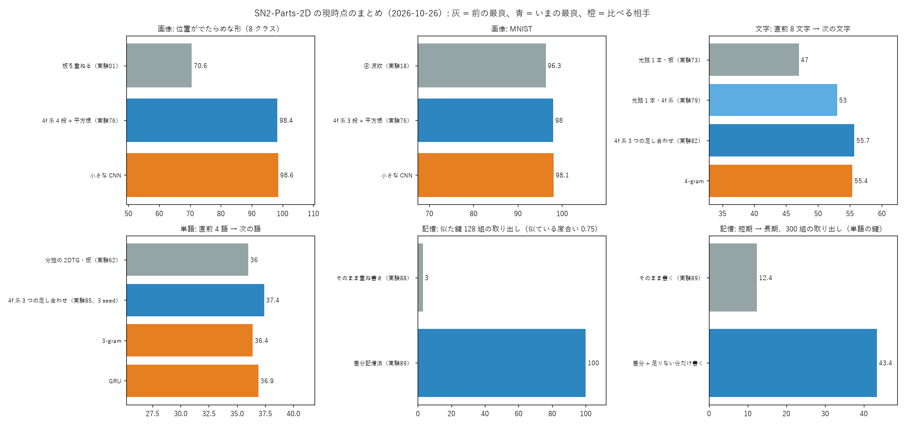

**いまの柱は 3 つ。**

1. **光の CNN（4f 系の多段 + 光の非線形）**
   - レンズ → 周波数の面の板 → レンズ（= 畳み込み）を段にして、段の間に非線形を入れる。
   - 画像: 位置がでたらめな形 **98.4%**（前の最良 70.6、小さな CNN 98.6）、MNIST **98.0%**（前の最良 96.3、CNN 98.1）。実験75〜77。
   - 効く理由は「位相を崩すこと」（平方根 = 位相を捨てる）。カー効果は強さ 0.03〜0.1 なら使える（1 だと壊れる）。

2. **言語（拡散の入れ方 + 4f 系 + 足し合わせ）**
   - 文字や単語を面全体に広げて（拡散）4f 系に通す。光路 1 本で文字 53.0%（前の最良 50.1）。実験78・79。
   - 性格の違う光路（覚えすぎる分担の 2DTG と、覚えきれない光路 1 本）の確率を足すと、**文字 55.7%（4-gram 55.4）、単語 37.4%（3-gram 36.4、GRU 36.9）**。実験80〜85。

3. **記憶（4f 系の板への重ね書き）**
   - 「鍵 → 値」を学習なしで書き込み、比率で融合できる（短期 80% + 長期 20%）。明るさから「どちらの記憶か」と確信度が読める。実験87・88。
   - **差分記憶法**（鍵の共通部分を引く）で似た鍵の問題が消える。**足りない分だけ書く**繰り返し記憶で、短期 → 長期の取り出しが 12 → 43%。実験89。

**マイナスポイント（いまの弱点）**

- 重みが大きい: 言語の足し合わせは重み約 500〜1100 万（GRU の 15 倍）、学習に約 1 時間。4-gram は数えるだけで数秒。
- 光路 1 本は長い文脈を使えない（直前 2 語でも 16 語でも 36%、実験86）。
- 出口の面で読む方式は位置のずれに弱い（2 画素で MNIST 98 → 69%）。
- 記憶は値がでたらめな窓での結果。1 枚の板に 200 組を超えると取り出しは 50% 前後。
- 実機で作れるかは未確認（平方根は段ごとに測って出し直す装置が要る、板の位置合わせに弱い）。

**次にやること**: 持ち主の記憶の構想（関連記憶・重要度記憶、方法は今後増える）、長い文章の要所をまとめる仕組み、実際の言葉を値にした記憶。

---

## これまでの区切り

### 画像認識の区切り（2026-10-20、実験00〜30）

**当時の最良の構成**:

画像を振幅として場に載せる → [板 ①（交点で掛け算、X 用・Y 用の帯 32 本ずつ）→ 回折（角スペクトル法、間隔 64 画素）→ 明るさを平均 1 に] × 16 → レンズ → 窓。64 × 64、学習する数 2057（sn2_parts_2d.py 0.2.0、実験01）。

| 目標 | 状況 |
|---|---|
| M1: 合成した 2 次元の模様の分類（板 ①②③ と混合、比較相手、計算量） | 4 課題のうち 3 つは小さな CNN に並ぶ: 縞の向き 99.9（CNN 100）、位置 **99.8**（CNN 99.0）、向き × 位置 99.4（CNN 100）。**形は 70.6 で CNN（98.6）・レンズの後の明るさの回帰（100）に大きく負ける**。推論 45 µs/件（CNN 6 µs）。3 seed（実験01） |
| M2: 融合・取消・足し算・語根が 2 次元でも成り立つか | 取消は完全（差 0、実験07）。**足すだけの融合は、「担当なし」の一般の絵を見せて学習すれば向き × 位置で 100.0%（同時学習 99.4）**、形で 57.7%（70.6）。3 seed（実験10）。1 本の光路への足し算は壊れる（59.9%、実験09） |
| M3: 本物の画像（MNIST など。ダウンロードは許可を得てから） | **MNIST 95.7%（④ 波紋 128 個・学習率を 0 まで下げる、実験17）**。以下は実験15 の条件: **MNIST 94.4%（板 ①、学習する数 2059。ロジスティック回帰 92.5%（4 万個）を上回る、小さな CNN 97.8%）**、Fashion-MNIST 84.4%（回帰 84.4、CNN 86.1）。3 seed（実験15） |
| M4: SN2-Acoustics が使える形にする | 未着手 |
| M5: 最小版 1.0.0 を公開 | 0.10.0（画像認識の区切り。読み方の部品・光学相関器を追加） |

当時の分かったこと・追記（クリックで開く）

- **効いた工夫**: 融合する技能に「担当なし」の一般の絵を見せる（融合 80.8 → 100.0%、実験10）、板を通してからレンズで読む（位置が答えに効く課題で、レンズだけの回帰 10.6% → 99.5%、実験01）、2 次元の tilt 照明（形 70.6 → 73.9（4 通り）→ 79.9（16 通り）、実験04）
- **効かなかった工夫**: 学習しないでたらめな板 + 窓（偶然並み、実験01）、レンズだけ + 窓（偶然並み）、入力を位相として載せる（形 70.6 → 55.2、向き × 位置 99.4 → 69.3、実験02）
- **10/17**: ① 交点で掛け算の板は、入力が掛け算の形で回折が近軸なら、行と列の 1 次元の計算に分かれ、2 次元の計算と一致する（tests/test_parts.py）。時間は大きさでほとんど変わらず（256 × 256 でも 0.14 ms）、メモリは 2 次元の約 1/130（実験00）。
- **10/18**: 板の形 ①②③ の差は小さい（区画 8 × 8 = 8 画素四方では、③ の輪も局所的には縞に見える）。**見立てと逆に ① が一番良かった**（形 70.6、向き × 位置 99.4。② は 60.0 / 97.9）。「X と Y が混ざらないので組み合わせに弱い」は、板は掛け算の形でも、入力が掛け算の形でなければ光の場は混ざるので、当たらなかった。形の課題では訓練でも 91〜94% で、覚えきれていない（実験01）。
- **10/18**: 区画を細かくして学習する数を 4 倍（8201）にすると、形の訓練は 100% になるがテストは 70% のまま。形の課題の天井は容量ではなく汎化（平行移動への強さ）。区画を大きくしても ③ 波紋の持ち味は出ず、どの大きさでも ①②③ はほぼ同じ（実験03）。
- **10/18**: **2 次元の tilt 照明（区画どうしの干渉を消す）で形の課題が上がり、区画を細かくするほど伸びる**（板 ①: 70.6 → 73.9 → 79.9、計算 4 倍・16 倍）。CNN（98.6）にはまだ届かない（実験04）。
- **10/18**: アナログで作るなら、1 次元と同じく精度は粗くてよい（位相 4 ビットで向き × 位置 99.4 → 97.6）が、**板の位置合わせに 1 次元よりさらに弱い（1 画素のずれで 99.4 → 18〜26%、ほぼ偶然）**。① はどの誤差でも ②③ より少し強い（実験05）。
- **10/18**: 64 で学習した板を 128 へ引き伸ばし（間隔 s² 倍）・敷き詰めで移すと、学習し直さない限り働かない（15% / 10%。入力も敷き詰めたときだけ完全に同じ、実験06）。**別々に学習した 2 技能を足すだけの融合は 80.8%（同時学習 99.4）で、1 次元（−1.2 点）より大きく落ちる**。取消は完全（実験07）。
- **10/18**: 融合の取り違えは、較正（温度・背景光）で 86.8%、共通の出発点から派生させて並列に足すと 88.1% までしか戻らない。**1 本の光路への足し算（θ0 + ΔA + ΔB）は 2 次元では壊れる（59.9%、1 次元では並列と同等だった）**（実験08・09）。
- **10/18**: **どの技能とも関係のない一般の絵（ぼやけた塊・斑の模様）を「担当なし」として見せて学習すると、相手のデータを一切使わずに、足すだけの融合が 80.8 → 100.0%（同時学習 99.4 を上回る）になった**（向き × 位置、3 seed、実験10）。形では 39.4 → 57.7%（同時学習 70.6）。
- **10/18**: ④ 減衰する波紋（持ち主の案、波紋 32 個 = 学習する数 2057）は、向き × 位置で 99.8%（① 99.4、どの板より良い）、位置・縞の向きも 99% 前後。形は 62.3%（① 70.6）で訓練も 66% と覚えきれないが、**訓練とテストの差が 4 点しかなく（① は 23 点）、平行移動への強さはいちばん良い**。波紋 128 個は学習が進まない（形 33%）。重ねた波紋の深さが大きすぎるためと考えられる（実験11）。
- **10/18**: 担当なしの学習があれば、技能を 4 つに増やしても足すだけの融合は 100.0%（なしなら 35.1%、同時学習 99.4）。1 次元で見えた「技能が増えるほど落ちる」は出なかった（実験12）。
- **10/19**: ④ 波紋を 128 個・初期の深さ 0.5 倍にすると、照明なしで形の課題 76.3%（① 70.6、④ 32 個 62.3）。訓練との差は 4 点のまま（実験13）。⑤ 楕円・大きさつきは ④ と同程度か少し下（形 56.7、実験14）。**MNIST で板 ① が 94.4%（学習する数 2059）、ロジスティック回帰（92.5%、4 万個）を上回った**。④ は MNIST 86.6%、Fashion-MNIST では seed によって学習が崩れた（実験15）。
- **10/19**: 学習曲線（実験16）: 板 ① は MNIST で約 5000 ステップ（学習 200 秒）で頭打ちに近づき（最高 95.1%）、1 万ステップでも訓練とテストの差は 1.2 点で過学習は小さい。足りないのは学習の速さと覚える力。④ はテストが大きく上下し、学習が安定しない（実験16）。
- **10/19**: **学習率を最後に 0 まで下げる（cosine）と、学習の谷が消え、最後の時点が一番良くなった。④ 波紋 128 個は MNIST 88.5 → 95.7%（これまでの最良、① 95.3）、Fashion 79.9 → 84.8%**。板 ① も少し良くなる（MNIST 94.7 → 95.3）（実験17）。
- **10/19**: 学習中の谷では、訓練も必ず一緒に落ちる（谷 95 回すべて）。落ちるのは似た上着どうし（プルオーバー・コート・T シャツ・シャツ）が入れ替わる形で、的外れな着眼点（訓練は保ってテストだけ落ちる）ではなく学習の揺れ。板の移動平均で答えると、学習率一定でも ④ が 78.1 → 82.6%（実験21）。④ の数の種類ごとの学習率（中心 10 倍・幅 0.1 倍）で MNIST 96.3%・Fashion 85.9% と最良を更新（実験18）。波紋の中心の初期配置（格子・ずらし・でたらめ）は差がない（実験19）。
- **10/19**: 親の光路から子を作る木（Fashion-MNIST）では、子の作り方（別々のでたらめ・同じでたらめ・親から派生・親の前半を共有）で子の正解率も融合（75〜79%）もほぼ変わらない。少ないデータでも親から作る利点は見えない（実験20）。クラスを窓 16〜32 個の明るさの模様（符号）で表すと、1 クラス 1 窓と同等以上（符号を学習して 85.3%、1 窓 84.2%）。窓の数に縛られない読み方として使える。ただし学習なしで足したクラスは古いクラスを奪い（10 クラスで 54%）、部品の和だけのクラス（例 0 枚）は当たらない（8.7%）（実験22）。
- **10/19**: 全部のクラスの符号を「例の平均の模様（典型）」にそろえると、学習なしで 2 クラスを足しても 10 クラスで 76.3%（そろえないと 54%、10 クラスで学習すると 84.6%）。足したクラス（例 100 枚、学習なし）は 63.7%（実験23）。
- **10/20**: **部品ごとの窓で「部品があるか」を学習し、部品の出やすさの偏りを補正すると、例を 1 つも見せないクラス（コート・ブーツ・スニーカー）を部品の組み合わせだけで 77〜82% 当てられた（見せたクラスとの調和平均 69〜71）。1 次元の語根（実験34・36）の結果が 2 次元でも成り立つ**（実験26）。**4f 系（光学相関器）で、数字のある位置に光を集め、2 本の光路を別の色で重ねて「ここが 3、ここが 7」を出せた**（目標の位置で光る 95〜99%）。ただし目標と別の数字の見分け（AUC）は 82〜89% で、別の数字でも光ることが多い（実験27）。
- **10/20**: 4f 系を 2 段にして間に光の非線形（明るさを測って光を出し直す）を入れると、目標の数字とほかの数字の見分けが AUC 89/82 → 97/97 に上がり、誤報が半分になった（実験28）。共通する特徴（なんでも数字に光る光路）を引くのは効かず、相手（3 なら 7）を引くのは 1 段のときだけ少し効く（実験29）。親から子の木は学習率を 0 まで下げても作り方で差なし（実験25）。
- **10/20**: 数字ごとに 4f 系 2 段 + 非線形の光路を 1 本ずつ（10 本）別々に学習し、色を分けて融合すると、2 個並んだ数字のそれぞれの位置で正しい数字が一番光るのが 85.3%、絵の中の数字を全部当てたのが 79.5%（実験30）。
- **未解決**: 形の課題の融合（57.7 対 70.6、実験10）、大きさを変えて移すこと（実験06）、板の位置合わせへの弱さ（実験05）、形の分類（平行移動しても同じ形と分かること）、計算量（CNN の 7 倍の推論時間）
- **一貫した教訓**: レンズの後の明るさは平行移動で変わらない（形・向きは分かるが位置は分からない）。板はその前で位置を向きに変える働きをする（実験01）。

### 言語の区切り（2026-10-21、実験31〜65）

**当時の最良の構成（文字）**:

直前の文字の余りで担当を 16 に分け、各 2DTG（直前 4 文字を帯に、位置ごとの明るさ、板 ① 8 枚 × 区画 16、レンズ、窓 256 個の符号読み）を担当なしの学習で別々に学び、確率を足すだけ。**54.0%、CE 1.739**（光路 1 本の最良 50.1、GRU 53.3〜54.1、3-gram 53.7、4-gram 55.4、実験62）。詳細は docs/best_configs.md。

| 分かったこと | 根拠 |
|---|---|
| 1 本の光路は、全部の入力が同じ板を共有するので、覚えられる対応表が小さい。大きくしても、データを増やしても伸びが小さい | 実験35〜38・49・55〜57 |
| 表を分担させて足すだけで、同じ程度の重さで n-gram・GRU に並ぶ（文字）。単語は 36% で GRU（36.9）に近いが、符号の重みが増える | 実験58・62・64 |
| 少ないデータでは光路が GRU より強い（覚えすぎにくい） | 実験57 |
| 振幅 + 位相の板は位相だけより +2.2 点 | 実験63 |
| 光路は逆向きに通せるが、答えを明るさだけで持つと逆向きの連想にならない | 実験65 |
| 効かなかったもの: 1 次元で効いた照明の工夫・参照波、光の記憶、鏡の往復、短冊、入れ方、板の間隔、語の並べ方、関連度グレイン、2DTG の木（CE だけ少し良い） | 実験34・40・48・50・51・54・59〜61 |

## 作業の約束（2026-10-24 追記）

- プロジェクト間の掲示板 D:\AI_git\TmpFiles\BOARD.md は全部を読まず、作業を始めるときに見出しの一覧（grep -n '^### ' BOARD.md | tail -30）から前回より新しい投稿と関係する投稿だけを読む。部品の新しい版、取得したデータ（場所とライセンス）、ほかでも効きそうな知見・効かなかったこと、ほかへのお願いは末尾に >> で追記する（前の投稿は書き換えない・識別情報や秘密やデータそのものは書かない・数字には出典）。コミットは TmpFiles のセッションか持ち主がする。
- GPU（2026-10-25 から 2 枚、RTX 3060 12GB × 2、電力上限 150W。GPU 0 = CPU 直結 x16、GPU 1 = x4）は全プロジェクトで分け合う。固定の割り当てはない。
  GPU の仕事は共通の待ち行列に 1 行足して予約する: `echo "SN2-Parts-2D <.sh のパス> any # メモ（見込みの時間）" >> D:/AI_git/TmpFiles/gpu/queue.txt`。
  共通の実行役（タスク「GPU dispatch」）が空いた GPU で回し、開始・終了を TmpFiles/GPU_QUEUE.md の履歴に書く。.sh の中では GPU の番号を指定しない（cuda のまま）。1 行は数時間までに分ける。同じ .sh をもう一度回すときはメモを変えて新しい行で。
  自前の待ち行列（tools/queue_runner.sh、results/queue.txt）は実験82 で使うのをやめた（2026-10-25）。

## 目標

持ち主の依頼（2026-10-17）から:
- 2 次元の場に入力を載せ、2 次元の Sin の板と 2 次元の回折で処理し、2 次元のスクリーンで読む部品（関数）を作る。版番号を付け、改良ごとに上げる。
- Sin-CNN2 で効いた工夫が 2 次元でどうなるかを、1 つずつ実験で確かめながら部品にしていく。
- 到達点: M1（基本部品で合成した模様の分類）→ M2（融合・取消・足し算・語根）→ M3（本物の画像）→ M4（SN2-Acoustics が使える形）→ M5（最小版 1.0.0）。
- 評価の軸に、成績・計算量に加えて、アナログ（光・アナログ回路）で作りやすいか（位相だけの板、固定の ω、粗い精度、位置合わせへの弱さ）を入れる。
- 実機・ハードの検討（RealSin-CNN）とは混ぜない。
- （2026-10-18 持ち主の希望）図をなるべく作って docs/images/ に保管する（板の模様など、しくみのイメージがつかめるもの）。
- （2026-10-18 持ち主の案）⑤ 楕円で大きさを変えられる減衰する波紋（部品 0.7.0、実験14）。図は docs/images/sinc_ellipse.png・plates_sinc_ellipse.png。
- （2026-10-18 持ち主の案）④ 減衰する波紋 sin(k·r)/(k·r): 波紋の深さ・幅・中心の位置だけで板を作る（部品 0.5.0、実験11）。図は docs/images/sinc_single.png・plates_sinc.png。

## 環境とコードの出どころ

- 装置: NVIDIA GeForce RTX 3060（12GB）、PyTorch 2.14.1+cu126、Python 3.14.7。
- 2026-10-17 の実験00 の前の確認: 計算用の python プロセスはなかった。GPU の使用率は 1〜38%（画面表示などの分）。時間はその上での値で、小さな場では数 ms 程度ぶれうる。
- vendor/sinwave_minimal_v1_3_0.py: Sin-CNN2 の sinwave_minimal.py v1.3.0（コミット caa0c1f、GitHub の main と同じ。blob 9efa63a）。中身は書き換えていない。
- Sin-CNN2・SN2-Acoustics は読んだだけで、書き換えていない。

## 実験00: 場の大きさごとの計算時間とメモリ (exp00_cost.py、sweep00.sh)

着想: 持ち主の指示（2 次元は計算とメモリが重いので、大きさごとの時間とメモリを最初に測る）。M1 の場の大きさと実験の本数を決めるため。
条件: 板 16 枚、学習 1 ステップ（順伝播 + 逆伝播、Adam の更新は含まない）。区画 8 × 8（① は X・Y それぞれ帯 8 本）。入力は位相がでたらめな場。1 ステップ 64 件と 256 件、10 回 / 5 回の平均。seed 0。

1 件あたりの時間（ms）と最大メモリ（256 件のとき）:

| 条件 | 64 × 64 | 128 × 128 | 256 × 256 | メモリ 64 / 128 / 256 |
|---|---|---|---|---|
| 比較: 1 次元 SinWave（L=1024、区画 64） | 0.062 | | | 0.10 GB |
| ① 行と列に分けた計算（入力も掛け算の形） | 0.110 | 0.111 | 0.139 | 0.01 / 0.02 / 0.05 GB |
| ① を 2 次元の場で計算 | 0.155 | 0.503 | 1.936 | 0.38 / 1.52 / 6.09 GB |
| ② 斜めの縞 | 0.146 | 0.497 | 1.958 | 0.38 / 1.53 / 6.10 GB |
| ③ 波紋（等間隔の輪） | 0.158 | 0.508 | 1.954 | 0.38 / 1.53 / 6.10 GB |

1 ステップ 64 件のときは、どの条件も 1 件あたり 0.3〜0.6 ms（256 × 256 は 2.1 ms）で、小さな場では件数が少ないと割高（計算を呼ぶ回数で時間が決まる）。

- **2 次元の場の計算は、画素数にほぼ比例して増える（64 → 128 → 256 で 1 : 3.4 : 13）。メモリも画素数に比例し、256 × 256 は 256 件で 6.1GB**。色・照明を 8 通り重ねると 1 ステップに載らない。
- 板の形 ②③ の違いは計算量にほとんど出ない（模様を作る計算より FFT とメモリが支配的）。
- ① を行と列に分けると、大きさによらずほぼ一定（0.11〜0.14 ms）で、メモリは 1/100 以下。ただし入力が掛け算の形で、回折を近軸で計算するときだけ使える（画像は一般に掛け算の形ではない）。
- 解釈: 64 × 64 は 1 次元 L=1024 の 4 倍の画素で、時間は 2.5 倍。M1 の合成課題は 64 × 64 で、1 回の学習（1500 ステップ × 256 件）は約 1 分と見積もる。

次の一手: M1 は 64 × 64 で行う。128・256 は本物の画像（M3）と、大きさを変える実験（引き伸ばし・敷き詰め）で使う。256 で色・照明を重ねるなら件数を分けて計算する。

## 実験01: 2 次元の基本部品で、合成した模様を分類する (exp01_basic.py、sweep01.sh)

着想: 持ち主の依頼の M1。板の 3 つの形（① 交点で掛け算、② 斜めの縞、③ 波紋 r と r²）と混合（① 8 枚 + ③ 8 枚）を、同じ学習する数（2057）でそろえて比べる。
条件: 64 × 64 の合成課題 4 つ（experiments/tasks2d.py、図 docs/images/tasks.png）、訓練 4000・テスト 2000（seed ごとに作り直す）。板 16 枚・区画 8 × 8（① は X・Y の帯 32 本ずつ）、ω・k・中心は固定の乱数。入力は振幅として。学習 1500 ステップ × 256 件、Adam lr 0.01（回帰・MLP は 0.003）。3 seed。

テスト正解率（%、3 seed の平均 ± 標準誤差）:

| 方式 | 学習する数 | A 形 | B 縞の向き | C 位置 | D 向き × 位置 |
|---|---|---|---|---|---|
| 偶然 | – | 12.5 | 12.5 | 11.1 | 12.5 |
| レンズだけ + 窓 | 9 | 17.8 ± 1.3 | 12.0 ± 0.7 | 11.3 ± 0.5 | 13.1 ± 1.2 |
| でたらめな板（学習しない）+ 窓 | 9 | 11.7 ± 0.7 | 11.6 ± 0.8 | 13.5 ± 1.9 | 13.1 ± 1.3 |
| ロジスティック回帰（画素） | 32776 | 37.2 ± 0.5 | 13.8 ± 0.1 | **100.0 ± 0.0** | 64.9 ± 0.4 |
| レンズの後の明るさにロジスティック回帰 | 32776 | **100.0 ± 0.0** | **100.0 ± 0.0** | 10.6 ± 0.5 | 50.1 ± 0.3 |
| 小さな MLP（隠れ 32） | 131368 | 59.3 ± 0.5 | 76.2 ± 9.7 | **100.0 ± 0.0** | 95.8 ± 1.2 |
| 小さな CNN | 2784 | 98.6 ± 0.1 | **100.0 ± 0.0** | 99.0 ± 0.1 | **100.0 ± 0.0** |
| SinWave ① 交点で掛け算 | 2057 | **70.6 ± 1.8** | 99.9 ± 0.1 | **99.8 ± 0.1** | **99.4 ± 0.1** |
| SinWave ② 斜めの縞 | 2057 | 60.0 ± 0.7 | 99.9 ± 0.0 | 99.5 ± 0.1 | 97.9 ± 0.2 |
| SinWave ③ 波紋（等間隔の輪） | 2057 | 60.5 ± 0.9 | 99.9 ± 0.1 | 99.4 ± 0.1 | 97.5 ± 0.2 |
| SinWave ③ 波紋（ゾーンプレート） | 2057 | 61.3 ± 0.3 | 99.9 ± 0.0 | 99.6 ± 0.1 | 97.5 ± 0.1 |
| SinWave 混合（① 8 枚 + ③ 8 枚） | 2057 | 61.6 ± 0.5 | 99.9 ± 0.0 | 99.7 ± 0.0 | 97.7 ± 0.3 |

太字は SinWave の中の最良と、比較相手を含めた最良。訓練の正解率は、SinWave の形の課題で 90〜94%、それ以外はすべて 100%。
計算量（RTX 3060）: SinWave の学習 64〜81 秒（CNN 6 秒）、推論 44〜51 µs/件（CNN 6 µs、回帰 4 µs）、最大メモリ 386MB（CNN 56MB）。

- **SinWave は 4 課題のうち 3 つ（縞の向き・位置・向き × 位置）で、同じくらいの学習する数の小さな CNN に並んだ（99.4〜99.9 対 99.0〜100）。形の課題だけ 60〜71% で、CNN（98.6）とレンズの後の明るさの回帰（100）に大きく負けた。**
- **板の形の差は小さく、① 交点で掛け算が全課題で一番良かった**（形 +9〜11 点、向き × 位置 +1.5〜2 点）。見立て（① は X と Y が混ざらないので組み合わせの特徴に弱い）は外れた。板の模様は掛け算の形でも、入力の画像は掛け算の形ではないので、光の場の中で X と Y は混ざると考えられる。①が良い理由は、帯が 2 画素幅で細かく（②③ の区画は 8 画素四方）、場全体にわたる長い縞を作れるためかもしれない（未確認）。
- ③ 波紋は ② とほぼ同じ。区画が 8 画素四方と小さいと、中心が遠い輪は区画の中ではほぼ縞に見える（docs/images/plates.png）。③ の「どこに光を集めるか」を活かすには、区画を大きくする（1〜4 個）必要がある。
- 位置の課題で、レンズの後の明るさの回帰は偶然並み（10.6%）、SinWave は 99.5%。レンズの後の明るさは平行移動で変わらないので位置の情報がないが、板が位置を「向き」に変えてからレンズで集めている。向き × 位置でも、回帰は位置か向きの片方しか取れず（64.9 / 50.1）、SinWave は両方を取れた。
- 形の課題で負けたのは、平行移動（±6 画素）しても同じ形と答える必要があるため。レンズの後の明るさなら平行移動で変わらないのに、板を通すと位置の情報が混ざり込む（1 次元の「位置の雑音」と同じ）。訓練でも 90〜94% なので、容量も足りていない。
- でたらめな板 + 窓は偶然並み。1 次元の実験28（でたらめな板で 70%）は窓ではなく典型の模様との相関で読んでいた。窓の明るさだけでは、学習しない板の作る特徴を読めない。

次の一手: 形の課題を上げる。(1) 位置の雑音を減らす工夫（2 次元の tilt・アダマール照明、虹）を持ち込む、(2) 板の数・区画を増やす（容量）、(3) 典型の模様との相関で読む、(4) 入力を位相として載せる（実験02）。③ は区画を大きくして改めて比べる（実験03）。

## 実験02: 入力を振幅として載せるか、位相として載せるか (exp01_basic.py --input phase、sweep02.sh)

着想: 1 次元の SinWave は、文字を明るさ 1 の波（位相だけの光）として入れていた。画像も位相として載せれば（透明な凹凸の板と同じ）、光が場全体に広がり、板が働きやすいのでは。
条件: 実験01 と同じ（板 ① と ②、4 課題、3 seed）。入力だけ u = exp(j·π·明るさ) に変える。振幅の結果は実験01。

| 方式 | 入力 | 形 | 縞の向き | 位置 | 向き × 位置 |
|---|---|---|---|---|---|
| 小さな CNN（比較） | – | 98.6 ± 0.1 | 100.0 ± 0.0 | 99.0 ± 0.1 | 100.0 ± 0.0 |
| 板 ① | 振幅（実験01） | **70.6 ± 1.8** | 99.9 ± 0.1 | **99.8 ± 0.1** | **99.4 ± 0.1** |
| 板 ① | 位相 | 55.2 ± 1.7 | 99.9 ± 0.0 | **99.8 ± 0.0** | 69.3 ± 2.5 |
| 板 ② | 振幅（実験01） | 60.0 ± 0.7 | 99.9 ± 0.0 | 99.5 ± 0.1 | 97.9 ± 0.2 |
| 板 ② | 位相 | 38.8 ± 1.1 | 98.8 ± 0.1 | 98.9 ± 0.0 | 56.5 ± 0.2 |

- **位相として載せると悪くなった（形 −15〜21 点、向き × 位置 −30〜41 点）。見立ては外れた。** 訓練の正解率も下がる（形 68.9 / 56.7、向き × 位置 81.2 / 74.5）ので、汎化ではなく学習そのものが難しくなっている。
- 解釈: 位相の入力では、暗い背景（場の大部分）も明るさ 1 の平らな光になる。模様の情報は「平らな光に乗った小さなゆらぎ」になり、レンズの後では中心（向き 0）に光の大半が集まる。振幅の入力では光は模様の所にしかないので、板が模様の光だけを曲げられる、と考えられる。1 次元の文字の入力（平面波）は、光全体が情報だったので事情が違う。
- 位置・縞の向きは位相でも解ける（情報が粗い課題）。

次の一手: 入力は振幅を既定にする。位相を使うなら、背景を引く（明るさ 0 の所の位相を打ち消す参照光）などの工夫が要る。形の課題は、区画の大きさ・容量（実験03）、位置の雑音を減らす照明・虹で攻める。

## 実験03: 区画の大きさ（容量）と板の形 (exp01_basic.py --patches、sweep03.sh)

着想: 実験01 で ③ 波紋が ② と同じだったのは、区画（8 画素四方）が小さくて輪が見えないためでは。また、形の課題は訓練でも 91〜94% で、容量不足かもしれない。区画の数を変えて両方を確かめる。
条件: 実験01 と同じ（振幅の入力、板 16 枚）。区画を縦横 2・4・16 個（学習する数 137・521・8201。8 個 = 2057 は実験01）。形と向き × 位置の 2 課題、3 seed。① は帯の本数が区画² / 2 本（16 のときは 128 本で 64 画素を超えるので、実際に使われるのは 64 本）。

テスト正解率（%）。括弧は訓練:

| 板 | 区画 2 × 2 | 4 × 4 | 8 × 8（実験01） | 16 × 16 |
|---|---|---|---|---|
| 形: ① 交点で掛け算 | **47.0**（49.6） | **63.7**（73.5） | **70.6**（94） | 70.4 ± 1.6（96.5） |
| 形: ② 斜めの縞 | 33.3（38.1） | 47.4（59.7） | 60.0（91） | 69.7 ± 0.6（100） |
| 形: ③ 波紋（輪） | 33.7（38.9） | 47.4（60.7） | 60.5（92） | **70.9 ± 0.3**（100） |
| 形: ③ 波紋（ゾーンプレート） | 35.1（39.1） | 47.1（59.1） | 61.3（91） | 70.6 ± 0.9（100） |
| 向き × 位置: ① | **72.1** | **98.0** | 99.4 | 99.2 |
| 向き × 位置: ② | 53.5 | 82.1 | 97.9 | **99.6** |
| 向き × 位置: ③ 輪 | 51.9 | 82.4 | 97.5 | **99.6** |
| 向き × 位置: ③ ゾーン | 55.8 | 83.3 | 97.5 | **99.6** |
| 比較: 小さな CNN（2784） | 形 98.6 / 向き × 位置 100 | | | |

学習の時間は区画の数によらず 57〜63 秒（模様を作る計算は FFT に比べて小さい）。

- **形の課題の天井は容量ではなかった。区画 16 × 16（学習する数 8201、CNN の 3 倍）で訓練は 100% になるが、テストは 70% のまま（①②③ とも）。** 平行移動しても同じ形と答える「汎化」が足りない。
- **区画を大きくしても ③ 波紋の持ち味は出なかった**（2 × 2・4 × 4 でも ② と同じ）。輪で「どこに光を集めるか」を学べるという見立ては、少なくともこの課題では効いていない。
- 学習する数が少ないほど ① が有利（区画 2 × 2 で形 47.0 対 33〜35、向き × 位置 72.1 対 52〜56）。① は同じ数で場全体にわたる細い帯を持てるので、模様の自由度が大きいと考えられる。
- 解釈: 板をいくら学習しても、入力の位置がずれると板の模様との重なりが変わり、別の光の通り道になる。1 次元で「位置の雑音」と呼んだものと同じ。

次の一手: 位置の雑音を消す 2 次元の照明（tilt。区画どうしの干渉を消す、部品 0.3.0）で形の課題を試す（実験04）。

## 実験04: 2 次元の tilt 照明で位置の雑音を減らす (exp01_basic.py --illum、sweep04.sh)

着想: 1 次元では、違う位置の文字どうしの干渉（位置の雑音）を消す照明（tilt・アダマール）が大きく効いた（Sin-CNN2 実験10・11）。実験03 で形の課題の天井が汎化（平行移動への強さ）と分かったので、2 次元版を試す。
方法: 場を縦横 b × b の区画に分け、照明 j ごとに区画 m の光へ exp(j·2π·j·m/b²) を掛ける。b² 通りの明るさを平均すると、違う区画どうしの干渉がちょうど 0 になる（tests の test_illumination_cancels_cross_block_interference で確認、部品 0.3.0 の illumination）。計算は b² 倍。
条件: 実験01 と同じ（振幅の入力、板 16 枚・区画 8 × 8、学習する数 2057）。b = 2（4 通り）は形・向き × 位置 × 板 ①② × 3 seed、b = 4（16 通り）は形 × 板 ① × 3 seed。

| 板 | 照明 | 形 | 向き × 位置 | 形の訓練 | 学習の時間 | 推論 |
|---|---|---|---|---|---|---|
| 比較: 小さな CNN | – | 98.6 ± 0.1 | 100.0 ± 0.0 | 100 | 6 秒 | 6 µs |
| ① | なし（実験01） | 70.6 ± 1.8 | 99.4 ± 0.1 | 94 | 79 秒 | 44 µs |
| ① | tilt 2 × 2（4 通り） | 73.9 ± 0.4 | **99.8 ± 0.0** | 91 | 170 秒 | 129 µs |
| ① | tilt 4 × 4（16 通り） | **79.9 ± 0.4** | – | 93 | 619 秒 | 493 µs |
| ② | なし（実験01） | 60.0 ± 0.7 | 97.9 ± 0.2 | 91 | 64 秒 | 44 µs |
| ② | tilt 2 × 2（4 通り） | 65.9 ± 0.3 | 99.6 ± 0.1 | – | 166 秒 | 127 µs |

- **照明は効いた。形の課題で ① が 70.6 → 73.9（4 通り）→ 79.9（16 通り）、② が 60.0 → 65.9。区画を細かくするほど伸びる。** 向き × 位置も上がった（① 99.4 → 99.8、② 97.9 → 99.6）。
- 訓練の正解率はほとんど変わらない（91〜94%）のに、テストとの差が縮んだ（① 23 点差 → 13 点差）。位置の雑音が汎化を妨げていたという見立てと合う。
- 代償は計算。時間は照明の数ほどには増えない（4 通りで 2.2 倍、16 通りで 7.8 倍。小さな場では呼び出しの手間が大きいため）が、16 通りで推論 493 µs（CNN の約 80 倍）。
- CNN（98.6）にはまだ 19 点届かない。

次の一手: 16 通りより細かい照明（8 × 8 = 64 通り）は計算 64 倍で現実的でない。1 次元で効いた「平均の滲み層」（前後との平均、計算 1 倍）の 2 次元版、典型の模様との相関で読む方式を候補に残す。M1 の残り（アナログの強さ = 実験05、大きさの変え方 = 実験06）を先に進める。

## 実験05: アナログな装置で作ったときの強さ (exp05_analog.py、sweep05.sh)

着想: 持ち主の依頼の評価の軸「アナログで作りやすいか」。1 次元の Sin-CNN2 実験48 では、位相は 4 ビットで足りるが、板が 1 画素ずれると 93.5 → 26%、間隔が 5% 違うと 33% に落ちた。2 次元の板 ①②③ で比べる。
方法: 理想の装置で学習した光路（実験01 と同じ条件）に、作りの誤差を入れて評価する（学習し直さない）。誤差の乱数は seed ごとに固定（装置 1 台分）。板のずれは板ごとに向き（＋か−）がでたらめで、大きさは同じ。間隔の誤差は板ごとに ±誤差 の一様乱数。検出器の雑音は窓の明るさへの相対誤差。
条件: 向き × 位置・形の 2 課題 × 板 ①②③ × 3 seed。

向き × 位置（テスト正解率 %）:

| 作りの誤差 | ① 交点で掛け算 | ② 斜めの縞 | ③ 波紋 | 参考: 1 次元（実験48、16 クラス） |
|---|---|---|---|---|
| なし（理想） | **99.4 ± 0.1** | 97.9 ± 0.2 | 97.5 ± 0.2 | 93.5 |
| 位相 2 ビット（4 段階） | 17.7 ± 0.4 | 17.3 ± 0.6 | 14.8 ± 1.3 | |
| 位相 3 ビット | **82.4 ± 1.2** | 67.1 ± 1.9 | 66.8 ± 0.8 | |
| 位相 4 ビット | **97.6 ± 0.2** | 94.0 ± 0.7 | 93.1 ± 0.7 | ほぼ保つ |
| 位相 6 ビット | 99.4 ± 0.1 | 97.7 ± 0.2 | 97.2 ± 0.2 | |
| 画素ごとの位相の誤差 0.1 rad | **98.3 ± 0.3** | 94.6 ± 0.3 | 94.1 ± 0.5 | |
| 画素ごとの位相の誤差 0.3 rad | **59.8 ± 2.0** | 38.3 ± 1.0 | 41.3 ± 2.2 | |
| 板が x に 1 画素ずれる | 18.4 ± 1.8 | 16.9 ± 2.7 | 14.2 ± 0.5 | 26 |
| 板が x に 2 画素ずれる | 15.0 ± 1.4 | 14.6 ± 1.2 | 12.5 ± 0.5 | 13 |
| 板が y に 1 画素ずれる | **25.7 ± 1.2** | 19.2 ± 2.7 | 14.1 ± 1.4 | |
| 板の間隔 ±1% | **98.6 ± 0.3** | 96.8 ± 0.5 | 95.7 ± 0.5 | |
| 板の間隔 ±5% | 58.5 ± 13.5 | 58.5 ± 14.3 | 47.4 ± 16.5 | 33 |
| 検出器の雑音 5% | **99.2 ± 0.2** | 97.3 ± 0.4 | 96.9 ± 0.2 | 強い |
| 検出器の雑音 20% | **92.5 ± 0.4** | 88.7 ± 0.7 | 87.8 ± 0.8 | |

形の課題も同じ傾向（理想 70.6 / 60.0 / 60.5 → 4 ビット 62.4 / 49.4 / 47.5 → 1 画素のずれ 15.5 / 13.6 / 13.4、偶然 12.5）。

- **1 次元と同じく、精度・雑音には強く、組み立ての誤差に極端に弱い。2 次元では板のずれへの弱さがさらに大きく、1 画素で偶然に近い（99.4 → 14〜26%）。** 板が 16 枚あり、ずれが積み重なる構造は 1 次元と同じ。
- **① 交点で掛け算は、どの誤差でも ②③ より少し強い**（3 ビット 82 対 67、位相の誤差 0.3 rad で 60 対 38〜41）。ずれへの強さの差は小さい。
- 位相は 4 ビット（16 段階）で 98% を保つ。画素ごとの誤差は 0.1 rad までなら小さい。間隔は ±1% までなら保つが、±5% では seed（装置）によって大きくばらつく。
- 解釈: 板の模様は位置の細かい合わせ込みで答えを作っているので、1 画素ずれると全く別の光の通り道になる。粗い模様（区画を大きく）にしても、実験03 では正解率そのものが下がった。

次の一手: 1 次元の実験49 では、ずれを入れて学習すると強くなるが理想の性能が落ちた。2 次元で同じことを試すのは M1 の後に回す。アナログで作る前提なら「作った後に装置の上で学習し直す」方が現実的、という 1 次元の結論は 2 次元でも変わらない見込み。

## 実験06: 学習した板を大きな場へ移す（引き伸ばしと敷き詰め） (exp06_scale.py、sweep06.sh)

着想: 持ち主の見立て「比率を守れば X・Y が伸びても同じ効果」。回折の働きはフレネル数（模様の細かさ² / 間隔）で決まるので、模様を s 倍に引き伸ばすなら間隔を s² 倍にする（見立て）。1 次元の実験29 では敷き詰めで完全に同じ働きになり、普通の入力でも追加学習なしで良くなった。
方法: 64 × 64 で学習した光路（向き × 位置、板 ①②）を、学習し直さずに 128 × 128 で使う。
引き伸ばし = 板の画素を 2 × 2 に複製し、間隔 64 → 256、入力の絵も 2 倍、スクリーンの中央 64 × 64 を元の窓で読む。敷き詰め = 板を 2 × 2 に並べ、間隔 64 のまま、同じ大きさの絵を 128 の真ん中に置き、スクリーンの偶数番目の画素を読む。
条件: 3 seed。比べるもの: 元の 64 × 64、128 × 128 でゼロから学習（同じ区画数 8 × 8、同じ学習）。

| 方式 | 板 ① | 板 ② |
|---|---|---|
| 元の 64 × 64 | 99.4 ± 0.1 | 97.9 ± 0.2 |
| 引き伸ばし（間隔 s² = 4 倍） | 15.2 ± 1.3 | 20.8 ± 2.7 |
| 引き伸ばし（間隔はそのまま） | 9.1 ± 0.3 | 10.6 ± 0.7 |
| 敷き詰め（同じ大きさの絵を真ん中に） | 10.4 ± 1.4 | 12.2 ± 1.3 |
| 敷き詰め（絵も敷き詰める。理屈の上では元と同じ） | **99.4 ± 0.1** | **97.9 ± 0.2** |
| 128 × 128 でゼロから（絵が 2 倍、間隔 256） | 99.0 ± 0.1 | 97.3 ± 0.1 |
| 128 × 128 でゼロから（同じ絵を真ん中に） | 99.6 ± 0.1 | 98.4 ± 0.2 |

- **学習し直さずに移すと、引き伸ばしも敷き詰めも働かなかった（偶然 12.5% 並み〜21%）。** 入力も敷き詰めたときだけ元と完全に同じになる（理屈どおり）。
- 引き伸ばしは、間隔を s² 倍にした方がそのままより良い（15〜21 対 9〜11）ので、見立ての方向は合っているが、それだけでは足りない。考えられる原因: (1) 板の間隔 64・波長 1 では斜めに進む光が多く、近軸の近似（引き伸ばしで同じ働きになる条件）が成り立たない、(2) 入力の雑音の粒は 1 画素のままで引き伸ばされていない。どちらかは未確認（近軸の回折で学習した光路で確かめるのが次の一手）。
- 敷き詰め（同じ絵を真ん中に）が働かないのは、1 次元と違い、窓の読み方（偶数番目の画素）が元のスクリーンと同じ意味にならないためと考えられる。絵が 1 つだけだと、敷き詰めた板の周期と合わない。
- 128 でゼロから学習すれば、どちらの入力でも元と同じ正解率になる。大きさを変えるときは、学習し直すのが今のところ確実。

## 実験07: 別々に学習した 2 技能を足すだけで融合し、外して取消 (exp07_merge.py、sweep07.sh)

着想: Sin-CNN2 の一番の特徴（実験02・03・21）が 2 次元でも成り立つか（M2）。
方法: 8 クラスを 4 クラスずつ 2 つの技能に分け、それぞれ自分のデータだけで別の光路（板 ①、乱数も別）を学習する。窓 8 個を共有し、担当のクラスの窓だけをラベルにする。融合 = 2 本の光路のスコアの平均（明るさを足す）。向き × 位置は向きで分ける（A = 横・/、B = 縦・\、左右とも）。形は A = 円・正方形・三角・十字、B = L 字・横棒・リング・X。
条件: 板 ①、学習する数 2057 / 技能、3 seed。比べるもの: 全 8 クラスを 1 本で同時に学習。

| 課題 | 技能 A 単独 | 技能 B 単独 | 足すだけの融合 | 自信で選ぶ | 同時に学習（1 本） | 技能を選べた割合 | 取消（外した後のスコアの差） |
|---|---|---|---|---|---|---|---|
| 向き × 位置 | 99.7 ± 0.2 | 99.8 ± 0.1 | 80.8 ± 2.1 | 83.3 ± 1.0 | **99.4 ± 0.1** | 81.1 ± 2.1 | **0（完全）** |
| 形 | 71.6 ± 0.7 | 97.8 ± 0.3 | 39.4 ± 2.2 | 48.7 ± 1.8 | **70.6 ± 1.8** | 43.7 ± 1.4 | **0（完全）** |

- **取消は完全**（融合から B を外すと、A 単独とスコアが 1 桁も違わない）。構造上そうなる（並列光路）。
- **足すだけの融合は大きく落ちた（向き × 位置 −18.6 点、形 −31 点）。1 次元（2 技能で −1.2 点）よりずっと悪い。** 落ちた分はほぼ全部「どちらの技能の入力か」の取り違え（技能を選べた割合 81%・44%）。
- 各技能は自分のデータしか見ていないので、相手の技能の絵にも自分の窓を明るくしてしまう。1 次元でも同じ条件だったが、そこでは文字の頻度が技能ごとに違い、自然に分かれていたと考えられる。2 次元の課題では、技能 A と B の絵が似ている（同じ線・同じくらいの大きさの形）。
- 「自信で選ぶ」（SN2-Acoustics 実験02 で強かった）は少しだけ良い（+2.5・+9.3 点）。

次の一手: SN2-Acoustics で効いた較正（生の点数で専門家どうしの目盛りをそろえる、jcal）。少量の共通データで温度と背景光だけを合わせる。共通の出発点から派生させて足し算する方式（1 次元の実験23）も試す。

## 実験08: 融合の取り違えを、少量の共通データでの較正で直す (exp08_calib.py、sweep08.sh)

着想: 実験07 の融合の落ち込みは技能の取り違え。SN2-Acoustics の実験02 では、専門家どうしの点数の目盛りを生の点数のまま合わせる較正（jcal）が効いた。
方法: 実験07 と同じに 2 技能を別々に学習したあと、板は動かさず、各光路の温度と窓ごとの背景光（2 × 9 = 18 個）だけを、全クラスから取った少量の較正データ（40・200・1000 件、訓練・テストとは別）で、融合したスコアに合わせる。
条件: 板 ①、3 seed。

| 課題 | 較正なし（実験07） | 較正 40 件 | 較正 200 件 | 較正 1000 件 | 同時に学習 |
|---|---|---|---|---|---|
| 向き × 位置 | 80.8 ± 2.1 | 85.4 ± 1.6 | 86.6 ± 1.5 | 86.8 ± 1.4 | **99.4 ± 0.1** |
| 形 | 39.4 ± 2.2 | 43.5 ± 1.0 | 44.3 ± 0.6 | 44.6 ± 0.7 | **70.6 ± 1.8** |

- **較正は少し効く（+5〜6 点）が、40 件でほぼ頭打ちで、同時学習には遠い（−12.6 点）。**
- 温度と背景光は窓ごとの一定のずらしなので、「相手の技能の絵で自分の窓が明るくなる」こと自体は直せない、と考えられる。原因は板（光の通り道）の側にある。
- 取消は較正の後も、外したい光路を除いて元の温度・背景光に戻せば完全に元どおり（構造上）。

次の一手: 共通の出発点から派生させた技能の足し算（1 次元の実験23、実験09）。

## 実験09: 共通の出発点から派生させた技能の足し算 (exp09_arith.py、sweep09.sh)

着想: 1 次元の実験23 では、共通の出発点 θ0 から派生させた技能どうしなら、θ0 + ΔA + ΔB の 1 本の光路で並列光路と同等に融合できた。実験07・08 の取り違えが共通の出発点で直るか。
方法: θ0 = 縞の向きの課題（8 クラス）で学習した光路（板 ①）。そこから A・B を自分のデータだけで追加学習（実験07 と同じ分け方）。1 本の光路への足し算 θ0 + λ(ΔA + ΔB)（λ = 0.5・0.75・1）と、派生させた A・B の並列光路を比べる。3 seed。
注意: 1 次元の実験23 の θ0 は、A・B の両方が持つクラス（バナナ・ブドウ）を学習していた。ここの θ0 は別の課題で、A・B と共通のクラスを持たない。

| 課題 | A 単独 | B 単独 | 足し算 λ=1 | λ=0.75 | λ=0.5 | 派生させて並列 | ゼロから並列（実験07） | 同時に学習 |
|---|---|---|---|---|---|---|---|---|
| 向き × 位置 | 99.8 ± 0.0 | 99.7 ± 0.1 | 59.9 ± 1.0 | 68.4 ± 0.6 | 63.7 ± 1.1 | **88.1 ± 1.6** | 80.8 ± 2.1 | **99.4 ± 0.1** |
| 形 | 76.9 ± 0.8 | 96.7 ± 0.4 | 19.7 ± 0.3 | 24.5 ± 1.5 | 28.9 ± 0.7 | 36.1 ± 1.1 | 39.4 ± 2.2 | **70.6 ± 1.8** |

- **1 本の光路への足し算は壊れた（向き × 位置 59.9%、形 19.7%）。1 次元の結果（並列と同等）は 2 次元では再現しなかった。** λ を小さくしても戻らない。
- 共通の出発点から派生させると、並列に足す融合は少し良くなる（向き × 位置 80.8 → 88.1）が、形では変わらない。
- 解釈（未確認）: 2 次元の板は 1 枚あたり 4096 画素の模様で、追加学習による変化 ΔA と ΔB が同じ画素の位相を別々の向きに動かす。位相の和は光の掛け算なので、2 つの変化が同じ光の通り道で重なると、互いの働きを壊すと考えられる。1 次元では文字ごとに光の向き（周波数）が分かれていたので、変化が重なりにくかった。
- 出発点の課題が A・B と共通のクラスを持たないことも、1 次元と条件が違う。

次の一手: 融合については「取消は完全、足すだけの融合は取り違える」が 2 次元の現状。取り違えを直すには、技能が「自分の担当でない絵」で暗くなることを学ぶ必要がある。相手のデータを使わずにそれを学ぶ方法として、どの技能とも関係のない一般の絵（でたらめな模様など）を「担当なし」として見せる案を試す。

## 実験10: 「担当なし」の一般の絵を見せて、融合の取り違えを直す (exp10_reject.py、sweep10.sh)

着想: 実験07〜09 で、融合の落ち込みの元は「各技能が自分の担当でない絵にも自分の窓を明るくする」ことと分かった。相手の技能のデータを使わずにこれを直すため、どの課題とも関係のない一般の絵を「担当なし」として見せ、そのときはどの窓も同じ明るさになる（答えを出さない）ように学習させる。
方法: 一般の絵 = tasks2d.make_generic（ぼやけた塊 1〜3 個、ぼかした雑音を切った斑の模様。線や課題の形は描かない）。技能ごとに別の乱数で 4000 枚。損失 = 自分のデータのクロスエントロピー + w × 一般の絵での「全部の窓で一様」へのクロスエントロピー（1 ステップに一般の絵 128 枚）。融合は実験07 と同じ足すだけ（較正なし）。
条件: 板 ①、w = 0（実験07 と同じ）・0.3・1、3 seed。

| 課題 | w | A 単独 | B 単独 | 足すだけの融合 | 技能を選べた割合 | 同時に学習（実験07） |
|---|---|---|---|---|---|---|
| 向き × 位置 | 0 | 99.7 ± 0.2 | 99.8 ± 0.1 | 80.8 ± 2.1 | 81.1 ± 2.1 | 99.4 ± 0.1 |
| 向き × 位置 | 0.3 | 100.0 ± 0.0 | 100.0 ± 0.0 | **100.0 ± 0.0** | 100.0 ± 0.0 | |
| 向き × 位置 | 1 | 100.0 ± 0.0 | 100.0 ± 0.0 | 99.9 ± 0.1 | 100.0 ± 0.0 | |
| 形 | 0 | 71.6 ± 0.7 | 97.8 ± 0.3 | 39.4 ± 2.2 | 43.7 ± 1.4 | **70.6 ± 1.8** |
| 形 | 0.3 | 70.3 ± 0.1 | 97.1 ± 0.5 | 53.9 ± 1.0 | 62.8 ± 0.9 | |
| 形 | 1 | 67.1 ± 1.4 | 97.6 ± 0.2 | **57.7 ± 0.3** | 67.7 ± 0.8 | |

- **向き × 位置では、相手のデータを一切使わずに、足すだけの融合が 80.8 → 100.0% になり、同時学習（99.4）を上回った。** 技能を選べた割合も 81 → 100%。取消は構造上そのまま完全。
- 形では 39.4 → 57.7% と大きく良くなったが、同時学習（70.6）には 13 点届かない。技能 A（円・正方形・三角・十字）自体が単独で 67〜72% と弱く、形どうしが似ているので「担当でない形」を一般の絵だけからは学びにくいと考えられる。
- 技能単独の正解率はほとんど下がらない（向き × 位置ではむしろ 100% に上がった）。
- 解釈: 一般の絵で「答えを出さない」ことを覚えると、板は「自分の担当の特徴があるときだけ光を窓に集める」形になる。相手の技能の絵は自分の担当の特徴を持たないので、暗いままになる。1 次元では文字の頻度が技能ごとに違い、これが自然に起きていたと考えられる。

次の一手: 部品にする（担当なしの絵の生成と損失を train の選択肢に）。形の課題の融合、3 技能以上、④ 波紋の板でも同じか。

## 実験11: ④ 減衰する波紋の板（持ち主の案） (exp01_basic.py --method sinc、sweep11.sh)

着想: 持ち主の案（2026-10-18）。sin(√(x² + y²)) / √(x² + y²) のような、中心が深く外ほど浅い波紋で、「波紋の幅と深さと原点の位置」だけで板を作る。
方法: 板 1 枚 = 波紋 M 個の和。波紋 m の位相の遅れ = A_m · sin(k_m r_m) / (k_m r_m)、r_m は中心 (cx_m, cy_m) からの距離（部品 0.5.0 の plate_sinc）。区画には分けない。A・k・cx・cy の 4 つをすべて学習する。初期値は A = 1〜3、k = 2π/64〜π/2（対数一様）、中心は −32〜96（場の外も含む）。図: docs/images/sinc_single.png、plates_sinc.png。
条件: 実験01 と同じ（振幅の入力、板 16 枚、4 課題、3 seed）。M = 32（学習する数 2057、①②③ と同じ）、M = 128（8201）、① 8 枚 + ④ 8 枚。seed 0 の学習した板の図: docs/images/exp11_*_plates.png。

テスト正解率（%）。括弧は訓練:

| 板 | 学習する数 | 形 | 縞の向き | 位置 | 向き × 位置 | 学習の時間 |
|---|---|---|---|---|---|---|
| 比較: 小さな CNN | 2784 | **98.6** | 100.0 | 99.0 | **100.0** | 6 秒 |
| ① 交点で掛け算（実験01） | 2057 | **70.6 ± 1.8**（94） | 99.9 ± 0.1 | **99.8 ± 0.1** | 99.4 ± 0.1 | 79 秒 |
| ② 斜めの縞（実験01） | 2057 | 60.0 ± 0.7（91） | 99.9 ± 0.0 | 99.5 ± 0.1 | 97.9 ± 0.2 | 64 秒 |
| **④ 減衰する波紋 32 個** | 2057 | 62.3 ± 1.3（**66**） | 99.0 ± 0.9 | 98.9 ± 0.5 | **99.8 ± 0.2** | 88 秒 |
| ④ 減衰する波紋 128 個 | 8201 | 33.2 ± 3.1（34） | **100.0 ± 0.0** | **99.9 ± 0.0** | **100.0 ± 0.0** | 87 秒 |
| ① 8 枚 + ④ 8 枚 | 2057 | 60.1 ± 0.7（74） | 99.7 ± 0.1 | 99.6 ± 0.1 | 98.4 ± 0.5 | 92 秒 |

- **④ 減衰する波紋は、向き × 位置でどの板より良く（99.8%、波紋 128 個なら 100.0%）、学習する数は 1 板あたり波紋 32 個 × 4 個の数だけ。** 板の模様は「深さ・幅・中心の位置」だけで決まり、区画の境目がない。
- **形の課題では 62.3% と ① に負けるが、訓練の正解率も 66% で、訓練とテストの差は 4 点しかない（① は 94 対 71 で 23 点差）。** つまり覚えきれていない（容量・学習の進み方の問題）が、覚えた分は平行移動しても崩れにくい。
- 波紋 128 個は、易しい 3 課題では最良（100%）だが、形では学習が進まない（訓練 34%）。学習後の板の図（exp11_shape_sinc128_s0_plates.png）では、重なった波紋で深さ（位相の遅れ）が大きくなりすぎ、なめらかな大きな塊になっている。波紋の数に応じて初期の深さを小さくする必要があると考えられる（未確認）。
- 学習で波紋の中心はあまり動かない（図の黒い点）。深さと幅が主に変わっている。
- ① との混合は、どちらか単独より良くはならなかった。

次の一手: ④ の初期の深さを波紋の数で割る（√M で）。④ と 2 次元の照明（実験04）の組み合わせで形の課題を試す（④ は平行移動に強く、照明は位置の雑音を消すので、組み合わせが効くかもしれない）。

## 実験12: 技能を 3〜4 個に増やした融合 (exp12_many.py、sweep12.sh)

着想: 実験10 で、担当なしの学習があれば 2 技能の足すだけの融合が同時学習を上回った。1 次元では技能が増えるほど融合後の判別が落ちた（4 技能で同時学習より約 4 点低い、Sin-CNN2 実験21）。2 次元ではどうか。
方法: クラスを k 個の技能に等分し、各技能は自分のクラスのデータと一般の絵（技能ごとに別の乱数）だけで学習する（部品 0.6.0 の train(reject=...)、重み 0.3）。融合は足すだけ。向き × 位置は向きごとにまとめて 4 技能（各 2 クラス: 同じ向きの左右）、位置は 3 技能（各 3 マス = 1 行）。
条件: 板 ①、3 seed。

| 課題 | 技能の数 | 担当なしの学習あり | なし | 同時に学習（1 本） |
|---|---|---|---|---|
| 向き × 位置 | 4 | **100.0 ± 0.0** | 35.1 ± 0.8 | 99.4 ± 0.1 |
| 位置 | 3 | 99.4 ± 0.1 | 99.0 ± 0.3 | **99.8 ± 0.1** |

- **担当なしの学習があれば、技能を 4 つにしても足すだけの融合は 100.0%。** なしでは 35.1%（4 技能のうちどれの入力かをほとんど当てられない）。
- 位置の課題は、担当なしの学習がなくても融合が成り立つ（99.0%）。担当（行）ごとに光の来る場所が違うので、技能どうしが自然に分かれると考えられる。1 次元で文字の頻度が技能ごとに違ったのと同じ事情。
- 計算は技能の数だけ増える（4 技能で推論 4 本分）。

次の一手: 技能をもっと増やす（8 技能 = 1 クラスずつ）、形の課題での多技能、SN2-Acoustics の振り分け役（前段の共有）と組み合わせて計算を減らす。

## 実験13: ④ 減衰する波紋で形の課題を上げる（初期の深さ・照明） (exp01_basic.py --sinc_depth --illum、sweep13.sh)

着想: 実験11 で ④ は形の課題を覚えきれず（訓練 66%）、波紋 128 個は深さが大きくなりすぎて学習が進まなかった。初期の深さを浅くする。④ は平行移動に強いので、位置の雑音を消す照明（実験04）と組み合わせる。
条件: 形の課題、3 seed。学習する数は波紋 32 個で 2057、128 個で 8201。

| 条件 | テスト | 訓練 | 学習の時間 |
|---|---|---|---|
| ① 交点で掛け算（実験01） | 70.6 ± 1.8 | 94 | 79 秒 |
| ① + 照明 16 通り（実験04） | **79.9 ± 0.4** | 93 | 619 秒 |
| ④ 32 個、深さ 1（実験11） | 62.3 ± 1.3 | 66 | 88 秒 |
| ④ 32 個、深さ 0.5 | 48.6 ± 2.1 | 57 | 65 秒 |
| ④ 128 個、深さ 1（実験11） | 33.2 ± 3.1 | 34 | 87 秒 |
| **④ 128 個、深さ 0.5** | **76.3 ± 1.8** | 80 | 75 秒 |
| ④ 128 個、深さ 0.25 | 64.6 ± 2.3 | 77 | 75 秒 |
| ④ 32 個 + 照明 4 通り | 59.5 ± 0.2 | 65 | 177 秒 |
| ④ 32 個 + 照明 16 通り | 59.8 ± 3.3 | 62 | 650 秒 |

- **④ 波紋 128 個を初期の深さ 0.5 倍で始めると、形の課題が 33.2 → 76.3% になり、照明なしの板では一番良い（① 70.6）。** 訓練とテストの差は 4 点のまま（① は 23 点）。照明 16 通りの ①（79.9、計算 8 倍）に、計算 1 倍で近づいた。
- 波紋が多いときは、重なった深さの合計がちょうど良い範囲になるよう初期の深さを浅くする必要がある（128 個で 0.5 倍が最良、0.25 倍は浅すぎ）。32 個では浅くすると悪くなる。重なった深さの合計（√個数 × 深さ）がそろう所が良い、と考えられる（32 個 × 1 ≈ 128 個 × 0.5）。
- ④ に照明を足しても良くならなかった（62.3 → 59.5〜59.8）。④ はもともと平行移動に強い（訓練とテストの差が小さい）ので、照明が消す「位置の雑音」が少ないと考えられる。足りないのは覚える力のほう。

## 実験14: ⑤ 楕円で大きさを変えられる減衰する波紋（持ち主の案） (exp01_basic.py --method sinc_e、sweep14.sh)

着想: 持ち主の案（2026-10-18）。④ に楕円（縦横の比と角度）と大きさ（届く範囲）を足す。図: docs/images/sinc_ellipse.png、plates_sinc_ellipse.png。
方法: 波紋 1 つ = A・k・cx・cy・q（縦横の比 e^q）・θ・log s（届く範囲）の 7 つの数。位相の遅れ = Σ A · sin(kρ)/(kρ) · exp(−(ρ/s)²)、ρ は楕円の距離。板 1 枚に 18 個（学習する数 2025）。
条件: 4 課題、3 seed。

| 板 | 学習する数 | 形 | 縞の向き | 位置 | 向き × 位置 | 学習の時間 |
|---|---|---|---|---|---|---|
| ④ 波紋 32 個（実験11） | 2057 | **62.3 ± 1.3**（訓練 66） | 99.0 ± 0.9 | 98.9 ± 0.5 | **99.8 ± 0.2** | 88 秒 |
| ⑤ 楕円・大きさつき 18 個 | 2025 | 56.7 ± 2.4（訓練 67） | **99.6 ± 0.2** | **99.2 ± 0.5** | 99.1 ± 0.8 | 128〜151 秒 |

- **⑤ は ④ と同程度で、形の課題では少し下（56.7 対 62.3）。** 波紋 1 つあたりの数が増えた分、同じ学習する数では波紋の数が 18 個に減る。形の課題では、波紋の形を細かく決められることより、波紋の数の方が効くと考えられる（実験13 で 128 個が良かったことと合う）。
- 計算は 1.5 倍（楕円の計算と包む関数）。

次の一手: ⑤ も波紋を増やし深さを浅くして比べる（④ 128 個 = 8201 個と同じ数なら ⑤ 73 個）。

## 実験15: 本物の画像（MNIST・Fashion-MNIST） (exp15_mnist.py、sweep15.sh)

着想: 持ち主の提案（2026-10-18）。合成課題と融合が成り立ったので、本物の画像で試す（M3）。データは持ち主の許可を得て取得（MNIST: CC BY-SA 3.0、Fashion-MNIST: MIT。data/ に置き、リポジトリには入れない）。
方法: 28 × 28 の画像を 64 × 64 の場の真ん中に置き、振幅として載せる。板 16 枚。学習 3000 ステップ × 256 件（訓練 6 万枚を約 13 周）。テストは公式の 1 万枚。
条件: 3 seed。④ は波紋 32 個・深さ 1（実験11 の設定。実験13 の最良の設定はこの後に判明）。

| 方式 | 学習する数 | MNIST | Fashion-MNIST | 学習の時間 |
|---|---|---|---|---|
| ロジスティック回帰（画素） | 40970 | 92.5 ± 0.1 | **84.4 ± 0.2** | 6 秒 |
| レンズの後の明るさで回帰 | 40970 | 86.8 ± 0.4 | 83.6 ± 0.1 | 8 秒 |
| 小さな CNN | 2882 | **97.8 ± 0.1** | **86.1 ± 0.1** | 11 秒 |
| **SinWave 板 ①** | 2059 | **94.4 ± 0.1** | **84.4 ± 0.2** | 181 秒 |
| SinWave ④ 波紋 32 個 | 2059 | 86.6 ± 0.3 | 55.9 ± 20.6 | 167〜178 秒 |

訓練の正解率: ① MNIST 95.3 / Fashion 85.9、CNN 98.0 / 87.5。どれも訓練とテストの差は 1〜2 点で、過学習は小さい。
学習した板の図: docs/images/exp15_mnist_xy_s0_plates.png、exp15_mnist_sinc_s0_plates.png。

- **MNIST で板 ① が 94.4% になり、ロジスティック回帰（92.5%、学習する数 4 万）を、20 分の 1 の学習する数で上回った。** Sin-CNN2 のポイント表の目標（92.5%）に届いた。小さな CNN（97.8%）にはまだ 3.4 点届かない。
- Fashion-MNIST では ① が回帰と並ぶ（84.4 対 84.4）。CNN（86.1）に 1.7 点届かない。
- ④ は MNIST 86.6% で ① に負け、Fashion-MNIST では seed によって学習が崩れた（3 本のうち 1 本が大きく低い）。この時点の ④ は実験13 の良い設定（128 個・深さ 0.5）ではない。
- 計算は CNN の約 16 倍の学習時間（181 秒対 11 秒）。

次の一手: 学習曲線で、何ステップで十分か（持ち主の依頼、実験16）。④ は 128 個・深さ 0.5 で測り直す。融合（0〜4 と 5〜9 を別々に学んで足す）。

## 実験16: 学習曲線 — 何ステップで十分に学習したと言えるか (exp16_curve.py、sweep16.sh、図 docs/images/exp16_curve.png)

着想: 持ち主の依頼（2026-10-19）。過学習と計算コストの目安にする。
方法: 実験15 と同じ条件で最大 1 万ステップ（1 ステップ 256 枚、訓練 6 万枚を約 43 周）学習し、50〜10000 の 14 か所でテスト（1 万枚）と訓練（先頭 1 万枚）の正解率を測る（測る時間は学習の時間に入れない）。「十分に学習した」= テストの正解率が、その後の最高値から 0.5 点以内に入った最初のステップ（seed ごとに求めて平均）。学習率は一定（板 0.01、回帰 0.003、CNN 0.01）。④ は実験13 の最良の設定（波紋 128 個・深さ 0.5、学習する数 8203）。
条件: 3 seed。

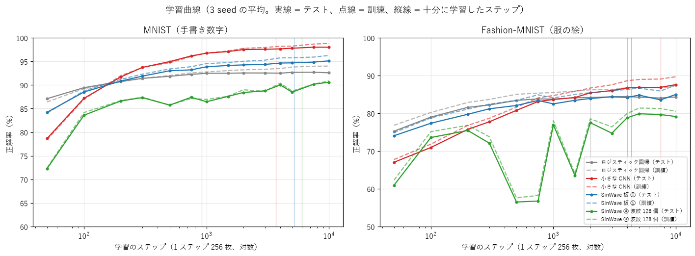

| データ | 方式 | 最高のテスト | 十分に学習したステップ | そこまでの学習時間 | そのときの訓練 − テスト | 1 万ステップでの訓練 − テスト |
|---|---|---|---|---|---|---|
| MNIST | ロジスティック回帰 | 92.8 | 917 | 1 秒 | +0.2 | +1.4 |
| MNIST | 小さな CNN | **98.1** | 3667 | 10 秒 | +0.4 | +0.8 |
| MNIST | SinWave 板 ① | 95.1 | 5167 | 199 秒 | +1.1 | +1.2 |
| MNIST | SinWave ④ 波紋 128 個 | 90.9 | 6000 | 252 秒 | +0.4 | +0.3 |
| Fashion | ロジスティック回帰 | 84.6 | 2000 | 2 秒 | +1.7 | +2.8 |
| Fashion | 小さな CNN | **87.6** | 7500 | 19 秒 | +2.0 | +2.1 |
| Fashion | SinWave 板 ① | 85.0 | 4333 | 166 秒 | +1.6 | +2.5 |
| Fashion | SinWave ④ 波紋 128 個 | 81.0 | 4000 | 168 秒 | +1.4 | +1.4 |

- **板 ① は約 4000〜5000 ステップ（学習 3 分前後、訓練データを約 20 周）で十分に学習した。** そこから 1 万ステップまでの伸びは MNIST で 0.5 点程度。実験15 の 3000 ステップ（94.4%）はやや早く止めていた。
- **過学習は小さい。** 1 万ステップでも訓練とテストの差は 1〜2.5 点で、テストが下がり始めることはなかった（CNN・回帰も同じ）。学習する数が 2000 と少ないので、覚えすぎる余地がないと考えられる。限界は「覚える力」と「学習の速さ」の側にある。
- 十分に学習するまでの時間は、CNN の約 20 倍（MNIST 199 秒対 10 秒）、回帰の約 100 倍。
- **④ 波紋 128 個は、テストの正解率が学習中に大きく上下する**（Fashion で 56〜80%）。学習率 0.01 が ④ には大きすぎ、波紋の中心や幅が一度に動きすぎると考えられる。1 次元の Sin-CNN2 の最小版は、学習率を 0 まで下げる cosine を使っていた（この実験は一定）。

次の一手: 学習率の変え方（cosine）と、④ の学習率を下げる（実験17）。

## 実験17: 学習率を最後に 0 まで下げる（cosine）と、④ の学習率 (exp16_curve.py --sched cosine、sweep17.sh、図 docs/images/exp17_cosine.png)

着想: 実験16 で、学習中にテストの正解率が上下し（谷）、④ は特に大きく揺れた。谷では訓練の正解率も一緒に落ちていたので、学習の進め方の揺れ（歩幅が大きすぎる）と見立てた。1 次元の Sin-CNN2 の最小版は、学習率を最後に 0 まで下げる cosine を使っていた。
条件: MNIST・Fashion-MNIST、5000 ステップ、cosine（学習率 0.01 → 0）。④ は波紋 128 個・深さ 0.5 で、学習率 0.003 → 0 も。3 seed。比べるもの: 学習率一定（実験16 の 5000 ステップ時点）。
「最大の落ち込み」= 隣り合う測定点の間でテストの正解率が下がった幅の最大。

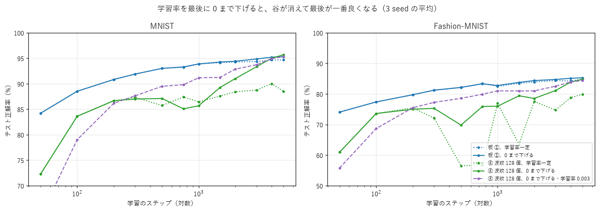

| データ | 板 | 学習率 | 5000 ステップのテスト | 途中の最高 | 最大の落ち込み | 学習の時間 |
|---|---|---|---|---|---|---|
| MNIST | ① | 一定 0.01（実験16） | 94.7 ± 0.2 | | 0.3 | |
| MNIST | ① | 0.01 → 0 | 95.3 ± 0.1 | 95.3 | 0.1 | 193 秒 |
| MNIST | ④ 128 個 | 一定 0.01（実験16） | 88.5 ± 0.5 | | 2.5 | |
| MNIST | ④ 128 個 | **0.01 → 0** | **95.7 ± 0.0** | 95.7 | 2.0 | 211 秒 |
| MNIST | ④ 128 個 | 0.003 → 0 | 95.3 ± 0.1 | 95.3 | 0.5 | 220 秒 |
| Fashion | ① | 一定 0.01（実験16） | 84.8 ± 0.1 | | 0.9 | |
| Fashion | ① | **0.01 → 0** | **85.3 ± 0.1** | 85.3 | 0.6 | 191 秒 |
| Fashion | ④ 128 個 | 一定 0.01（実験16） | 79.9 ± 1.1 | | 47.1 | |
| Fashion | ④ 128 個 | 0.01 → 0 | 84.8 ± 0.1 | 84.8 | 8.9 | 210 秒 |
| Fashion | ④ 128 個 | 0.003 → 0 | 84.4 ± 0.0 | 84.4 | 1.1 | 211 秒 |
| 比較 | 小さな CNN（実験16、一定） | | MNIST 98.1 / Fashion 87.6 | | | 10〜19 秒 |

- **学習率を最後に 0 まで下げると、どの条件でも最後の時点が一番良くなった（谷で終わらない）。** 途中で揺れても、学習率が小さくなる後半で落ち着く。
- **④ 波紋 128 個は MNIST で 88.5 → 95.7%、Fashion で 79.9 → 84.8% と大きく良くなり、MNIST ではこれまでの最良（① 95.3% を上回る）。** ④ が弱く見えたのは、板の形ではなく学習の進め方のせいだった（見立ての修正）。
- ④ の学習率を 0.003 に下げると途中の揺れは小さくなる（最大の落ち込み 8.9 → 1.1）が、最後の正解率はわずかに下がる。
- 学習の時間は変わらない（cosine は計算を増やさない）。小さな CNN にはまだ届かない（MNIST 2.4 点、Fashion 2.3 点）。

次の一手: 学習率を 0 まで下げるのを標準にする（部品の train に入れる）。数の種類ごとの学習率（実験18）、中心の初期配置（実験19）はこの学習率で行う。

## 実験18: ④ 波紋の数の種類ごとの学習率 (exp16_curve.py --lr_center --lr_width、sweep18.sh)

着想: 持ち主の問い（今の勾配のライブラリが合っていないのでは、2026-10-19）。Adam はどの数も同じくらいの歩幅で動かすが、④ では中心（画素、0〜64）と幅 k（0.03〜1.5）の単位がまったく違う。
条件: MNIST・Fashion-MNIST、波紋 128 個・深さ 0.5、学習率 0.01 → 0（cosine）、5000 ステップ、3 seed。中心の学習率の倍率 × 幅の学習率の倍率。

| 中心 × 幅 | MNIST | Fashion-MNIST |
|---|---|---|
| 1 × 1（実験17） | 95.7 ± 0.0 | 84.8 ± 0.1 |
| **10 × 0.1** | **96.3 ± 0.1** | **85.9 ± 0.0** |
| 1 × 0.1 | 95.9 ± 0.2 | 85.7 ± 0.0 |
| 10 × 1 | 96.1 ± 0.1 | 85.6 ± 0.2 |
| 比較: 板 ①（実験17） / 小さな CNN（実験16） | 95.3 / 98.1 | 85.3 / 87.6 |

- **中心を大きく（10 倍）、幅を小さく（0.1 倍）動かすと、両方のデータで最良を更新（MNIST 96.3%、Fashion 85.9%）。** 中心を動かしやすくする効果と、幅を動きにくくする効果は、どちらも単独で少し効き、合わせると一番良い。
- 見立て（単位の違いが合っていない）は当たっていた。ただし効果は 0.5〜1 点で、CNN との差（MNIST 1.8 点、Fashion 1.7 点）はまだ残る。

## 実験19: ④ 波紋の中心の初期配置（格子・格子 + ずらし・でたらめ） (exp16_curve.py --sinc_centers、sweep19.sh)

着想: 持ち主の問い（学習前の焦点の位置は整然と並ぶ方がよいか、でたらめがよいか、2026-10-19）。④ の学習では中心があまり動かない（実験11）ので、初期配置が効くかもしれない。
条件: 実験17 と同じ（中心・幅の学習率の倍率は 1）。格子 = −0.5L〜1.5L に 12 × 12 の格子（128 個なので最後の行は途中まで）、ずらし = 格子の間隔の ±1/4 のでたらめなずれ。3 seed。

| 初期配置 | MNIST | Fashion-MNIST |
|---|---|---|
| でたらめ（実験17） | 95.7 ± 0.0 | 84.8 ± 0.1 |
| 格子 | 95.9 ± 0.0 | 84.9 ± 0.1 |
| 格子 + ずらし | 95.8 ± 0.0 | 84.8 ± 0.1 |

- **中心の初期配置による差はほとんどない（0.2 点以内）。** 1 次元の実験19（ω の配置）と同じ結論。格子は作りやすく位置合わせもしやすいので、アナログで作るなら格子で始めて損はない。
- 融合で「学習前の板が同じ方が有利か」は実験20 で別に確かめる。

## 実験21: 学習の谷の理由 — 細かい学習曲線とクラスごとの正解率 (exp21_dips.py、sweep21.sh、図 docs/images/exp21_dips.png)

着想: 持ち主の問い（2026-10-19）。学習中に正解率が落ち込むのはなぜか。持ち主の例: 服の影を服の特徴として覚えると、影のない服で外れる（的外れな着眼点）。それなら「訓練は保ったままテストだけ落ちる」か「特定のクラスだけ落ちる」はず。学習の揺れなら「訓練とテストが一緒に落ちる」。
方法: Fashion-MNIST（訓練 55000・確かめ用 5000・テスト 1 万）、5000 ステップ、50 ステップごとにテスト・訓練・確かめ用・クラスごとのテスト・板の移動平均（係数 0.995 = 直近約 200 ステップ）の光路のテストを測る。板 ①・④（128 個・深さ 0.5）× 学習率一定・0 まで下げる × 3 seed。

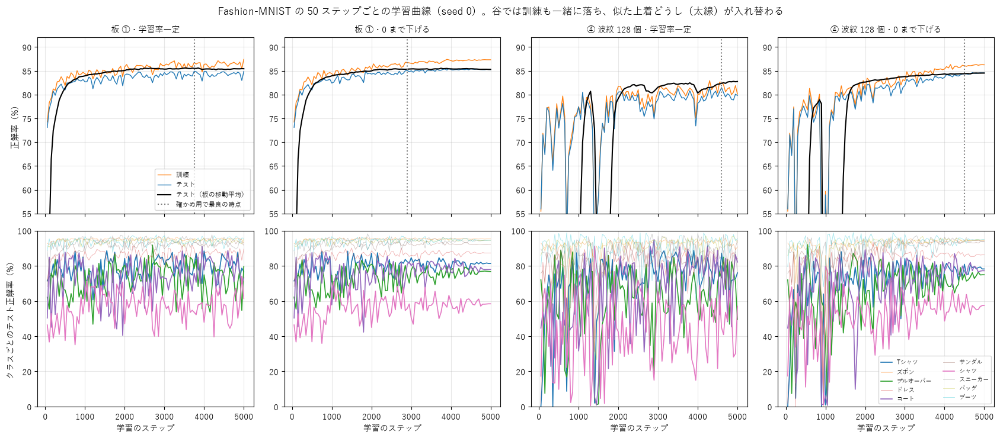

| 板 | 学習率 | 最後のテスト | 移動平均の板で | 確かめ用で最良の時点で | テストが 2 点以上落ちた回数（そのうち訓練も落ちた回数） |
|---|---|---|---|---|---|
| ① | 一定 | 84.2 ± 0.4 | **85.3 ± 0.1** | 84.8 ± 0.1 | 4（4） |
| ① | 0 まで下げる | 85.1 ± 0.1 | 85.1 ± 0.1 | 84.9 ± 0.1 | 0 |
| ④ 128 個 | 一定 | 78.1 ± 1.5 | **82.6 ± 0.1** | 81.4 ± 0.4 | 62（62） |
| ④ 128 個 | 0 まで下げる | **84.6 ± 0.1** | 84.6 ± 0.1 | 84.5 ± 0.1 | 29（29） |

- **谷はすべて、訓練も一緒に落ちていた（95 回中 95 回）。的外れな着眼点ではなく、学習の進め方の揺れ。**
- 谷で大きく落ちるクラスは、ほぼ似た上着どうし（プルオーバー・コート・T シャツ・シャツ）。似たクラスの境目が、1 ステップごとに行ったり来たりしている（図の下段の太線）。ほかのクラス（ズボン・バッグ・靴）はほとんど揺れない。
- 谷で終わらない工夫: **板の移動平均で答えると、学習率一定でも最後の谷の影響が消える**（④ 78.1 → 82.6）。学習率を 0 まで下げれば、移動平均も最良の時点の取り出しも要らない（最後がほぼ一番良い）。
- 1 次元の Sin-CNN2 の実験（実験23・34 など）は、もともと学習率を 0 まで下げて学習していたので、この谷の影響は受けていない（コードで確認: experiments/exp23_arith.py・exp34_roots.py の CosineAnnealingLR）。

次の一手: 部品の train の標準を「学習率を 0 まで下げる」にする。④ は中心・幅の学習率の倍率を標準に入れる。

## 実験20: 親の光路から子の光路を作る木 (exp20_tree.py、sweep20.sh)

着想: 持ち主の構想（2026-10-19、Project Metasequoia）。服を学習した光路からジャケットなどの光路を作るとき、共通性の高い親を参考にできるはず。ばらばらに学習したものを融合するときも、学習初期の板が同じ方が有利な気がする。
方法: Fashion-MNIST。親 = 大まかな 3 分類（上着類・靴・その他）を学習した板 ① 16 枚（3000 ステップ、学習率一定）。子 = 各グループの中の細かい分類（上着類 5・靴 3・その他 2 クラス）。子の作り方 4 通り: 別々のでたらめ（indep）、全部の子が同じでたらめ（same）、学習した親から派生（derive）、親の前半 8 枚を共有して凍結（front）。子は 2000 ステップ（学習率一定）、担当なしの絵（重み 0.3）でも学習。融合 = 3 本の子のスコアを足す（10 分類）。子のデータは全部と 1 クラス 300 枚。3 seed。

| 子のデータ | 作り方 | 上着類（5） | 靴（3） | その他（2） | 融合（10 分類） |
|---|---|---|---|---|---|
| 全部 | 別々のでたらめ | 76.3 ± 0.1 | 94.6 ± 0.1 | 99.6 ± 0.0 | **79.2 ± 0.7** |
| 全部 | 同じでたらめ | 76.3 ± 0.1 | **94.9 ± 0.1** | 99.7 ± 0.0 | 77.4 ± 0.8 |
| 全部 | 親から派生 | 76.2 ± 0.2 | 94.5 ± 0.1 | 99.6 ± 0.0 | 79.1 ± 0.4 |
| 全部 | 親の前半を共有・凍結 | 74.4 ± 0.2 | 93.4 ± 0.1 | 99.6 ± 0.1 | 75.7 ± 1.9 |
| 300 枚 | 別々のでたらめ | **73.0 ± 0.2** | 90.4 ± 0.7 | 99.5 ± 0.0 | 77.3 ± 0.7 |
| 300 枚 | 同じでたらめ | 72.2 ± 0.3 | **91.4 ± 0.3** | 99.3 ± 0.1 | 77.3 ± 1.2 |
| 300 枚 | 親から派生 | 72.6 ± 0.6 | 91.0 ± 0.3 | 99.3 ± 0.1 | **78.5 ± 0.3** |
| 300 枚 | 親の前半を共有・凍結 | 71.3 ± 0.4 | 90.2 ± 0.3 | 99.5 ± 0.1 | 75.4 ± 0.9 |
| 比較 | 10 分類を 1 本で同時に学習（実験17、cosine 5000 ステップ） | | | | 85.3 ± 0.1 |

親の大まかな 3 分類は 98.4%。1 回（4 通り × 3 本の子）の学習に約 28 分。

- **子の作り方による差はほとんどない（子の正解率は 1 点以内、融合は 75〜79%）。持ち主の見立て（共通の初期の板・親から作ると有利）は、この形では確かめられなかった。** 少ないデータ（300 枚）でも、親から派生させる利点は小さい（融合 77.3 → 78.5、子の正解率は変わらない）。
- 親の前半を凍結して共有すると、子も融合も少し悪くなる（計算は前半を 1 回で済ませられる利点はある）。
- 融合（75〜79%）は 10 分類を同時に学習した 1 本（85.3%）に 6〜10 点届かない。上着類の中の区別（76%）が弱いのが主な原因と、子どうしの取り違え。
- 注意: この実験は学習率一定（実験17 より前の設定）で、子の学習も 2000 ステップと短い。学習率を 0 まで下げると差が出る可能性は残る（未確認）。

次の一手: 学習率を 0 まで下げ、子の学習を長くして測り直す。親から派生させたときに子が親の何を引き継いでいるか（板の変化の大きさ）を見る。

## 実験22: 窓の数に縛られない読み方 — 符号で読む (exp22_codes.py、sweep22.sh)

着想: 持ち主の案（2026-10-19）。「1 クラス = 1 窓」では融合を続けると窓が足りなくなる。窓の数 K は固定のまま、クラスを K 個の窓の明るさの模様（符号）で表せば、クラスは実質無制限に増やせる。(1) 模様で判断、(2) 例の平均の模様（典型）でクラスを足す、(3) 部品の符号の和でクラスを定義する。
方法: Fashion-MNIST、板 ① 16 枚、学習率 0.01 → 0、3000 ステップ。窓の明るさから平均を引いて長さ 1 にし、符号（同じく平均を引いて長さ 1）との内積 × 温度を点数にする。3 seed。
- A: 1 クラス 1 窓（K = 10）、でたらめな ±1 の符号（K = 16・32）、符号も学習（K = 16）
- B: 8 クラスで学習（K = 32）した後、コート・ブーツを、板を動かさず例 n 枚の平均の模様を符号にして足す（学習なし）
- C: 部品（上半身・長袖・前開き・下半身・全身・足・運動靴・丈が高い・持ち物）の符号の和を符号にし、コートを見せずに 9 クラスで学習。コート = 上半身 + 長袖 + 前開き と定義だけする
- D: 技能 A（0〜4）と B（5〜9）を同じ 32 個の窓・でたらめな符号で別々に学習（担当なしの絵も）、窓の明るさの模様を足して照らし合わせる

| 読み方 | 正解率 |
|---|---|
| A: 1 クラス 1 窓（K = 10） | 84.2 ± 0.0 |
| A: でたらめな符号 K = 16 | 84.5 ± 0.1 |
| A: でたらめな符号 K = 32 | 84.6 ± 0.1 |
| **A: 符号も学習 K = 16** | **85.3 ± 0.0** |
| B: 8 クラス（足す前） | 88.0 ± 0.1 |
| B: 例 5 / 20 / 100 枚で 2 クラスを足した後の 10 クラス | 53.7 ± 4.3 / 52.8 ± 3.7 / 54.1 ± 3.1 |
| B: そのときの新しい 2 クラスだけ | 95.6 ± 1.5 / 97.1 ± 1.2 / 97.8 ± 0.7 |
| C: 9 クラス（見せたもの） | 87.1 ± 0.0 |
| C: コート（例 0 枚、部品だけで定義） | 8.7 ± 1.2 |
| C: 10 クラス全体 | 78.7 ± 0.1 |
| D: 2 技能の融合（窓の模様を足す） | 71.3 ± 0.7 |
| D: 2 技能の融合（点数を足す） | 66.8 ± 1.7 |

- **クラスを窓の模様（符号）で表しても、1 クラス 1 窓と同じ以上に当たる（K = 16 で符号も学習すると 85.3%）。窓の数をクラス数に合わせる必要はない。** 窓の数に縛られない読み方の土台として使える。
- 学習なしで例の平均の模様を符号にしてクラスを足すと、新しいクラスは 96〜98% 当たるが、古いクラスの絵まで新しいクラスと答えてしまい、10 クラスでは 54% に落ちる。新しいクラスの符号（例の平均）は、学習で作った古い符号（でたらめな ±1）より、どの絵の模様にも似やすいためと考えられる（作り方がそろっていない）→ 実験23。
- 部品の和だけで定義したコートは当たらない（8.7%、偶然 10%）。1 次元の語根（実験34）では 89.7% だった。見せていない「上半身 + 長袖 + 前開き」の組み合わせは、見せたプルオーバー（上半身 + 長袖）やシャツ（上半身 + 前開き）と近く、どちらかに吸い込まれると考えられる → 実験24 で見せないクラスを変えて確かめる。
- 符号での融合は 71%（1 クラス 1 窓での融合は実験20 で 75〜79%）。

次の一手: 符号の作り方をそろえる（全部のクラスを例の平均の模様に、実験23）。部品の和で見せないクラスを変えて確かめる（実験24）。

## 実験23: 典型の模様で全部のクラスの符号をそろえて、学習なしでクラスを足す (exp22_codes.py --parts B、sweep23.sh)

着想: 実験22 で、学習なしで足したクラス（例の平均の模様が符号）が古いクラス（でたらめな ±1 の符号）を奪った。符号の作り方がそろっていないためと見立てた。
方法: 実験22 の B と同じ（8 クラスでたらめな符号 K = 32 で学習 → 板は動かさない）。そのあと、古い 8 クラスも含めて全部のクラスの符号を、例 n 枚の窓の模様の平均に置き換える。3 seed。

| 符号の作り方 | 10 クラス全体 | 足した 2 クラス（コート・ブーツ、学習なし） |
|---|---|---|
| 古い 8 クラス = 学習した符号、新しい 2 クラス = 例 100 枚の平均（実験22） | 54.1 ± 3.1 | 97.8 ± 0.7 |
| **全部 = 例 20 枚の平均** | 74.4 ± 0.4 | 63.2 ± 5.2 |
| **全部 = 例 100 枚の平均** | **76.3 ± 0.6** | 63.7 ± 6.1 |
| 比較: 10 クラスで学習（でたらめな符号 K = 32、実験22） | 84.6 ± 0.1 | （学習している） |
| 比較: 8 クラスだけ（足す前） | 88.0 ± 0.1（8 クラス） | |

- **符号の作り方を「例の平均」にそろえると、奪い合いが大きく減り、学習なしで 2 クラスを足しても 10 クラスで 76.3%（そろえないと 54%）。** 足したクラスそのものは 63.7%（偶然 10%）で、板を一度も見せていないクラスでも典型の模様で見分けられる。
- 10 クラスで学習した場合（84.6%）には 8 点届かない。コートはプルオーバー・シャツと、ブーツはスニーカー・サンダルと模様が近い。
- 窓の数（32）は変えていない。クラスを足すのに窓も学習も要らない、という持ち主の案の (2)「共通の模様から想定」の形が成り立った。

次の一手: 足したクラスと近いクラスの区別（典型の模様の差を強調する、少しだけ学習する）。

## 実験24: 部品の符号の和だけで、例を見せないクラスを当てる（見せないクラスを変えて） (exp22_codes.py --parts C --holdout、sweep24.sh)

着想: 実験22 で、部品の和で定義したコート（例 0 枚）は 8.7% で当たらなかった。見せないクラスを変えても同じかを確かめる。
条件: 実験22 の C と同じ（符号 = 部品の符号の和、K = 32、9 クラスで学習）。見せないクラス: ブーツ（足 + 丈が高い）・スニーカー（足 + 運動靴）・プルオーバー（上半身 + 長袖）・コート（上半身 + 長袖 + 前開き）。3 seed。

| 見せないクラス | そのクラスの正解率 | 見せた 9 クラス | 何と答えたか（3 seed の合計、多い順） |
|---|---|---|---|
| ブーツ | 0.0 ± 0.0 | 83.4 ± 0.1 | サンダル 1570、スニーカー 1419 |
| スニーカー | 0.0 ± 0.0 | 83.7 ± 0.3 | サンダル 2160、ブーツ 802 |
| プルオーバー | 0.4 ± 0.2 | 87.5 ± 0.1 | シャツ 1714、コート 1061 |
| コート | 8.7 ± 1.2 | 87.1 ± 0.0 | プルオーバー 1229、シャツ 976 |

- **部品の符号の和を符号にするだけでは、例を見せないクラスはどれも当たらない（0〜9%）。** 必ず、部品を共有する見せたクラスに吸い込まれる。
- 学習では各クラスの符号（部品の和）全体に合わせるだけで、部品ひとつひとつを見分けることは求めていない。そのため「丈が高い」のような、見せないクラスにしかない部品の働きが育たないと考えられる（ブーツを見せないと「丈が高い」を持つクラスがない）。
- 1 次元の実験34 では、部品ごとに窓を持たせ「その部品があるか」を学習していた。

次の一手: 部品ごとの窓で部品の有無を学習する（1 次元の語根と同じ形）と、偏りの補正・γ（実験26）。

## 実験26: 部品ごとの窓で部品の有無を学習し、例を見せないクラスを部品で当てる（1 次元の語根の 2 次元版） (exp26_parts.py、sweep26.sh)

着想: 実験24 で、部品の符号の和を符号にするだけでは、例を見せないクラスは当たらなかった（0〜9%）。1 次元の Sin-CNN2 実験34・36 の語根の検出器（部品ごとの窓で「その部品が含まれるか」を学習、偏りの補正 + γ）を 2 次元で試す。持ち主の案の (3)「部品を見つけて組み合わせる」。
方法: Fashion-MNIST、板 ① 16 枚、窓 = 部品 9 個。各部品の窓の点数を「その部品があるか」の確率として二値のクロスエントロピーで学習（1 クラスは見せない）。学習率 0.01 → 0、3000 ステップ。
答え方: クラスの点数 = Σ（ある部品の log σ(s)）+ Σ（ない部品の log σ(−s)）。prior = 部品の出やすさ（訓練データでの対数オッズ）を点数から差し引く（実験36 の 1）。γ = 見せたクラスの点数から一定の値を引く（実験36 の 2）。3 seed。
指標: 見せないクラスの正解率（10 クラスの中から）、見せたクラスの正解率、両者の調和平均（どちらも高いときだけ高い）。

| 見せないクラス（部品） | 補正 | 見せないクラス | 見せたクラス | 調和平均 | 10 クラス全体 |
|---|---|---|---|---|---|
| コート（上半身 + 長袖 + 前開き） | なし | 6.0 ± 0.6 | 80.4 ± 0.1 | 11.1 | 73.0 |
| コート | **偏りの補正** | **76.9 ± 1.0** | 62.9 ± 0.2 | **69.2** | 64.3 |
| コート | なし + γ = 4 | 86.8 ± 0.5 | 66.5 ± 0.0 | **75.3** | 68.6 |
| ブーツ（足 + 丈が高い） | なし | 0.0 ± 0.0 | 77.4 ± 0.1 | 0.0 | 69.7 |
| ブーツ | **偏りの補正** | **80.8 ± 2.9** | 61.8 ± 0.1 | **70.0** | 63.7 |
| スニーカー（足 + 運動靴） | なし | 0.0 ± 0.0 | 77.9 ± 0.1 | 0.0 | 70.1 |
| スニーカー | **偏りの補正** | **81.6 ± 0.7** | 62.4 ± 0.2 | **70.7** | 64.3 |
| プルオーバー（上半身 + 長袖） | 偏りの補正 | 0.0 ± 0.0 | 73.9 ± 0.0 | 0.1 | 66.6 |
| プルオーバー | なし + γ = 4 | **78.8 ± 3.8** | 64.7 ± 0.1 | **71.0** | 66.1 |
| 比較: 部品の符号の和（実験24） | | 0〜9 | 83〜88 | | 75〜79 |
| 比較: 1 次元の語根（Sin-CNN2 実験36、偏りの補正 + γ） | | 77.5 | 68.6 | 72.7 | |

部品ごとの有無の正解率は 95.2%（9 部品の平均）。

- **部品ごとの窓で有無を学習し、偏りを補正すると、例を 1 つも見せないクラスを部品の組み合わせだけで 77〜82% 当てられた（偶然 10%）。見せたクラスとの調和平均は 69〜71 で、1 次元の語根（72.7）とほぼ同じ。** 持ち主の案 (3)「部品を見つけて組み合わせる」が 2 次元でも成り立つ。
- 実験24（符号の和）との違いは、部品ひとつひとつを窓に分けて「あるか・ないか」を学習させたこと。そのため、見せないクラスにしかない部品（「丈が高い」はブーツだけ）も、ほかのクラスに「ない」ことから学べる。
- その代わり、見せたクラスの正解率が 77〜80 → 62〜67% に下がる（見せないクラスに引き寄せられる）。補正の強さ（γ）で、どちらを重く見るかを選べる（1 次元と同じ）。
- プルオーバー（上半身 + 長袖）は、コート（+ 前開き）・シャツ（上半身 + 前開き）に挟まれ、偏りの補正だけでは当たらない（0%）。γ を大きくすると 78.8%。部品の組み合わせがほかのクラスの「部分集合」になっているクラスは、引き寄せの向きが逆になると考えられる。

次の一手: 部品を人が決めず、学習で見つける（例: 典型の模様のちがい）。融合（技能ごとに部品の窓を共有）。

## 実験27: どこに何があるかを出す — 4f 系（光学相関器） (exp27_locate.py、sweep27.sh・sweep27b.sh、図 docs/images/exp27_locate.png)

着想: 持ち主の案（2026-10-19）。犬の光路と猫の光路を融合したとき、「このピクセルが猫、ここが犬」と出せれば一番良い。確率で「犬 48%・猫 72%」のように独立に答えてもよい。
方法: 光学の 4f 系（VanderLugt の相関器）: レンズ（フーリエ変換）→ 周波数の面の位相の板 → 逆のレンズ。周波数の面の板は、絵のどこに物があっても同じ働きをする（位置をずらしても出力が同じだけずれる）。出力の面の、探す物がある位置に光が集まるように学習する。
条件: 64 × 64 の場に、20 × 20 に縮めた MNIST の数字を 1〜2 個ランダムな位置に（3・7・ほかが 1/3 ずつ）。訓練 2 万枚・テスト 2000 枚（MNIST の訓練・テストから別々に作る）。技能「3」と「7」を別の光路で。出力の各画素を「その数字の中心（半径 3 画素）か」の確率として、二値のクロスエントロピー（中心の画素に重み pos_weight）。学習率 0.01 → 0、3000 ステップ × 64 枚。3 seed。
板: fourier = 周波数の面に位相の板 1 枚（64 × 64 画素すべて、4096 個）、fourier4 = 4 段、plates = いまの板 ① 16 枚で最後のレンズを使わない。
指標: 位置（目標の数字の中心から 4 画素以内で確率 > 0.5）、誤報（ほかの数字の位置で確率 > 0.5）、AUC（目標の数字の位置とほかの数字の位置で、確率の最大を比べて目標の方が高い組の割合。閾値によらない見分けの強さ。50 = 見分けられない、100 = 完全）、ある・なし（絵全体の最大 > 0.5）。

| 板 | 重み | 3: 位置 | 3: 誤報 | 3: AUC | 7: 位置 | 7: 誤報 | 7: AUC | 学習する数 | 時間 |
|---|---|---|---|---|---|---|---|---|---|
| fourier | 20 | 99.4 ± 0.1 | 83.1 ± 0.5 | 87.7 ± 0.6 | 98.8 ± 0.2 | 90.7 ± 0.3 | 78.3 ± 0.6 | 4098 | 15 秒 |
| fourier4 | 20 | 99.4 ± 0.2 | 84.6 ± 0.6 | – | 98.8 ± 0.0 | 90.6 ± 0.5 | – | 16386 | 32 秒 |
| plates（板 ① 16 枚） | 20 | 99.2 ± 0.3 | 96.4 ± 1.1 | – | 98.6 ± 0.1 | 98.3 ± 0.1 | – | 2050 | 175 秒 |
| **fourier** | **5** | 97.0 ± 0.4 | 60.7 ± 1.2 | **89.4 ± 0.5** | 95.4 ± 0.1 | 68.8 ± 0.8 | **82.2 ± 0.5** | 4098 | 15 秒 |
| fourier | 1 | 82.0 ± 2.2 | 31.3 ± 0.9 | 84.5 ± 1.6 | 74.9 ± 1.2 | 34.7 ± 0.6 | 78.7 ± 0.8 | 4098 | 15 秒 |

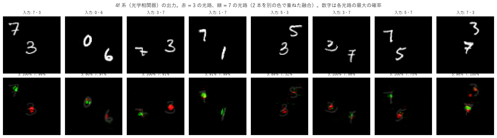

- **4f 系で、数字のある位置に光が集まり、2 本の光路を別の色で重ねると「ここが 3、ここが 7」が 1 枚で見える。** 周波数の面の板 1 枚（学習 15 秒）で、目標の数字の位置は 95〜99% で光る。持ち主の案の「どのピクセルが何か」の土台になる。
- **ただし、目標の数字とほかの数字の見分けはまだ弱い（AUC 82〜89%）。** 目標の位置で光らせようとすると、ほかの数字の位置でも光る（誤報 61〜91%）。重みで「見落とし」と「誤報」の引き換えは動くが、見分けの強さ（AUC）はあまり変わらない。
- 4 段に重ねても良くならない（fourier4 = fourier）。光の場に対して線形な系は、何段重ねても 1 枚の板（1 つの相関）と同じになるため。板 ① 16 枚（位置ごとに違う板）は、誤報がさらに多い（96〜98%）。位置をずらしても同じ働きをする周波数の面の板の方が、この課題には向いている。
- 解釈: 1 枚の相関（形の型との重なり）では、「3 の型」と「8 や 5」の重なりも大きい。見分けを強くするには、型の組み合わせを見る段（非線形）が要ると考えられる。

次の一手: 4f 系を 2 段にして、間に「明るさを測って、その明るさで光を出し直す」非線形を入れる（実験28、実行待ち）。

## 実験25: 実験20（親から子の木）を、学習率を 0 まで下げ、子の学習を長くして測り直す (exp20_tree.py --sched cosine --steps_child 4000、sweep25.sh・resume_25_26.sh・resume2.sh)

着想: 実験20 は学習率一定・子 2000 ステップと古い設定だった。実験17 で学習率を 0 まで下げると結果が大きく変わったので、測り直す。
条件: 実験20 と同じ。親・子とも学習率 0.01 → 0、子 4000 ステップ。3 seed。途中で PC 側の起動が止まり、残りを切り離した起動でやり直した（結果は 3 seed すべてそろっている）。1 回あたり 53〜95 分。

| 子のデータ | 作り方 | 上着類（5） | 靴（3） | 融合（10 分類） |
|---|---|---|---|---|
| 全部 | 別々のでたらめ | 77.3 ± 0.0 | 95.0 ± 0.1 | 80.5 ± 0.5 |
| 全部 | 同じでたらめ | 77.3 ± 0.0 | 95.0 ± 0.1 | 79.3 ± 0.3 |
| 全部 | 親から派生 | 77.2 ± 0.3 | 94.4 ± 0.1 | **80.6 ± 0.1** |
| 全部 | 親の前半を共有・凍結 | 75.3 ± 0.1 | 93.2 ± 0.3 | 78.9 ± 0.8 |
| 300 枚 | 別々のでたらめ | 73.2 ± 0.3 | 90.9 ± 0.3 | 76.5 ± 0.0 |
| 300 枚 | 同じでたらめ | 73.3 ± 0.2 | 91.4 ± 0.2 | **77.5 ± 1.0** |
| 300 枚 | 親から派生 | 73.4 ± 0.4 | 90.8 ± 0.2 | 76.7 ± 0.9 |
| 300 枚 | 親の前半を共有・凍結 | 73.2 ± 0.5 | 90.9 ± 0.1 | 76.0 ± 0.9 |

- **学習率を 0 まで下げても、子の作り方による差は 1〜2 点で、seed の揺れと同じくらい。実験20 の結論（この形では、共通の初期の板・親から作る利点は見えない）は変わらない。** 全体に 1 点ほど良くなった（融合 79 → 80）。
- 親の前半を凍結して共有すると、データが全部のときだけ少し悪い（計算は前半を共有できる）。

## 実験28: 4f 系を 2 段にして、間に光の非線形を入れる (exp27_locate.py --method fourier2nl、sweep28.sh)

着想: 実験27 で、4f 系（光学相関器）は目標の数字の位置に光を集められるが、ほかの数字でも光る（AUC 82〜89%）。光の場に対して線形な系は何段重ねても 1 枚の板と同じ（4 段でも同じだった）。1 段目で形の部品に光を集め、明るさを測ってその明るさで光を出し直し（カメラと表示器のつなぎ = 光の非線形）、2 段目でその組み合わせを見れば、見分けが強くなるはず。
条件: 実験27 と同じ課題、目標の画素の重み 5。1 段目の明るさの平方根を振幅として 2 段目に入れる。3 seed。学習する数 8196（周波数の面の板 2 枚）。

| 方式 | 3: 位置 | 3: 誤報 | 3: AUC | 7: 位置 | 7: 誤報 | 7: AUC | 学習の時間 |
|---|---|---|---|---|---|---|---|
| 4f 系 1 段（実験27） | 97.0 ± 0.4 | 60.7 ± 1.2 | 89.4 ± 0.5 | 95.4 ± 0.1 | 68.8 ± 0.8 | 82.2 ± 0.5 | 15 秒 |
| **4f 系 2 段 + 光の非線形** | **98.8 ± 0.1** | **36.6 ± 0.5** | **96.9 ± 0.4** | **98.8 ± 0.3** | **34.5 ± 1.9** | **97.0 ± 0.2** | 21 秒 |

- **間に光の非線形を 1 つ入れるだけで、見分けの強さ（AUC）が 89 / 82 → 97 / 97 になり、誤報は約半分（61 / 69 → 37 / 35）になった。** 見落としも減った。計算は 1.4 倍。
- 線形の段を何段重ねても変わらなかったこと（実験27 の 4 段）と合わせると、見分けを強くするのは「段の数」ではなく「間の非線形」。
- アナログで作るなら、カメラ（明るさを測る）と表示器（光を出し直す）の組、または光の強さで透け方が変わる材料が要る。

## 実験29: 共通する「何か」に反応しないようにする — 差分で読む（持ち主の案） (exp29_diff.py、sweep29.sh)

着想: 持ち主の見立て（2026-10-20）。誤反応は、数字の形以外に「白い何か（線がある所）」という共通の特徴も覚えているため。3 と 7 の共通部分で反応しないようにすれば、それぞれの特徴だけで判断できるはず。判断が難しいときは差分でチェックする（1 次元の実験23 では似た技能を引くと誤反応が減った）。
方法: 実験27・28 の課題で、光路を 3 本学習する: 「3」「7」「なんでも数字」（どの数字の位置でも光る = 共通する特徴）。読み方: Z3 だけ / Z3 − λ·Z数字（共通を引く、λ = 0.5・1）/ Z3 − Z7（相手を引く）。Z は確率になる前の点数。4f 系 1 段と 2 段 + 非線形。3 seed。
指標: AUC（目標と、ほかのすべての数字）、目標の 95% が光る閾値での誤報、3 と 7 の間だけの AUC と誤報。

| 方式 | 読み方 | 3: AUC | 3: 誤報 | 3 対 7 の AUC | 7: AUC | 7: 誤報 | 7 対 3 の AUC |
|---|---|---|---|---|---|---|---|
| 1 段 | そのまま | 89.4 ± 0.5 | 49.5 ± 1.8 | 94.0 ± 0.3 | 82.2 ± 0.5 | 65.5 ± 0.3 | 85.8 ± 0.8 |
| 1 段 | 共通を半分引く | 89.0 ± 0.6 | 46.2 ± 2.5 | 92.8 ± 0.7 | 84.8 ± 1.2 | 62.6 ± 2.4 | 87.9 ± 0.9 |
| 1 段 | 共通を全部引く | 70.8 ± 1.1 | 83.4 ± 1.2 | 71.9 ± 1.2 | 65.7 ± 1.7 | 90.4 ± 1.3 | 65.9 ± 3.4 |
| 1 段 | **相手を引く** | **89.9 ± 0.9** | **44.6 ± 3.1** | **94.6 ± 0.8** | **87.6 ± 0.7** | **49.6 ± 1.8** | **93.4 ± 0.2** |
| 2 段 + 非線形 | **そのまま** | **96.9 ± 0.4** | **14.4 ± 2.0** | **99.2 ± 0.1** | **97.0 ± 0.2** | **15.3 ± 1.1** | 98.7 ± 0.1 |
| 2 段 + 非線形 | 共通を半分引く | 95.4 ± 0.4 | 22.8 ± 2.5 | 97.5 ± 0.3 | 95.0 ± 0.7 | 27.7 ± 3.4 | 97.0 ± 0.4 |
| 2 段 + 非線形 | 共通を全部引く | 77.7 ± 0.8 | 73.4 ± 2.9 | 80.5 ± 0.8 | 78.1 ± 2.4 | 73.9 ± 3.8 | 81.1 ± 2.4 |
| 2 段 + 非線形 | 相手を引く | 95.8 ± 0.7 | 20.6 ± 3.3 | 99.0 ± 0.2 | 96.6 ± 0.3 | 17.0 ± 1.2 | **99.1 ± 0.2** |

- **共通する特徴（なんでも数字に光る光路）を引くのは効かなかった。全部引くと大きく悪くなる（AUC 89 → 71）。** 見立ては外れた。3 の光路はすでに「ほかの数字の位置では光らない」ように学習しているので、共通の部分はある程度引かれている。さらに引くと、3 自身の光も削られると考えられる。
- **相手を引く（Z3 − Z7）は、1 段のときに効いた**（7 の AUC 82 → 88、誤報 66 → 50、7 と 3 の間の AUC 86 → 93）。差分でチェックする案は、似た 2 つの区別には効く。
- 2 段 + 非線形のときは、そのまま読むのが一番良い（引くと少し悪くなる）。間の非線形が、共通の特徴を除いて組み合わせを見る働きを、すでに中でしていると考えられる。持ち主の案（共通部分に反応しない）は、外で引くより、光路の中の非線形の段として入れる方が効く。

次の一手: 2 段 + 非線形を部品にする（4f 系・中間の明るさの段）。3 と 7 以外の数字（10 クラス）で、各数字の位置を同時に出す。

## 実験30: 10 種類の数字の位置を同時に出す (exp30_ten.py、sweep30.sh、図 docs/images/exp30_ten.png)

着想: 実験28 の 4f 系 2 段 + 光の非線形で、3 と 7 の位置を見分けよく出せた。持ち主の目標（融合した光路それぞれが反応する場所を、ピクセル単位で出す）を 10 種類に広げる。
方法: 64 × 64 の場に MNIST の数字（20 × 20）を 1〜2 個、0〜9 を同じ割合で置く（訓練 2 万・テスト 2000）。数字ごとに光路を 1 本（4f 系 2 段 + 非線形、学習する数 8196）、それぞれ自分の数字の中心に光を集めるよう別々に学習（目標の画素の重み 5、学習率 0.01 → 0、3000 ステップ）。融合 = 10 本の出力を並べ、場所ごとに一番高い光路の数字を答えにする（色を分けた重ね合わせと同じ）。3 seed。1 回（10 本）約 100 秒。

| 指標 | 値 |
|---|---|
| 数字の位置での答え（その数字の中心から 4 画素以内で一番光った光路が正しい） | **85.3 ± 0.5** |
| 絵の中の数字（1〜2 個）を全部当てた | 79.5 ± 0.6 |
| 数字ごとの AUC（その数字の位置と、ほかの数字の位置の見分け）の平均 | 93.2 ± 0.2 |
| 数字ごとの AUC（0〜9） | 96.5 / 98.1 / 91.0 / 93.5 / 92.0 / 92.0 / 95.3 / 92.9 / 91.0 / 89.6 |
| 参考: 1 つだけの数字の分類（実験18、④ 波紋 128 個、位置は出せない） | 96.3 |

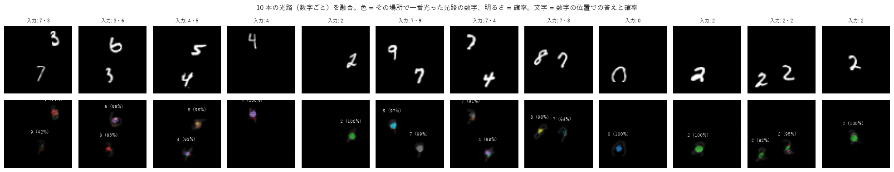

- **10 本の光路を別々に学習して色で融合するだけで、「この位置は 3、この位置は 7」を 1 枚の出力で 85% 当てられた。** 光路どうしは一度も一緒に学習していない（1 本ずつ別に学習）。
- 見分けにくいのは 9・2・8（AUC 90〜91%）で、4・7・3 と取り違えやすい。1・0・6 は見分けやすい（95〜98%）。
- 1 つだけの数字の分類（96.3%）より低いのは、(1) 数字が 20 × 20 と小さい、(2) 2 個並ぶと光が互いに漏れる、(3) 10 本の光路の目盛り（確率の高さ）がそろっていない、ため。(3) は実験08 のような較正で直せる見込み（未確認）。

次の一手: 画像認識はここで区切る（持ち主の判断、2026-10-20）。残る候補: 10 本の目盛りの較正、CNN との差を詰める（2 段 + 非線形を分類にも）、光学相関器のアナログの強さ、色のある写真。

---

# 言語（2026-10-20〜）

方針と一覧: docs/plan_text.md。課題は 1 次元の Sin-CNN2 と同じ作り方（experiments/text/textdata.py。n-gram の値が 1 次元と一致することを確認: 2-gram 42.9 / 2.10、3-gram 53.7 / 1.78、4-gram 55.4）。データは Sin-CNN2 が取得した CC-100 日本語の先頭 約 60 万字を data/ に写して使う（持ち主の了承済み、リポジトリには入れない）。

## 実験31・32: 文章を 2 次元の場に載せて次の文字 (exp31_text2d.py、sweeps/sweep31_32.sh・sweep31_32b.sh・sweep31_seed0_redo.sh、図 docs/images/exp31_history.png)

着想: 持ち主の依頼（2026-10-20）。1 次元では、文脈を一度に入れる方式は 48% で頭打ち（Sin-CNN2 実験27・30・32）。2 次元なら縦 = 位置、横 = 文字に分けて持てる。画像の実験28 では、光学相関器の間に光の非線形を入れると見分けが大きく強くなった。
方法: 直前 8 文字を 64 × 64 の場に載せる。場を縦に 8 本の帯（8 行ずつ）に分け、位置 m の帯に文字 c の平面波（向き kx = (c·g) mod 64、ky = ⌊c·g / 64⌋ mod 64）。入力の文字は頻出 511 字 + その他。答えは 64 クラス。
光路: plates = 板 ① 16 枚 + レンズ + 窓 64 個（実験31）。corr1・corrNL2・corrNL3 = 4f 系 1〜3 段（段の間に光の非線形）+ 出力の面の窓（実験32）。
比べる相手: n-gram、GRU（埋め込み・記憶 128）、ロジスティック回帰（8 文字の one-hot）。学習率 0.01 → 0、3000 ステップ × 256 件、訓練 6 万件・テスト 1 万件。3 seed。学習の経過を 250 ステップごとに記録（持ち主の依頼）。
注意: 実験32 の最初の版は、相関器の後にレンズを通して読んでいた。周波数の面の位相の板のすぐ後のレンズの明るさは板に関係しない（|U e^{jφ}|² = |U|²）ので、最後の段の板が働いていなかった（1 段なら「レンズで見ただけ」と同じ）。直してから測り直した（古い結果は results/exp32_old_lens.txt）。

| 方式 | 学習する数 | テストの正解率 | テストの確信度 CE | 訓練の正解率 | 学習の時間 |
|---|---|---|---|---|---|
| 2-gram | | 42.9 | 2.10 | | |
| **3-gram** | | **53.7** | **1.78** | | |
| 4-gram | | 55.4 | 1.86 | | |
| ロジスティック回帰（one-hot） | 262208 | 45.1 ± 0.4 | 2.27 | 58.9 | 2 秒 |
| GRU | 172864 | 47.6 ± 0.2 | 2.25 | 71.1 | 5 秒 |
| 2 次元の場 + 板 ① 16 枚 | 2113 | 38.7 ± 0.4 | 2.93 | 39.7 | 123 秒 |
| 2 次元の場 + 4f 系 1 段 | 4161 | 35.7 ± 0.5 | 3.07 | 36.3 | 18 秒 |
| 2 次元の場 + 4f 系 2 段 + 非線形 | 8257 | 36.9 ± 0.3 | 2.96 | 38.3 | 23 秒 |
| 2 次元の場 + 4f 系 3 段 + 非線形 2 回 | 12353 | 37.4 ± 0.3 | 2.94 | 39.0 | 30 秒 |
| 参考: 1 次元、文脈を一度に入れる（Sin-CNN2 実験27） | 16384 | 48.0 | 2.17 | | |
| 参考: 1 次元、光の記憶（Sin-CNN2 実験41・50） | 1.6〜13 万 | 51.1〜54.2 | 1.75〜1.96 | | |

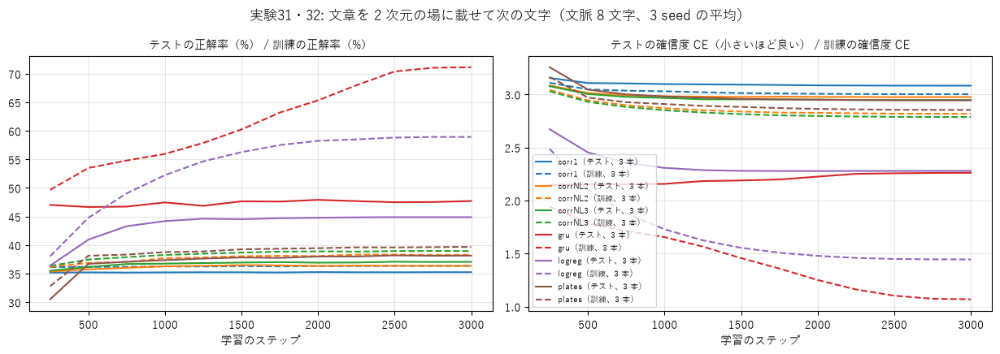

- **2 次元の場に載せただけでは、どの光路も 36〜39% で、1 次元（48〜54%）にも 2-gram（42.9%）にも届かなかった。**
- 学習の経過を見ると、光路は訓練とテストがほぼ同じ（39.7 対 38.7）で、学習の始めからほとんど伸びない。覚えすぎではなく、**覚えられていない**。GRU は訓練 71% に対してテスト 47.6% で、覚えすぎ。
- 非線形の段を増やすと少しずつ良くなる（35.7 → 36.9 → 37.4）が、伸びは小さい。画像の実験28 ほどの効き目はない。
- 解釈（未確認）: (1) 8 文字の光を同じ重さで重ねているので、一番効く直前の文字の光がほかの 7 文字に埋もれる（1 次元の実験52 で、直前の文字ほど明るくすると 44% まで上がった）。(2) 次の文字は「直前の文字そのもの」で大半が決まり、位置の方向の型（畳み込み）が効きにくい課題。(3) 窓 64 個に 1 クラスずつは、光の取り合いになる。

次の一手: 直前の文字ほど明るく入れる（位置ごとの明るさを学習）、帯の幅を直前の文字ほど広く、答えを符号で読む。1 次元の最良（光の記憶）の 2 次元版。

## 実験33: 直前の文字ほど明るく入れる（位置ごとの明るさを学習） (exp31_text2d.py --recency、sweeps/sweep33.sh)

着想: 実験31・32 の見立て（8 文字の光を同じ重さで重ねているので、直前の文字の光が埋もれる）。1 次元の実験52 でも、直前の文字ほど明るくすると上がった。
方法: 実験31・32 と同じ。位置 m の帯の光に e^{w_m} を掛け（w は学習、初期値は直前ほど明るい 0.3·(m − 7)）、全体の明るさをそろえる。学習する数は 8 個増えるだけ。3 seed。

| 方式 | 明るさ | テストの正解率 | CE | 訓練の正解率 |
|---|---|---|---|---|
| 2 次元の場 + 板 ① 16 枚 | 同じ（実験31） | 38.7 ± 0.4 | 2.93 | 39.7 |
| 2 次元の場 + 板 ① 16 枚 | **位置ごとに学習** | **43.6 ± 0.5** | **2.43** | 44.4 |
| 2 次元の場 + 4f 系 3 段 + 非線形 | 同じ（実験32） | 37.4 ± 0.3 | 2.94 | 39.0 |
| 2 次元の場 + 4f 系 3 段 + 非線形 | 位置ごとに学習 | 41.1 ± 0.6 | 2.64 | 42.7 |
| 比較: 2-gram / 3-gram / GRU | | 42.9 / 53.7 / 47.6 | 2.10 / 1.78 / 2.25 | |

- **位置ごとの明るさを学習すると +4〜5 点（板 ①: 38.7 → 43.6%）で、2-gram（42.9%）をわずかに上回った。** 見立て（直前の文字が埋もれる）は当たっていた。
- それでも GRU（47.6%）・1 次元の一度に入れる方式（48.0%）・3-gram（53.7%）には届かない。訓練とテストの差は小さいままで、まだ覚えきれていない。

次の一手: 光の記憶の 2 次元版（実験34、実行中）。

## 実験34: 光の記憶の 2 次元版 (exp34_memory2d.py、sweeps/sweep34.sh、図 docs/images/exp34_history.png)

着想: 1 次元の Sin-CNN2 で一番効いたのは光の記憶（1 文字ずつ入れ、前の光を混ぜて持ち越す。実験41・47・50、最大 54.2%）。2 次元でも伸びるか。
方法: 文字は場全体を照らす 2 次元の平面波（向き = (c·g) mod 4096 を縦横に分けたもの）。各時刻: 入力 = (1−α)·文字の光 + α·前の時刻の光（板の後、レンズの前）→ 板 ① 8 枚（回折しながら）→ 持ち越す。答えはレンズの後の明るさを、クラスの文字の光が集まる位置の窓（3 × 3）で読む（出力の光が次の入力と同じ形）。全時刻で次の文字を学習。学習する数 1089。3 seed。

| 方式 | テスト（文脈 8） | CE | 訓練 | 文脈 1 → 2 → 3 → 8 文字 | 学習の時間 |
|---|---|---|---|---|---|
| 光の記憶 2D、α = 0.5 | 41.3 ± 0.4 | 2.70 | 41.2 | 40.5 → 41.7 → 41.9 → 41.3 | 470 秒 |
| 光の記憶 2D、α = 0.3 | 42.4 ± 0.1 | 2.61 | 42.8 | 40.7 → 42.3 → 43.0 → 42.4 | 469 秒 |
| 比較: 2 次元の場 + 板 + 位置ごとの明るさ（実験33） | 43.6 ± 0.5 | 2.43 | 44.4 | | 123 秒 |
| 比較: 1 次元の光の記憶・小さいモデル（Sin-CNN2 実験41、学習する数 約 1.6 万） | 45.4 | | | 41.6 → 45.1 → 45.4 → 45.4 | |
| 比較: 2-gram / 3-gram / GRU | 42.9 / 53.7 / 47.6 | 2.10 / 1.78 / 2.25 | | | |

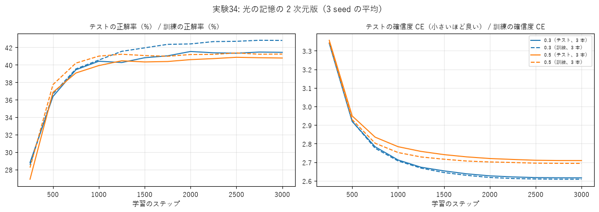

- **光の記憶の 2 次元版は 41〜42% で、文脈を伸ばしても 2〜3 文字で頭打ち。1 次元の光の記憶（小さいモデル 45.4%）にも、一度に入れる 2 次元の場（43.6%）にも届かなかった。**
- 学習する数が 1089 と小さい（1 次元の小さいモデルの 1/15）ことが効いている可能性がある（未確認）。訓練とテストが同じで、覚えきれていない。
- 計算は 1 文字ずつ 8 回通すので、一度に入れる方式の約 4 倍。

ここまでの言語のまとめ（実験31〜34）: 2 次元にしても、次の文字の予測では 1 次元（48〜54%）を上回る見込みはまだ見えない。一番良いのは「2 次元の場 + 板 + 位置ごとの明るさ」の 43.6%（2-gram をわずかに上回る）。

## 実験35: 容量を増やすと伸びるか（2 次元の場 + 板 ① + 位置ごとの明るさ） (exp31_text2d.py --patches --layers、sweeps/sweep35.sh)

着想: 実験31〜34 はどれも訓練とテストが同じで、覚えきれていない。学習する数が 1000〜2000 と小さい（1 次元の大きいモデルは 13 万）。
条件: 実験33 の板 ① + 位置ごとの明るさで、区画を 16（帯 128 本ずつ、学習する数 約 8 千）、さらに板を 32 枚（約 1.6 万）。3 seed。

| 板 × 区画 | 学習する数 | テスト | CE | 訓練 | 学習の時間 |
|---|---|---|---|---|---|
| 16 × 8（実験33） | 2121 | 43.6 ± 0.5 | 2.43 | 44.4 | 123 秒 |
| 16 × 16 | 8265 | 44.5 ± 0.3 | 2.37 | 45.1 | 119 秒 |
| **32 × 16** | **16457** | **46.9 ± 0.3** | **2.23** | 48.0 | 234 秒 |
| 比較: GRU（17 万） / 1 次元の一度に入れる方式（1.6 万） / 3-gram | | 47.6 / 48.0 / 53.7 | 2.25 / 2.17 / 1.78 | | |

- **容量を増やすと伸びる（43.6 → 44.5 → 46.9%）。板の枚数の方が区画より効く。** 学習する数 1.6 万で、同じくらいの数の 1 次元（48.0%）・GRU（47.6%、CE では上回る 2.23 対 2.25）にほぼ並んだ。
- まだ訓練とテストの差は小さく（1 点）、もっと大きくすれば伸びる見込み。

次の一手: 板 64 枚・区画 16〜32 まで大きくする（実験37）。光の非線形（実験36、実行中）と合わせる。

## 実験36: 板を段に分け、間に光の非線形（言語） (exp31_text2d.py --method platesNL2/3、sweeps/sweep36.sh)

着想: 画像の実験28 では、光学相関器の間に光の非線形（明るさを測って光を出し直す）を入れると見分けが大きく強くなった。言語でも板の間に入れる。
条件: 板 ① 16 枚を 2 段（8 + 8）または 3 段（5 + 5 + 5 枚）に分け、段の間で明るさの平方根を振幅として出し直す。位置ごとの明るさつき。区画 8・16。3 seed。

| 方式 | 区画 | 学習する数 | テスト | CE | 訓練 |
|---|---|---|---|---|---|
| 非線形なし（実験33・35） | 8 / 16 | 2121 / 8265 | 43.6 ± 0.5 / 44.5 ± 0.3 | 2.43 / 2.37 | 44.4 / 45.1 |
| 2 段（非線形 1 回） | 8 / 16 | 2186 / 8330 | 42.8 ± 0.3 / 43.8 ± 0.3 | 2.47 / 2.42 | 43.0 / 44.4 |
| 3 段（非線形 2 回） | 8 / 16 | 2123 / 7883 | 41.2 ± 0.3 / 42.8 ± 0.4 | 2.56 / 2.48 | 41.5 / 42.9 |

- **言語では、板の間の光の非線形は効かなかった（−1〜2 点）。** 段を増やすほど悪い。同じ枚数を段に分けると、1 段あたりの板が少なくなる（回折が足りない）ことが効いている可能性がある（未確認）。画像（位置を探す課題）で効いた理由と、言語（直前の文字の組み合わせ）の違いは、まだ説明できない。

## 実験37: さらに大きく（板 64 枚、区画 32） (exp31_text2d.py --layers --patches、sweeps/sweep37.sh)

着想: 実験35 で、容量を増やすと伸び続けた（板の枚数の方が区画より効いた）。
条件: 位置ごとの明るさつきの板 ①。板 64 枚 × 区画 16（学習する数 約 3.3 万）、板 32 枚 × 区画 32（約 6.6 万）。3 seed。

| 板 × 区画 | 学習する数 | テスト | CE | 訓練 | 学習の時間 |
|---|---|---|---|---|---|
| 32 × 16（実験35） | 16457 | 46.9 ± 0.3 | 2.23 | 48.0 | 234 秒 |
| **64 × 16** | **32841** | **49.1 ± 0.3** | **2.12** | 51.8 | 441 秒 |
| 32 × 32 | 65609 | 46.8 ± 0.3 | 2.23 | 48.5 | 227 秒 |
| 比較: GRU（17 万） / 1 次元の一度に入れる方式（1.6 万） / 1 次元の光の記憶（1.6〜13 万） | | 47.6 / 48.0 / 51.1〜54.2 | 2.25 / 2.17 / 1.75〜1.96 | | |
| 比較: 2-gram / 3-gram | | 42.9 / 53.7 | 2.10 / 1.78 | | |

- **板を 64 枚にすると 49.1%（CE 2.12）で、GRU（47.6%）と 1 次元の一度に入れる方式（48.0%）を上回った。** 2 次元の言語で初めて、1 次元の同じ形の方式を越えた。
- **効くのは板の枚数（深さ）で、区画（1 枚の細かさ）ではない。** 区画を 2 倍（学習する数 4 倍）にしても変わらない（46.8 対 46.9%）。
- 訓練とテストの差が開き始めた（2.7 点）。光の記憶（1 次元の最良 54.2%）と 3-gram（53.7%）にはまだ届かない。

次の一手: 板 128 枚（実験38）、位置ごとに色を分けて位置を干渉に頼らずに持つ（実験39）。どちらも実行中。

## 実験38・39: 板 128 枚、位置ごとに色を分ける (exp31_text2d.py --layers 128 / --color、sweeps/sweep38_39.sh)

- 実験38（板 128 枚 × 区画 16、学習する数 6.6 万）: **49.9 ± 0.1%**（CE 2.08）。64 枚（49.1%）からの伸びは小さく、訓練 56% と覚えすぎが始まった。学習 868 秒。
- 実験39（位置ごとに色を分ける、板 32 枚 × 区画 16）: **43.7 ± 0.2%**（同じ枚数で分けない 46.9%）。位置を干渉なしで持たせると悪くなる。帯どうしの干渉そのものが役に立っていると考えられる。計算 5 倍。

## 実験40: 文字列の入れ方の工夫（持ち主の案） (exp40_inputs.py、sweeps/sweep40.sh、図 docs/images/exp40_history.png)

着想: 持ち主の見立て（2026-10-20）。帯に並べると文字列によって反応する場所が変わりすぎるのでは。にじませ（拡散）が要るのでは。参照光で文字の前後に合わせて光に変化を与え、周波数拡散して重ね合わせ、レイヤ全体に入れるのが良いのでは。同心円（真ん中に 1 文字目）も工夫の一つ。
方法: 板 ① 32 枚 × 区画 16（実験35 の 46.9% の形）、位置ごとの明るさを学習。入れ方 6 通り: 帯（実験33 と同じ）、にじませ（帯を縦にぼかして隣と重ねる）、前後の平均（1 次元の滲み層）、2 次元の虹（全部を場全体に重ね、位置ごとに向きをずらす）、拡散符号（全部を場全体に重ね、位置ごとにでたらめな位相の参照光を掛ける）、同心円の輪。3 seed。

| 入れ方 | テスト | CE | 訓練 | 学んだ位置ごとの明るさ（古い → 直前） |
|---|---|---|---|---|
| 帯（実験33 と同じ） | 46.9 ± 0.3 | 2.23 | 48.0 | 0.02, 0.03, 0.04, 0.06, 0.08, 0.14, 1.13, 3.30 |
| にじませ | **47.2 ± 0.2** | 2.23 | 48.3 | 0.03, …, 0.16, 1.11, 3.63 |
| 前後の平均 | 46.8 ± 0.3 | 2.26 | 48.2 | 0.03, …, 0.29, 0.56, 3.66 |
| 2 次元の虹 | 47.0 ± 0.2 | 2.22 | 48.3 | 0.02, …, 0.17, 1.20, 3.49 |
| 拡散符号（参照光） | 47.1 ± 0.2 | 2.22 | 48.7 | 0.03, …, 0.19, 1.14, 3.42 |
| 同心円 | 46.9 ± 0.2 | 2.25 | 48.6 | 0.05, …, 0.16, 1.21, 6.11 |

- **入れ方 6 通りの差は 0.4 点以内で、どれも 47% 前後。入れ方は今の限界の原因ではなかった。**
- **学んだ位置ごとの明るさを見ると、どの入れ方でも、直前の文字（3.3〜6.1）と 2 文字前（0.6〜1.2）だけが明るく、それより前はほぼ 0。** 光路は、直前の 2 文字しか使っていない。3-gram（同じく直前 2 文字、53.7%）との差（約 7 点）は、「直前 2 文字の組み合わせ」を区別しきれていないことになる。
- 解釈: 明るさは光の 2 乗なので、2 文字の光の掛け算（組み合わせ）の成分は自然に入っている。それを 64 個の窓だけで読み分けるのが限界になっていると考えられる（511 × 511 通りの組を 64 個の明るさに落とす）。

次の一手: 窓を増やして符号で読む（実験42）。文脈を短くして 1 文字あたりの帯を太く（文字の区別を細かく）する（実験41）。どちらも実行中。

## 実験41〜43: 文脈を短く・窓を増やして符号で読む・正解の窓に光を集める (exp40_inputs.py --n / --K / --focus、sweeps/sweep41_42.sh・sweep43.sh、図 docs/images/text_windows.png・text_inputs.png)

着想: 実験40 で、光路は直前 2 文字しか使っていないと分かった。出力の窓の図（text_windows.png）では、光は砂嵐のようにスクリーン全体へばらまかれ、窓に入る光は 25%（窓の面積の割合と同じ）。光を正解の窓に集めているのではなく、ばらまかれた光のわずかな差を温度で大きくして答えている。
条件: 板 ① 32 枚 × 区画 16、帯、位置ごとの明るさ。3 seed。
- 実験41: 文脈を 2・3・4 文字に（帯が太くなり、文字の向きの区別が細かくなる）
- 実験42: 窓を 128・256 個にして、クラスを窓の模様（符号、学習する）で読む（画像の実験22 の形）
- 実験43: 正解の窓に入る光の割合を上げる損失（−log 割合）を重み 0.1・0.3・1 で足す

| 条件 | テスト | CE | 訓練 | 学習する数 |
|---|---|---|---|---|
| 基準: 文脈 8、窓 64（実験35・40） | 46.9 ± 0.3 | 2.23 | 48.0 | 16457 |
| 文脈 2 | 47.4 ± 0.4 | 2.22 | 48.8 | 16452 |
| 文脈 3 | 47.2 ± 0.1 | 2.22 | 48.4 | 16453 |
| 文脈 4 | 47.0 ± 0.2 | 2.24 | 49.3 | 16454 |
| 窓 128 個 + 符号 | 47.7 ± 0.1 | 2.12 | 50.0 | 24714 |
| **窓 256 個 + 符号** | **48.1 ± 0.3** | **2.09** | 50.5 | 33034 |
| 光を集める損失 0.1 / 0.3 / 1 | 46.9 / 46.9 / 45.9 | 2.23 / 2.24 / 2.32 | 48.0 / 48.2 / 46.7 | 16458 |

- **文脈を 2 文字にしても変わらない（47.4%）。光路が直前 2 文字しか使っていないことの裏付け。** 帯を太くして文字の区別を細かくしても伸びない。
- **窓を増やして符号で読むと少し良くなる（46.9 → 48.1%、CE 2.23 → 2.09）。** 取り出し方は効くが、効き目は約 1 点。
- 正解の窓に光を集める損失は効かない（重みを大きくすると悪化）。光を 1 か所に集めることと、答えを当てることは両立しにくいと考えられる。

次の一手: 深さ（板 64・128 枚）と窓 256 個の符号を合わせる（実験44、実行中）。

## 実験44: 深さ + 窓 256 個の符号 (exp40_inputs.py --K 256 --layers 64、sweeps/sweep44.sh)

板 ① 64 枚 × 区画 16 + 窓 256 個の符号: **49.6%（seed 0）、48.9%（seed 1）**、CE 2.03。64 枚 + 窓 64 個（49.1%）からほとんど伸びない。板を増やす方向は頭打ちと判断（持ち主も同じ見立て、2026-10-20）し、seed 2 と板 128 枚は中止した。

## 実験45: 文字を「板」として光に通す（掛け算で組み合わせる） (exp45_modulate.py、sweeps/sweep45.sh)

着想: 実験40〜44 で、光路は直前 2 文字しか使わず、組み合わせも区別しきれない。文字の光を足し合わせる限り、組み合わせは明るさの 2 乗の交差項にしか出ない。文字そのものを位相の板にして光を順に通せば、文字どうしが光の上で掛け算になり、間の板と回折で順番も表せるはず（持ち主の案「参照光で文字の前後に合わせて光に変化を与える」を、前の文字が次の文字の参照光になる形に）。持ち主の方針（2026-10-20）: 板を少なめにして根本策を速く試す（ふるい分け: 板 16 枚、1500 ステップ、seed 0、1 本 約 1 分）。
方法: 平らな光から始め、位置 m の順に「光 × exp(j·文字の模様)」→ 学習する板 2 枚（回折しながら）。最後にレンズ → 窓。文字の模様は、文字ごとの向きの平面波（wave）か、でたらめな位相の模様（rand）。

| 条件（ふるい分け、seed 0） | テスト | CE | 訓練 |
|---|---|---|---|
| 足し合わせる（帯、実験33 の形） | 42.8 | 2.48 | 42.8 |
| 足し合わせる + 窓 256 個の符号 | 46.3 | 2.23 | 47.4 |
| 掛け算（でたらめな模様） | 36.3 | 3.12 | 36.1 |
| 掛け算（平面波） | 36.3 | 3.13 | 36.1 |
| 掛け算（でたらめ、深さ 0.3） | 36.3 | 3.08 | 36.1 |
| 掛け算 + 窓 256 個の符号 | 2.2 | 4.21 | 4.2 |
| 掛け算、明るさを対数で読む（平面波 / でたらめ、500 ステップ） | 36.3 / 36.3 | 3.08 / 3.11 | |
| 参考: いつも「その他」と答える | 36.3 | | |

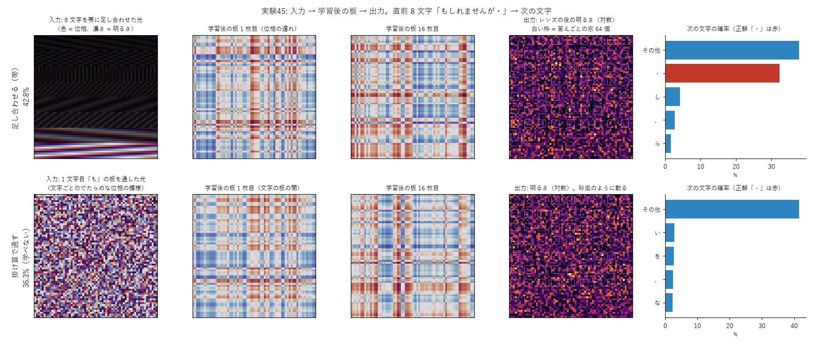

*入力 → 学習後の板 → 出力（tools/fig_exp45.py、同じ条件で学習し直したもの）。上: 足し合わせる形は、帯ごとに文字の光が並び（上の古い文字ほど暗い）、出口の窓で答えの「・」に 32% を出す。下: 掛け算の形は、1 文字目の板を通しただけで光が砂嵐になり、出口も散って、いつも「その他」と答える。*

- **文字を板として掛け算で通す形は、まったく学習できなかった（36.3% = いつも「その他」と答えるのと同じ）。** 損失が最初からほとんど下がらない。
- 文字 1 つだけ（n = 1）でも学べない（23.5%、対数で読んでも 37.4%）。同じ光を「足し合わせる」形の入口（EncNet）と、最初の出力は 1 桁も違わないことを確かめたので、作り方の誤りではない。
- 解釈（未確認）: (1) 平面波を掛け合わせると、向きが足し算になるだけで（順番が消え、ほかの組と重なる）、レンズの後では 1 点に光が集まり、明るさの幅が極端に大きくなる。(2) でたらめな模様を何枚も掛けると、光は砂嵐になり、学習する板の小さな変化では答えに届かない。

次の一手: 掛け算は、組み合わせたい 2 文字（直前と 2 つ前）だけにする、文字の模様をなめらかにする、など。別の根本策（直前 2 文字の組を入力の段階で 1 つの向きにする）と並べてふるい分けする。

## 実験46: 直前 2 文字の組を入口で 1 本の光にする（ふるい分け） (exp40_inputs.py --enc pairmul / pairhash、sweeps/sweep46.sh)

着想: 実験45 で掛け算の光路は学べなかった。組み合わせを光路に作らせるのでなく、入口で表してしまえばどこまで伸びるか（上限の目安）。実験40 で一番古い帯は使われていなかったので、そこに直前 2 文字の組を 1 本の平面波として入れる。
方法: pairmul = 直前と 2 つ前の文字の平面波の掛け算（向きの足し算。2 つ前の文字は別の歩幅で並べる）。pairhash = 2 文字の組ごとに決まった向き（組の番号を散らす。組が違えば向きもほぼ違う）。組の帯の明るさの初期値は e^1。ふるい分け（板 16 枚 × 区画 8、1500 ステップ、seed 0）。

| 入れ方 | 窓 | テスト | CE | 訓練 | 学んだ明るさ（組の帯、…、2 つ前、直前） |
|---|---|---|---|---|---|
| 帯（基準） | 64 | 42.8 | 2.48 | 42.8 | 0.05, …, 0.76, 4.51 |
| 帯（実験45） | 256 の符号 | 46.3 | 2.23 | 47.4 | |
| 組の掛け算 | 64 | 43.9 | 2.47 | 43.3 | 1.50, …, 0.57, 6.41 |
| 組の掛け算 | 256 の符号 | 45.6 | 2.44 | 46.0 | 2.93, …, 0.35, 2.88 |
| 組ごとの向き | 64 | 43.6 | 2.51 | 43.9 | 1.92, …, 0.46, 5.25 |
| 組ごとの向き | 256 の符号 | 44.0 | 2.42 | 43.3 | 4.07, …, 0.75, 1.45 |

- **直前 2 文字の組を入口で 1 本の光にしても、ほとんど良くならない（+1 点前後、窓 256 個の符号では基準より悪い）。** 組の帯は明るく学ばれている（使われている）のに伸びない。
- 組ごとの向き（組が違えば別の点に光が集まる）でも 43.6〜44.0% にとどまる。**光路が「組の向き → 答えの窓」の対応をほとんど覚えられていない。** 3-gram は、組（約 26 万通り）ごとに次の文字の数を数えた大きな表を持つ。光路の板（学習する数 2 千）は、何千通りもの向きをそれぞれ正しい窓へ送り分ける「配線表」としては小さすぎる、と考えられる。
- まとめ（実験31〜46）: 2 次元の言語の詰まりどころは、入れ方でも取り出し方でも組み合わせの作り方でもなく、**覚えておける対応の数（学習する数）**。同じ学習する数なら 1 次元と同じくらいで、2 次元にした利点は今のところ見えない。伸ばすには学習する数を大きくするしかなく（板 64 枚 = 3.3 万個で 49%、1 次元の光の記憶 13 万個で 54%）、計算が重くなる。

## 実験47: 間引き・等価時間標本化（場を 64 → 32） (exp40_inputs.py --L、sweeps/sweep47.sh)

着想: 持ち主の依頼（2026-10-20）。1 次元の実験35（L と互いに素な歩幅で周波数を並べると L を 1/4 にしても同等以上）を 2 次元で。文字の向きは互いに素な歩幅で 32 × 32 = 1024 通りに並べる（511 字なので重ならない）。
条件: 帯、板 ① 16 枚 × 区画 8、1500 ステップ、3 seed。

| 場 | 文脈 | 板 | テスト | 学習の時間 | 学習する数 |
|---|---|---|---|---|---|
| 64 × 64 | 8 | 16 | 42.7 | 69 秒 | 2122 |
| 64 × 64 | 2 | 16 | 43.1 | 60 秒 | 2116 |
| 32 × 32 | 8 | 16 | 41.0 | 35 秒 | 2122 |
| 32 × 32 | 2 | 16 | 42.5 | 35 秒 | 2116 |
| 32 × 32 | 8 | 32 | **43.5** | 66 秒 | 4170 |

- **場を 32 × 32 にすると、計算は半分（69 → 35 秒）で、正解率は 0.6〜1.7 点下がるだけ。同じ計算なら、場を小さくして板を倍にした方が良い（43.5 対 42.7）。** 1 次元の等価時間標本化の考え方は 2 次元でも使える（画素数は 1/4 だが、時間は小さな計算を何回も呼ぶ手間のため 1/2）。
- 32 × 32 では文脈 8 文字の帯が 4 行しかなく、文脈 2 文字（16 行）の方が良い。

## 実験50: 往復のたびにレイヤの違う場所を通す（持ち主の「鏡の往復」案、ふるい分け） (exp50_bounce.py、sweeps/sweep50.sh)

着想: 持ち主の案（2026-10-20）。向かい合った鏡の間を、わずかに傾けたレーザーが往復し、毎回回折するレイヤを通る。往復のたびに光がずれて違う場所を通るので、順番が「どこを通ったか」で区別され、光の状態が履歴を持ち越す。持ち主の補足: 厳密な鏡でなく、出力を入力に戻す形でよい。
方法: 横長の大きなレイヤ（縦 32 × 横 32 + shift·7、板 ① 8 枚分）。往復 t は横 [t·shift, t·shift + 32) の部分を通る。入力 = 0.7·文字 t の光 + 0.3·前の往復の光。往復ごとにレンズで読んで次の文字を当てる（全部の往復で学習）。1500 ステップ、seed 0。

| ずらし幅 | テスト（文脈 8） | 文脈 1 → 2 → 3 → 8 | 学習する数 | 訓練 |
|---|---|---|---|---|
| 0（毎回同じ場所 = 光の記憶） | 39.4 | 39.0 → 38.7 → 39.6 → 39.4 | 577 | 38.8 |
| 16 画素 | 38.2 | 38.6 → 36.3 → 37.5 → 38.2 | 1473 | 37.5 |
| 32 画素（毎回まったく別の場所） | 38.4 | 38.4 → 37.5 → 38.4 → 38.4 | 2369 | 37.5 |

- **往復のたびに違う場所を通しても良くならなかった（38〜39%）。** 文脈が伸びても正解率は上がらない（どれも文脈 1 文字の時点とほぼ同じ）。前の光を持ち越しても、それが次の答えに使われていない。
- ふるい分けの条件（場 32 × 32、板 8 枚、1500 ステップ）で学習する数も少なく、光の記憶の 2 次元版（実験34、42.4%）より低い。
- 持ち主の見立て「全部の方式が同じくらいになるのは、試験方法の絞り（訓練 6 万件）のせい」を、実験49（訓練データを全部に）で確かめてから、往復の形を大きくするかを決める。

## 実験48: 短冊形で、文字ごとの光が後ろの文字の範囲にだけ届く形（持ち主の案） (exp48_strip.py、sweeps/sweep48.sh、図 docs/images/strip_input.png)

着想: 持ち主の案（2026-10-20）。1:4 程度の短冊形にして、文字ごとに 0.5 ずつずらした範囲を照らす。各文字の光は自分の位置から後ろ（下）へ 3 単位分だけを照らす（プリズムで下向きに傾け、前側をマスクで切る）。光が時間の向きに一方通行で流れる。
条件: 短冊 208 × 32 画素（1 単位 = 32 画素）。板 ① 16 枚（帯 16 本ずつ）、位置ごとの明るさを学習。1500 ステップ、3 seed。比べる: マスクなし、プリズムなし・強く、照らす範囲 1.5 単位。

| 形 | テスト | CE | 学習の時間 | 学んだ明るさ（2 つ前、直前） |
|---|---|---|---|---|
| 基本（マスクあり、プリズム 4、範囲 3） | 41.7 ± 0.4 | 2.60 | 100 秒 | 0.50, 2.92 |
| マスクなし（全部の文字が全体を照らす） | 41.6 ± 0.1 | 2.60 | 122 秒 | 0.44, 3.13 |
| プリズムなし | 42.0 ± 0.2 | 2.61 | 137 秒 | 0.64, 3.84 |
| プリズム強く（12） | 41.1 ± 0.2 | 2.61 | 137 秒 | 0.40, 3.37 |
| 照らす範囲 1.5 単位 | 41.6 ± 0.3 | 2.60 | 100 秒 | 0.39, 3.95 |
| 比較: 正方形 32 × 32 の帯（実験47、同じ板の数・学習の長さ） | 41.0 | | 35 秒 | |

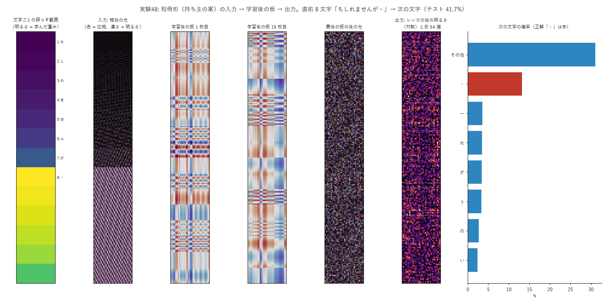

*入力 → 学習後の板 → 出力（tools/fig_exp48.py、基本の形を同じ条件で学習し直したもの）。左から: 文字ごとの照らす範囲（直前の文字ほど明るく学んだ）、短冊の入力の光、学習後の板（短冊の形に合わせた縦長の帯）、最後の板の後の光、出口の明るさと窓、次の文字の確率。*

- **短冊形も 41〜42% で、正方形の帯（41.0%）と同じ。マスク・プリズム・照らす範囲を変えても差は 1 点以内。** 学んだ明るさも、やはり直前と 2 つ前の文字だけが明るい。
- どの形でも同じ所に集まるので、持ち主の 3 つ目の見立て（試験方法の絞り = 訓練 6 万件）を実験49 で確かめる。

## 実験49: 訓練データを全部に（6 万件 → 約 53 万件） (exp40_inputs.py / exp31_text2d.py --max_train 600000、sweeps/sweep49.sh)

着想: 持ち主の見立て（2026-10-20）: どんなに違う形でも正解率がそろうのは「試験方法の絞り」のせいでは。調べると、n-gram は訓練用の文書を全部（約 53 万件分）数えているのに、光路と GRU は 6 万件しか見ていなかった。6 万件では GRU も 47.6% で、光路（47〜50%）と同じ所にいた。
条件: 訓練データを全部（531,908 件）に。1 ステップ 256 件で、3000 ステップ（計算は 6 万件と同じ）と、長く（光路 12000・GRU 20000）。光路は帯 + 板 ① 32 枚 × 区画 16（窓 64・256 の符号）。seed 0・1。

| 方式 | 訓練 | ステップ | テスト | CE | 訓練の正解率 | 学習の時間 |
|---|---|---|---|---|---|---|
| GRU | 6 万件（実験31） | 3000 | 47.6 | 2.25 | 71.1 | 5 秒 |
| **GRU** | **全部** | 3000 | **53.3 / 53.0** | **1.80 / 1.77** | 55.5 / 54.9 | 7 秒 |
| **GRU** | **全部** | 20000 | **54.1 / 53.6** | **1.77 / 1.75** | 56.8 / 56.5 | 46 秒 |
| 光路（窓 64） | 6 万件（実験35） | 3000 | 46.9 | 2.23 | 48.0 | 234 秒 |
| 光路（窓 64） | 全部 | 3000 | 47.1 / 47.0 | 2.20 / 2.19 | 47.0 / 48.1 | 285 秒 |
| 光路（窓 64） | 全部 | 12000 | 48.1 / 47.9 | 2.14 / 2.13 | 47.5 / 48.0 | 1230 秒 |
| 光路（窓 256 の符号） | 全部 | 3000 | 48.6 / 48.5 | 2.05 / 2.05 | 48.6 / 48.6 | 290 秒 |
| 比較: 3-gram（全部の文書） / 4-gram | | | 53.7 / 55.4 | 1.78 / 1.86 | | |

- **持ち主の見立ては、GRU については当たっていた。訓練データを全部にすると、GRU は 47.6 → 53.3%（長く学習して 54.1%）と 3-gram（53.7%）に並んだ。** 6 万件は GRU にとっての天井だった。
- **光路は、データを全部にしてもほとんど伸びない（47 → 48%、長く学習しても +1 点）。** 訓練の正解率もテストと同じ 48% 前後で、光路は覚えきれていない。光路の天井は、データではなく光路そのもの（覚えておける対応の数）にある。
- 6 万件で GRU と光路が同じ所に集まっていたのは、それぞれ別の理由（GRU = データ、光路 = 表現の力）で、たまたま近い値だった。
- 2 次元の言語のこれまでの結論: 次の文字の予測では、2 次元の光路は約 48〜50% で頭打ち（学習する数を増やしても、データを増やしても、入れ方・取り出し方を変えても）。同じデータで GRU・3-gram は 54% 前後。

## 実験51: Sin-CNN2 で効いたが未着手だった工夫（照明・非コヒーレント光・参照波） (exp51_untried.py、sweeps/sweep51.sh、図 docs/images/exp51_history.png)

着想: 持ち主の依頼（2026-10-20、「未着手のものを進めて」）。docs/sin_cnn2_checklist_text.md の × のうち、1 次元で大きく効いたもの。
方法: 実験45 の add と同じ土台（帯、位置ごとの明るさ、板 ① 16 枚 × 区画 8、窓 64 個、1500 ステップ、学習率 0.01 → 0）に、
  tilt（位置 m の光に exp(j·2π·j·m/8) を掛けた 8 通りの明るさを平均。違う位置の文字どうしの干渉が 0 になる）、hadamard（同、位相 0・π）、
  weighted（tilt の 8 通りに学習する重み。干渉を残す位置の組を選べる、1 次元の実験25）、incoh（位置ごとのでたらめな位相 8 通りを平均）、
  ref（レンズの直前に強さを学習する平らな参照光を足す。明るさに光の場そのものに比例する成分が加わる）を入れる。
条件: 3 seed。

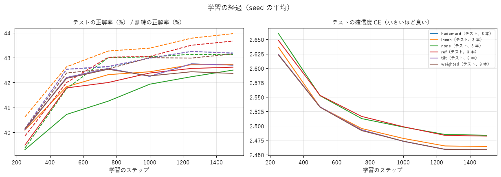

| 工夫 | テスト | CE | 訓練 | 学習の時間 |
|---|---|---|---|---|
| なし | 42.7 ± 0.6 | 2.48 | 43.1 | 79 秒 |
| 参照波 | 43.0 ± 0.7 | 2.46 | 43.7 | 78 秒 |
| 照明の重み付き平均 | 42.9 ± 0.4 | 2.45 | 43.1 | 339 秒 |
| tilt 照明 | 43.1 ± 0.5 | 2.45 | 43.2 | 333 秒 |
| アダマール照明 | 43.1 ± 0.5 | 2.45 | 43.2 | 339 秒 |
| 非コヒーレント光 | 43.5 ± 0.8 | 2.46 | 44.0 | 336 秒 |

- **どれも +0.3〜0.8 点で、seed のばらつき（± 0.5〜0.8）の範囲。1 次元で +3〜8 点効いた工夫も、2 次元の言語では効かない。** 照明の 3 つと非コヒーレント光は計算が 4 倍。
- 重み付き照明で学んだ重みはほぼ均等（0.10〜0.15）。どの位置の組の干渉を残しても変わらない、ということ。
- 参照波の強さは 1 → 0.6 に下がった（参照光を使う方向には学習が進まなかった）。
- 訓練の正解率もテストと同じ 43〜44% で、覚えきれていない。違う位置の文字どうしの干渉（雑音）が天井の原因ではなく、実験49 と同じく表現の力が天井。
- これで 2 次元の言語の「1 文字ずつ、1 本の光路で」の形は、試せる工夫をひととおり試した。持ち主の判断（2026-10-20）: 頭打ちなので、部品を集めて複雑なモデルを考える段階へ。整理は docs/parts_review.md。

## 実験52: 単語（形態素）を単位にして、次の単語の確率を出す (exp52_words.py、worddata.py、sweeps/sweep52.sh)

着想: 持ち主の案（2026-10-20）。入力を単語ごとのトークンにして、次の単語の確率を出す（「やぁ、→ こんにちは 20%」）。
方法: 文を MeCab（fugashi 1.5.2 + 辞書 unidic-lite 1.0.8、MIT/BSD、約 50MB、持ち主の許可を得て導入）で単語に切る。訓練の文書 331,741 語・テスト 42,706 語、1.68 万種類。
      直前 4 語 → 次の 1 語。入力は頻出 4094 語 + その他 + 文書の始まり（64 × 64 の 4096 通りの向きに 1 語ずつ、帯に並べ、位置ごとの明るさを学習）。
      答えは頻出 1023 語 + その他 = 1024 クラス（その他がテストの 19.7%）。光路は板 ① 32 枚 × 区画 16 + 窓 256 個の符号読み。訓練 6 万件、3000 ステップ。
条件: 3 seed。

| 方式 | 正解率 | CE | 上位 5 に入る | 訓練の正解率 | 学習の時間 | 学習する数 |
|---|---|---|---|---|---|---|
| 単語の 2-gram（全部の訓練文書） | 33.7 | 3.52 | 62.0 | | | |
| 単語の 3-gram | 36.4 | 3.96 | 61.5 | | | |
| ロジスティック回帰 | 32.6 ± 0.4 | 3.58 | 59.2 | 47.1 | 21 秒 | 1678 万 |
| GRU | 32.5 ± 0.3 | 3.64 | 58.1 | 59.9 | 7 秒 | 76 万 |
| **光路** | **30.4 ± 0.4** | 3.68 | 55.2 | 32.2 | 288 秒 | 28 万（大半は符号） |

光路が出した確率の例（seed 0）: ありがとう → ござい 82.6%。よろしくお願い → いたし 22.5%・し 9.2%・な 8.7%。東京の → その他 42.1%・で 11.3%。明日の天気は → 、 33.3%・その他 27.2%。

- 光路と GRU の差は 2 点（文字のときは 4〜5 点）。光路の訓練の正解率はテストと同じ 32% で、ここでも覚えきれていない。
- 「その他」（語彙の外）が上位に来やすい。内容語（天気 → 晴れ）は語彙 1024 の外に落ちることが多い。

## 2DT グレインと関連度の見積もり（数えた表、est_grains_counts.py・est_relatedness_counts.py・est_analogy_counts.py）

持ち主の案（2026-10-20）: k 語先を当てる学習器（2DT グレイン、2DTG-k）を並べて確率を割り当てで足す。確率 × 関連度（話題の近さ）で決める。関連度の差分（王 − 女王 = 亭主 − 女房）。
光路の前に、各グレインを数えた表に置き換えて上限を見積もった（テスト 1 万件・5000 件）。
- 1 語だけ見る 2DTG を割り当て（0.6・0.25）で足しても 33.6 → 34.2%。確信度で重みをつけると下がる（29.5〜31.2）。確率の積は CE が悪化。
- **各 2DTG に「直前の語 + k 語前の語」を見せて 4 つを足すと 37.1%（3-gram 36.4）、CE 3.24（3-gram 3.96）**。→ 実験53 はこの形。
- 関連度（前後 10 語の共起 → PPMI → 64 次元、直前 50 語の内容語の平均との近さ）: 全部の語に掛けると機能語の予測を押しのけて下がる。内容語の位置では 11.0 → 13〜22%。**内容語の確率の合計は変えず、内容語の中だけ並べ替えると全体 37.2 → 37.3%、CE 3.48 → 3.43**。→ 実験54。
- 差分: 男 → 女 = 父 → **母**（1 位）、父 → 母 = 息子 → **娘**（1 位）、食べる → 飲む = 食べ → 飲ま（2 位）。夫 → 妻 = 父 → ? は外れ。差分どうしの向きの近さは最大 0.3 で弱い（33 万語では少ない）。

## 実験53: 2DT グレイン（2DTG）を 4 つ並べて足す（持ち主の案） (exp53_grains.py、sweeps/sweep53.sh)

方法: 2DTG-1 は直前の 1 語、2DTG-k（k = 2〜4）は (k 語前, 直前) の 2 語を入れる。各 2DTG は板 ① 8 枚 × 区画 16 + 符号読み 256（4 つで板 32 枚 = 実験52 の 1 本と同じ）。
      それぞれ別々に学習し、確率を合わせる: 同じ重み・割り当て 0.4/0.3/0.2/0.1・確信度・検証 5000 件で選んだ重み。3 seed。

| | 正解率 | CE | 上位 5 | 比べる: 数えた表 |
|---|---|---|---|---|
| 2DTG-1（直前 1 語） | 28.0 | 4.17 | 50.9 | 33.6（2-gram） |
| 2DTG-2（2 語前 + 直前） | 30.1 | 3.59 | 56.4 | 36.6 |
| 2DTG-3 | 29.4 | 3.61 | 56.2 | 34.7 |
| 2DTG-4 | 29.6 | 3.60 | 56.1 | 32.9 |
| 4 つを足す（同じ重み） | 30.4 ± 0.3 | 3.54 | 57.4 | 37.1 |
| 4 つを足す（確信度で重み） | 30.4 ± 0.3 | **3.52** | 57.5 | |
| 4 つを足す（選んだ重み 0.05/0.35/0.3/0.3） | 30.3 ± 0.2 | **3.52** | 57.4 | |
| 比べる: 1 本の光路で直前 4 語（実験52） | 30.4 ± 0.4 | 3.68 | 55.2 | |

- **足すと確信度（CE 3.68 → 3.52）と上位 5（55.2 → 57.4）は良くなったが、正解率は 1 本の光路と同じ 30.4%。**
- **一番の発見: 直前 1 語だけを見る 2DTG-1 が 28.0% で、2-gram の表（33.6%）を覚えきれていない。** 4096 通りの入力（光の向き）から 1024 通りの答えへの対応表を、板 8 枚の光路は表せない。
  数えた表では 2DTG を並べると 37.1% まで伸びるので、案の形は正しいが、1 つ 1 つの光路の表現の力が足りない。文字の実験の天井と同じ原因。
- 学んだ重みは 2DTG-1 にほぼ 0（0.05）で、2 語を見る 2DTG に均等。

## 実験54: 関連度グレイン（持ち主の案） (exp54_related.py、sweeps/sweep54.sh)

方法: 直前 50 語の内容語（訓練で出現 2000 回未満）を、語ごとの向きの平面波として場全体に重ねて入れる（話題の袋）→ 板 ① 16 枚 × 区画 16 → レンズ → 窓 64 個。
      答えの語ごとに符号（64 個の数）を学習し、関連度 = 窓の明るさと符号のコサイン。次の語が内容語の位置だけで学習（内容語の中の softmax）。
      確率（2DTG の改良形を数えた表で作ったもの）の内容語の部分を exp(λ·関連度) で掛け直す（内容語の確率の合計は元のまま、λ は検証 5000 件で選ぶ）。
      比べる相手: 数えた表の関連度（共起 → PPMI → 64 次元）。差分（男性 → 女性 = 彼 → ?）を符号で確かめる。3 seed、テスト 1 万件（内容語が 35.7%）。

| | 全体の正解率 | CE | 内容語の位置の正解率 | 関連度だけで内容語を当てる |
|---|---|---|---|---|
| 確率だけ | 37.0 | 3.85 | 10.6 | |
| + 光の関連度グレイン（λ = 0.5） | 36.9 | 3.85 | 10.9 | 1.8 |
| + 数えた表の関連度（λ = 2） | 37.1 | 3.83 | 11.9 | 2.2 |

- **光の関連度グレインは、話題の近さを学べなかった。** 内容語の位置で +0.3 点、近い語の例も意味をなさない（海 → 得る・みんな・友達…、猫 → 元・動物・印象…）。差分もすべて外れ。
- 数えた表の関連度でも、この確率（数えた表の平滑化を実験53 の見積もりと変えたもの）の上では +1.3 点（内容語の位置）と、見積もり（+2.4 点）より小さい。
- 50 語の袋を 1 本の光の重ね合わせで入れると、語が多すぎて模様が混ざり、どの語があったかを光路が取り出せないと考えられる（文字の実験の「直前 2 文字しか使えない」と同じ形）。

## 実験55: 1 つの光路が覚えられる対応表の大きさ (exp52_words.py --n 1、sweeps/sweep55.sh)

直前 1 語 → 次の語（数えた表 = 2-gram なら 33.6%）を、1 本の光路で。訓練 6 万件、3000 ステップ、seed 0。

| 板 × 区画 × 窓 | 正解率 | CE | 訓練 |
|---|---|---|---|
| 8 × 16 × 256 | 27.8 | 4.16 | 28.0 |
| 16 × 16 × 256 | 28.2 | 4.12 | 29.5 |
| 32 × 16 × 256 | 29.0 | 4.00 | 30.8 |
| 64 × 16 × 256 | 29.6 | 3.89 | 31.7 |
| 16 × 32 × 256 | 28.3 | 4.11 | 29.7 |
| 16 × 16 × 1024 | 28.6 | 4.06 | 30.1 |
| 16 × 8 × 256 | 28.0 | 4.15 | 29.4 |

- **「1 語 → 次の 1 語」の表でさえ、板 64 枚で 29.6%（表 33.6%）。訓練も 32% で覚えきれない。** 区画・窓の数ではほぼ変わらず、板の枚数だけが少しずつ効く。
- 見立て（持ち主のホログラムの問い、2026-10-21）: 入力の語 = 光の向き（角度）なので、光路は「角度 → 図柄」の角度多重ホログラム。薄い板は角度を変えても図柄がずれるだけで、角度ごとに別の図柄を出すには厚いホログラム（ブラッグの選択性）が要る。板を重ねるほど伸びるのはこのためと考えられる。→ 実験59。

## 実験56: 大きくして頭打ちを確かめる（持ち主の依頼） (exp52_words.py --L、sweeps/sweep56.sh・sweep56b.sh)

単語の課題（直前 4 語 → 1024 クラス）、訓練 6 万件、seed 0。夜中（01:50）に GPU のドライバのエラー（nvlddmkm）の時刻に止まり、朝に残りを回し直した。

| 場 | 板 | 区画 | ステップ | 正解率 | CE | 上位 5 | 訓練 | 学習の時間 | メモリ |
|---|---|---|---|---|---|---|---|---|---|
| 64 | 32（実験52） | 16 | 3000 | 30.4 | 3.68 | 55.2 | 32.2 | 288 秒 | |
| 64 | 64 | 16 | 3000 | 31.4 | 3.60 | 56.7 | 35.7 | 459 秒 | 1.4 GB |
| 64 | **128** | 16 | 3000 | **32.3** | **3.51** | **58.6** | 37.5 | 907 秒 | 2.7 GB |
| 128 | 32 | 16 | 3000 | 31.0 | 3.68 | 55.9 | 35.4 | 788 秒 | 3.0 GB |
| 128 | 64 | 16 | 3000 | 31.7 | 3.57 | 57.6 | 37.7 | 1475 秒 | 5.5 GB |
| 128 | 64 | 32 | 3000 | 31.9 | 3.58 | 57.3 | 38.3 | 1529 秒 | |
| 64 | 32 | 16 | 12000 | 29.6 | 4.01 | 54.6 | 38.4 | 1273 秒 | |
| 比べる: GRU / 2-gram | | | | 32.5 / 33.7 | | 58.1 / 62.0 | | | |

文字の課題（実験42 の形、窓 256 の符号）で場 128・板 64 枚: **50.1%**（CE 2.00、訓練 56.2、1479 秒。これまでの最良 49.9% をわずかに更新）。

- 板を倍にするごとに +1 点。128 枚で GRU（6 万件）に並ぶ。場を 128 に広げても同じ枚数なら +0.3〜0.6 点で、メモリは 4 倍。区画 32 も変わらない。
- 6 万件で長く学習（12000 ステップ）すると覚えすぎる（訓練 38.4、テスト 29.6）。

## 実験57: データの疎らさの確認（持ち主の依頼） (exp52_words.py --max_train、sweeps/sweep56b.sh)

| 方式 | 訓練 | ステップ | 正解率 | CE | 上位 5 | 訓練の正解率 |
|---|---|---|---|---|---|---|
| 光路（板 32） | 2 万件 | 3000 | **27.3** | 4.06 | 51.3 | 41.9 |
| GRU | 2 万件 | 3000 | 25.7 | 5.16 | 48.9 | 95.1 |
| 光路（板 32） | 6 万件 | 3000 | 30.4 | 3.68 | 55.2 | 32.2 |
| GRU | 6 万件 | 3000 | 32.5 | 3.64 | 58.1 | 59.9 |
| 光路（板 32） | 全部 33 万件 | 3000 | 30.5 | 3.54 | 56.4 | 29.9 |
| 光路（板 32） | 全部 | 12000 | 32.5 | 3.36 | 59.8 | 32.6 |
| 光路（板 128） | 全部 | 3000 | 32.7 | 3.35 | 59.7 | 33.8 |
| **GRU** | 全部 | 3000 | **36.9** | **3.04** | **64.4** | 40.3 |
| GRU | 全部 | 20000 | 35.7 | 3.33 | 62.6 | 53.5 |
| ロジスティック回帰 | 全部 | 20000 | 35.6 | 3.64 | 62.7 | 50.2 |

- **データが少ないとき（2 万件）は光路が GRU を上回る**（27.3 対 25.7。GRU は訓練 95% で覚えすぎ）。光路は覚えすぎにくい。
- データを増やすと、GRU は 32.5 → 36.9%（3-gram 36.4 を上回る）と伸び、光路は 30.4 → 32.5〜32.7% で伸びが小さい。文字の実験49 と同じく、光路の天井は表現の力。

場 128・板 64 枚を 6 万件で長く学習（9000 ステップ）: 29.5%（訓練 45.4、覚えすぎ。4384 秒）。

## 実験58: 小さな 2DTG に表を分担させ、バラバラに学習して足す（持ち主の方針） (exp58_split.py、sweeps/sweep58.sh)

方法: 直前の語の番号（頻度順）を G で割った余りで担当を分ける。2DTG-g は (2 語前, 直前) を入れ、担当の文脈は本当の答え、担当外は「担当なし」（1 バッチの 30%）を学ぶ。
      各 2DTG は別々に学習。融合 add = 確率を (1 − p_担当なし) で重みをつけて足すだけ。route = 直前の語のグループで 1 つを選ぶ（上限）。
条件: 板の合計 128 枚（G × 枚数）、区画 16、符号読み 256、訓練は全部（33 万件）、3000 ステップずつ、seed 0。

| 方式 | 正解率 | CE | 上位 5 | 担当の当たり | 学習の時間 |
|---|---|---|---|---|---|
| 1 本の光路、板 128 枚（実験57） | 32.7 | 3.35 | 59.7 | | 1231 秒 |
| 2DTG 4 個 × 板 32 枚、足すだけ | 33.7 | 3.46 | 60.0 | 89.3 | 1300 秒 |
| **2DTG 8 個 × 板 16 枚、足すだけ** | **35.7** | **3.20** | **63.4** | 99.8 | 1348 秒 |
| **2DTG 16 個 × 板 8 枚、足すだけ** | **36.0** | **3.19** | **64.0** | 99.8 | 1483 秒 |
| 16 個 × 8 枚、担当を直接選ぶ（route） | 35.9 | 3.18 | 64.1 | | |
| 比べる: GRU（全部）/ 3-gram | 36.9 / 36.4 | 3.04 / 3.96 | 64.4 / 61.5 | | 8 秒 |

- **同じ計算量で、1 本の光路より +3.3 点（32.7 → 36.0%）。GRU との差は 0.9 点、3-gram を CE・上位 5 で上回る。** 細かく分けるほど良い（4 → 8 → 16 個）。
- **注意（2026-10-21 訂正）: 板の枚数（光の計算）は同じだが、符号読みの符号（デジタルの重み、1025 × 256）が 2DTG ごとに 1 組あるので、学習する数は 1 本の 33 万に対して 16 個で 427 万（GRU 76 万）。伸びが光路の分担によるものか、デジタルの符号が増えたせいかは分けていない。** 符号を全部同じでたらめに固定した対照が実験64。
- 各 2DTG は担当外の文脈の 99.8〜100% に「担当なし」と答え、足すだけの融合が担当を直接選ぶのと同じになる（画像の実験10・12 の担当なしの学習が言語でもそのまま効く）。4 個 × 32 枚では担当外の判定が 92% に落ち、融合が少し下がる。
- 担当ごとの正解率は 20〜46% とばらつく（よく出る語「、」「の」などを含むグループが低い）。
- 光路の容量の天井（実験55・56）は、1 つの光路に覚えさせる表を小さくすることで避けられる。光路を並べて足すのはハードではただ。

実験58 の続き（sweeps/sweep58b.sh）:

| 2DTG の数 × 板 | seed | 正解率 | CE | 上位 5 | 担当の当たり |
|---|---|---|---|---|---|
| 8 × 16 | 0 / 1 | 35.7 / 35.3 | 3.20 / 3.19 | 63.4 / 63.2 | 99.8 / 99.7 |
| 16 × 8 | 0 / 1 | 36.0 / 36.3 | 3.19 / 3.19 | 64.0 / 63.7 | 99.8 |
| 32 × 4 | 0 | 36.1 | 3.23 | 63.6 | 99.4 |
| 64 × 2 | 0 | 36.2 | 3.34 | 62.9 | 98.5 |
| 16 × 16（計算 2 倍） | 0 | **36.4** | 3.21 | **64.2** | 99.3 |

- 16 個より細かく分けても 36% 前後で止まる（64 × 2 枚は CE が悪化）。計算を倍にしても +0.4 点。
- 各 2DTG が見ているのは直前 2 語だけなので、天井は「2 語の組 → 次の語」の情報量（数えた表の見積もりで 36.6〜37.1%）に近い。→ 見せる文脈を長くする（実験62）。

## 実験59: 厚いホログラムに近づける — 板の間隔 (exp52_words.py --n 1 --z、sweeps/sweep59.sh)

持ち主のホログラムの問い（2026-10-21）から。直前 1 語 → 次の語（実験55 と同じ、表なら 33.6%）、訓練 6 万件、seed 0。

| 板 | 間隔 z | 正解率 | CE | 訓練 |
|---|---|---|---|---|
| 1 | 64 | 25.9 | 4.55 | 25.2 |
| 32 | 4 / 16 / 64（実験55） / 256 / 1024 | 28.5 / 29.0 / 29.0 / 28.9 / 28.9 | 3.83〜4.00 | 28〜31 |
| 128 | 4 / 16 | 30.3 / 30.5 | 3.68 / 3.83 | 32〜34 |

- **間隔を変えても正解率は変わらない（28.5〜29.0%）。** 効くのは板の枚数だけ（1 枚 25.9 → 32 枚 29.0 → 128 枚 30.5）。
- 薄い板 1 枚でも 25.9% 出る（「角度 → ずれた同じ図柄」でも、頻度の高い答えはある程度当たる）。厚くする効果は「間隔」ではなく「板の数（学習できる自由度）」から来ている。

## 実験60: 使われ方の近い語を近い光の向きに並べる (exp52_words.py --layout、sweeps/sweep60.sh)

持ち主の見立て（差分・関連性の補完）。前後 2 語の共起 → PPMI → SVD の第 2・3 成分の順に、64 × 64 の向きへ並べる（embed）。比較: 今の並べ方（stride）、embed を語の間でかき混ぜたもの（embed_rand）。直前 4 語 → 1024 クラス、板 32 枚、seed 0。

| 並べ方 | 2 万件 | 6 万件 |
|---|---|---|
| stride（今まで） | 27.3 | 30.3 |
| embed（近い語を近くに） | 27.4 | 29.9 |
| embed_rand | 27.6 | 30.1 |

- **差なし。** 2 つの成分だけで 4000 語を並べる粗い並べ方では、近い向きが近い語にならず効果が出ない（並べた結果の行も意味の近さが見えにくい）。次は向きそのものを学習させる形で確かめる。

## 実験61: 2DTG の木 — 葉を枝・根が補う（持ち主の案） (exp61_tree.py、sweeps/sweep61.sh)

葉 16 × 板 8、枝 4 × 板 16、根 1 × 板 32（担当は直前の語の余り。葉・枝は担当なしの学習）。全部バラバラに学習し、検証 5000 件で混ぜ方を選ぶ。訓練は全部、seed 0。

| 融合 | 正解率 | CE | 上位 5 |
|---|---|---|---|
| 葉だけ（実験58 と同じ） | 36.0 | 3.20 | 63.7 |
| 枝だけ / 根だけ | 33.9 / 30.7 | 3.27 / 3.64 | 61.1 / 55.6 |
| 葉 0.7 + 枝 0.3（選んだ重み、根は 0） | 35.9 | **3.16** | **64.0** |
| 後退（葉の自信が低いほど枝へ） | 35.8 | **3.16** | 63.9 |

- **木にすると確信度（CE 3.20 → 3.16）と上位 5 は少し良くなるが、正解率は葉だけと同じ。** 根はまったく使われない。
- 葉・枝・根が同じ 2 語しか見ていないので、補える情報が少ない。補完を強くするには、段ごとに違う情報（長い文脈・関連度）を見せる必要がある。

## 2DTG の掛け算の見積もり（持ち主の案、数えた表、est_product_counts.py）

持ち主の案（2026-10-21）: 2DTG-k =「k 個前の 1 単位 → 次」を別々に学び、欲しい単位の前の n 個それぞれの出力を掛け算する（専門家の積・ナイーブベイズ）。
P(D | A, B, C) ∝ P(D)·Π_k [P_k(D | k 個前) / P(D)]^w。訓練は全部、テスト 1 万件。

| 組み方 | 単語（1024 クラス） | 文字（64 クラス） |
|---|---|---|
| 2DTG-1 だけ | 33.6 | 42.6 |
| 掛け算、重み 1（そのまま） | 32.2（2 個）→ 19.9（4 個） | 43.9（2 個）→ 38.6（8 個） |
| 掛け算、2 つ目以降を 0.1〜0.5 乗 | **34.9**（2〜3 個） | **46.4**（6 個） |
| 足し算（以前の見積もり） | 34.2 | |
| 2 単位の表（直前 + 2 つ前）× 遠い 2DTG（0.1〜0.2 乗） | 36.6 → 36.7 | 53.3 → 53.8 |

- 掛け算は足し算より良い。そのまま掛けると、証拠が独立でない（直前を見れば 2 つ前もだいたい分かる）ので自信過剰になって悪化する。弱めて掛ける。
- 1 単位ずつ別々に見る形の天井は 3-gram より下（文字 46.4 対 53.7）。組み合わせ（B と C が一緒なら D）を表せない。
- 1 単位だけを見る 2DTG は表が小さい（文字 512 × 64）ので、光路でも覚えやすい形。合わせ方の部品として残す。

## 実験62: 分担の 2DTG を文字の課題へ・見せる文脈を長く (exp58_split.py --task --m、sweeps/sweep62.sh)

直前の単位で担当を分ける（余り）。各 2DTG は直前 m 単位を帯で入れ、担当なしの学習。足すだけで融合。訓練は全部（文字 53 万件・単語 33 万件）、seed 0。

| 課題 | 2DTG × 板 | 見せる単位 m | 正解率 | CE | 上位 5 | 学習する数 |
|---|---|---|---|---|---|---|
| 文字 | 16 × 8 | 2 | 52.8 | 1.792 | 82.6 | 34 万 |
| 文字 | 16 × 8 | 3 | 53.7 | 1.750 | 83.1 | 34 万 |
| 文字 | **16 × 8** | **4** | **54.0** | **1.739** | 83.1 | 34 万 |
| 文字 | **64 × 2** | 3 | **54.8** | 1.797 | 83.0 | 115 万 |
| 単語 | 16 × 8 | 3 | 35.9 | 3.207 | 63.5 | 427 万 |
| 単語 | 16 × 8 | 4 | 35.2 | 3.230 | 62.6 | 427 万 |
| 比べる: 文字の光路 1 本の最良（場 128・板 64、実験56） | | | 50.1 | 2.00 | | |
| 比べる: 文字の GRU（全部、実験49）/ 3-gram / 4-gram | | | 53.3〜54.1 / 53.7 / 55.4 | 1.75〜1.80 / 1.78 / 1.86 | | 17 万 |

- **文字の課題で、分担の 2DTG が光路 1 本の最良（50.1%）を +3.9 点上回り、GRU・3-gram に並んだ（54.0%、CE 1.739 は GRU 1.75〜1.80 より良い）。** 64 個 × 2 枚なら 54.8%。
  文字は答えが 64 クラスで符号が小さいので、学習する数は光路 1 本（34 万）とほぼ同じ。**分担の効果は光路の側にある**（単語の実験58 の符号の問題はここにはない）。
- 文字では見せる文脈を長くするほど良い（2 → 3 → 4 で 52.8 → 54.0）。単語では長くしても変わらないか下がる（35.9・35.2）。単語の 4 語の組はデータが疎らで、表の上限が低い。
- 担当の当たりは 99.6〜100%。足すだけの融合 = 担当を選ぶのと同じ。

## 実験63: 板の種類（位相・振幅・両方）と読み方（明るさ・位相差も）（持ち主の依頼） (exp63_amp_phase.py、sweeps/sweep63.sh、図 docs/images/exp63_phase.png・exp63_both.png)

直前 1 語 → 次の語（実験55 と同じ、数えた表なら 33.6%）、板 32 枚 × 区画 16、窓 256 個の符号読み、6 万件、3000 ステップ、seed 0。
振幅の板は透過 exp(0.5·B·sin(...))（帯ごとに学習、板ごとに明るさの平均を 1 に戻すので実質は減らし方の比）。
位相差も読む = レンズの後の光を平らな参照光と干渉させ、明るさに加えて Re・Im（参照光との位相差の cos・sin × 強さ）も窓で読む。

| 板 | 明るさだけ | 位相差も読む |
|---|---|---|
| 位相だけ（今まで） | 29.0（CE 4.00） | 29.5（3.59） |
| 振幅だけ | 30.5（3.51） | 30.2（3.50） |
| **振幅 + 位相** | **31.2（3.46）** | 31.0（3.45） |

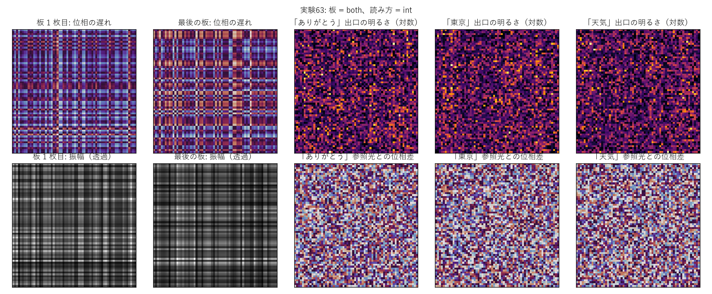

- **振幅 + 位相の板が、位相だけより +2.2 点（29.0 → 31.2%）、CE も 4.00 → 3.46 と良い。** 振幅だけでも +1.5 点。板 32 枚で、位相だけの板 128 枚（30.5%、実験59）を上回る。
  場所ごとに光を減らせると、語ごとの模様を作り分ける自由度が増えると考えられる。ハードでは吸収（または振幅の変調器）が要り、光は減る。
- 位相差も読む（干渉計）は、位相だけの板で CE を 4.00 → 3.59 と良くするが、正解率はほぼ同じ。振幅のある板では差がない。
- seed 1 本だけなので、差の大きさは目安。

## 実験65: 光路を逆向きに通す（持ち主の問い） (exp65_reverse.py、sweeps/sweep65.sh)

持ち主の問い（2026-10-21）: 「A の次が D」と学んだ光路に、出口から D を入れると A が光るか。実験63 の光路（明るさだけで読む）を使う。
出口に「D の符号の正の値をその窓に置いた明るさ」（位相 0）の光を置き、レンズ・回折・板を逆向き（共役）に通し、入口で語ごとの向きの強さを見る。
本当の「D の前に来やすい語」（訓練の数えた表）の上位 20 語との重なり、D は頻度の高い 50 語。

| 方法 | 上位 20 語の重なり（位相 / 両方 / 振幅の板） |
|---|---|
| 逆向きに通す | 0.1 / 0.2 / 0.2 語 |
| 偶然 | 0.2 語 |
| 順向きで全部の語を入れて裏返す（ベイズ） | 14.2 / 15.1 / 14.3 語 |

確かめ（同じ光路）: 出口の光を**位相まで含めて**逆向きに通すと、入口で元の語の向きに光が 100% 戻る（3 語とも 1 位、割合 1.000）。**明るさだけ**（位相を捨てる）にすると、元の語は 6〜944 位に落ちる。

- **逆向きに通すと、位相がある限り入力は完全に戻る（光を失わない変換なので）。しかし答えを明るさ（窓）だけで表すと位相がなく、逆向きの反応は偶然と同じ。**
- 「D の前に来やすい語」を知りたいなら、順向きに全部の語を通して裏返す（ベイズ）方が当たる（上位 20 のうち 14〜15 語）。光では語の数だけ光を通す計算になる。
- 逆向きの連想（ホログラムの双方向）を使うには、答えを位相まで持つ形（参照光との干渉で記録・再生する）にする必要がある。

## 実験64: 符号を固定して、分担の効果が光路によるものか確かめる (exp58_split.py・exp52_words.py --fixed_codes、sweeps/sweep64.sh)

符号（答えごとの窓の模様、デジタルの重み）を学習せず、全部の 2DTG で同じでたらめな符号に固定する。学習するのは光路（板）・位置ごとの明るさ・温度だけ。seed 0、訓練は全部。

| 方式 | 符号を学習（実験57・58・62） | 符号を固定 | 学習する数（固定） |
|---|---|---|---|
| 単語、光路 1 本 × 板 128 | 32.7 | 30.0 | 6.6 万 |
| 単語、2DTG 16 × 板 8 | 36.0 | **28.1**（担当の当たり 78.7%） | 7.0 万 |
| 単語、2DTG 8 × 板 16 | 35.7 | **28.6**（85.8%） | 6.8 万 |
| 文字、2DTG 16 × 板 8、直前 2 文字 | 52.8 | **43.9**（91.9%） | 7.0 万 |

- **符号を固定すると、分担の 2DTG は光路 1 本より悪くなる（単語 28.1 対 30.0）。分担の伸び（実験58・62）の大部分は、2DTG ごとに学習する符号（デジタルの重み）から来ていた。**
  担当外を「担当なし」と答える力も、符号を固定すると 99.8% → 79〜92% に落ちる（担当なしの見分けも符号が担っていた）。
- **訂正（2026-10-21）: 実験62 の報告で「文字の分担は学習する数が光路 1 本とほぼ同じ（34 万）」と書いたのは誤り。** 文字の光路 1 本の最良（実験56、場 128・板 64）は 4.9 万で、分担（34 万）は約 7 倍、GRU（17 万）の 2 倍。
- 公平に比べるため、光路 1 本の窓を 4096 個に増やして符号を同じくらいの大きさにした対照を回す（実験66）。

### 実験65 の続き: 位相差も読む光路なら、逆向きに「ぼんやり」光る（持ち主の案、exp65_reverse.py --read int_phase、exp65b_combine.py）

持ち主の見立て（2026-10-21）: 出口から「ジャケット」を入れると、入口に「ジャケットに共通するぼんやりした何か」が出る。複数のぼんやりから固められないか。
実験63 の「位相差も読む」光路は、符号に参照光との干渉（Re・Im）の部分を持つので、出口の光を位相つきで作って逆向きに通せる。

| 光路（実験63、位相差も読む） | 逆向きの上位 20 語の重なり（偶然 0.2） | 順向きで裏返す（ベイズ） |
|---|---|---|
| 位相だけの板 | **7.1** | 11.9 |
| 振幅 + 位相の板 | 3.2 | 14.1 |
| 振幅だけの板 | 1.9 | |
| 3 本の逆向きを足す / 掛ける | 7.6 / 7.7 | |
| 位相・両方の 2 本を足す / 掛ける | 7.7 / 7.5 | |

例（位相だけの板）: 「て」の前に来やすい語 → 逆向き: なっ・つい・し・思っ・れ・やっ（本当: し・その他・れ・なっ・つい・せ）。「に」→ よう・的・な・、（本当: その他・よう・的・ため・こと）。

- **明るさだけで読む光路では逆向きは偶然並み（0.1〜0.2 語）だったが、位相差も読む光路では 7 語（36 倍）に上がり、持ち主の言う「ぼんやりした共通の何か」が出た。** 答えを位相まで持つことが逆向きの連想の条件。
- 複数の光路の逆向きを合わせると少し固まる（7.1 → 7.7）。違う種類の光路どうしなので、同じ種類を何本も合わせればもっと固まる見込み。
- 順向きに全部の語を通して裏返す（ベイズ）にはまだ届かない（12〜14 語）。

## 実験66: 公平な比べ方 — 光路 1 本に、分担と同じくらいの符号（デジタルの重み）を持たせる (sweeps/sweep66.sh)

窓を 256 → 4096 個に増やし、符号の大きさを分担の 2DTG と同じくらいにした光路 1 本（板 128 枚 × 区画 16、訓練は全部、seed 0）。

| 課題 | 方式 | 正解率 | CE | 学習する数 |
|---|---|---|---|---|
| 文字 | 光路 1 本、窓 256 | 51.3 | 1.905 | 8.2 万 |
| 文字 | 光路 1 本、**窓 4096** | 51.3 | 1.906 | **33 万** |
| 文字 | **分担の 2DTG 16 × 8 枚**（直前 2 / 4 文字、実験62） | **52.8 / 54.0** | 1.79 / 1.74 | **34 万** |
| 単語 | 光路 1 本、**窓 4096** | 33.3 | 3.304 | **426 万** |
| 単語 | **分担の 2DTG 16 × 8 枚**（実験58） | **36.0** | 3.19 | **427 万** |

- **光路 1 本に同じだけの符号を持たせても伸びない（文字 51.3 → 51.3、単語 32.7 → 33.3）。学習する数・板の枚数をそろえても、分担の 2DTG の方が文字で +1.5〜2.7 点、単語で +2.7 点良い。**
- 実験64（符号を固定すると分担の伸びが消える）と合わせると: **分担の効果は本物だが、2DTG ごとに自分の符号（窓の模様の読み方）を学ぶことが条件。** 光路の分担と、担当ごとの読み方の組み合わせで効いている。
  （実験64 の時点での「伸びの大部分は符号から」という書き方は言い過ぎだった。正しくは「担当ごとの符号が要る。符号を増やすだけでは伸びない」）

## 実験67: 逆向きの「ぼんやり」を固める（持ち主の案） (exp67_firm.py、sweeps/sweep67.sh)

位相差も読む光路（位相だけの板、直前 1 語 → 次の語）を seed 0〜3 の 4 本用意（正解率 29.5 / 29.9 / 29.6 / 29.9%）。

「D の前に来やすい語」の上位 20 語との重なり（D は頻度の高い 50 語、偶然 0.2）:

| 方法 | 重なり |
|---|---|
| 逆向き 1 本 | 7.1 |
| **逆向き 4 本を掛け合わせる** | **9.6** |
| **逆向き 4 本の上位 50 語だけを順向きで確かめる** | **10.6** |
| 比べる: 順向きに全部の語を通して裏返す（1 本 / 4 本） | 11.9 / 12.2 |

穴埋め（テストの文の連続 3 語 (w, x, D) で、x を 4096 語から当てる、2000 件）:

| 手がかり | 正解率 |
|---|---|
| 左だけ（w を順向きに入れて x の確率） | 21.3 |
| 右だけ（D を出口から逆向きに入れて x の反応、1 本 / 4 本） | 18.0 / 19.1 |
| **左 × 右（掛け合わせる、右は 1 本 / 4 本）** | **32.4 / 33.8** |

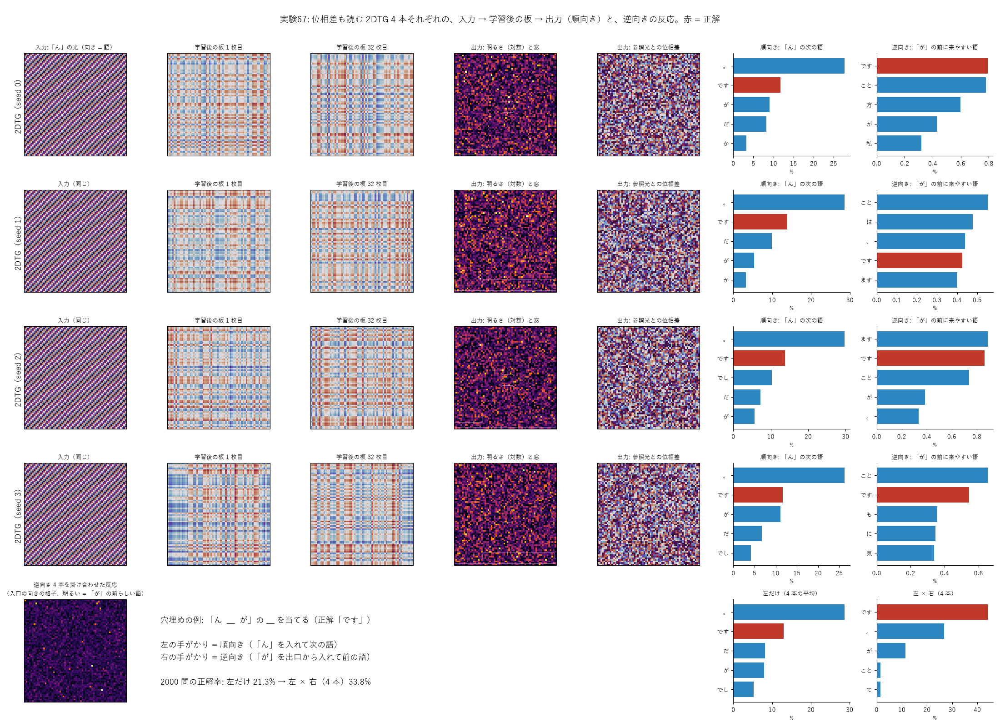

*4 本の 2DTG（位相差も読む光路、seed 0〜3）それぞれの、入力（語「ん」の光）→ 学習後の板 1・32 枚目 → 出口の明るさと参照光との位相差 → 順向きの「ん」の次の語、と逆向きの「が」の前に来やすい語（tools/fig_exp67.py）。下の段: 4 本の逆向きを掛け合わせた反応（入口の向きの格子）と、穴埋め「ん ＿ が」で左だけ（「。」と誤答）と左 × 右（「です」と正解）。*

- **同じ種類の光路を 4 本合わせると、ぼんやりが固まる（7.1 → 9.6）。逆向きで候補を絞り、50 語だけ順向きで確かめると 10.6 で、全部の語を順向きに通す方法（12.2）に、80 分の 1 の計算で近づく。**
- **穴埋めでは、逆向きの手がかりを掛け合わせると、左の手がかりだけの 21.3% から 33.8% に上がる（+12.5 点）。** 右側（後ろの語）の情報を、別に学習せず、同じ光路を逆に通すだけで使えた。
- 条件: 答えを位相まで持つ（参照光との干渉で読む）こと（実験65）。

## 実験68: 「その他」に光が集まる問題（持ち主の依頼） (exp68_other.py、sweeps/sweep68.sh、図 docs/images/exp68_other.png)

単語の課題（直前 2 語、訓練は全部）、1 段目は分担の 2DTG（16 個 × 板 8 枚、頻出 1023 語 + その他）。語彙 2048 の物差しで測る。seed 0・1。
1 次元（Sin-CNN2）では、窓ごとの背景光で「その他が 36%」という偏りを表せるようにしただけで、根本的には解決していない（Sin-CNN2 実験06b・43）。

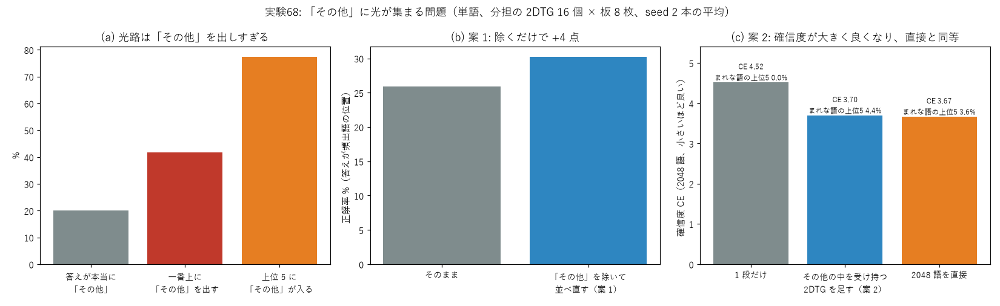

案 1（「その他」を除いて並べ直す、目安）:
| | seed 0 | seed 1 |
|---|---|---|
| 答えが本当に「その他」 | 19.7% | 20.3% |
| 光路が一番上に「その他」を出す | 41.2% | 42.3% |
| 上位 5 に「その他」が入る | 77.1% | 77.5% |
| 答えが頻出語の位置での正解率: そのまま → 除いて並べ直す | 26.1 → **30.1** | 25.7 → **30.3** |
| 同じく上位 5 | 58.4 | 58.0 |

案 2（「その他」の中を受け持つ 2DTG を足す。2 段目 = 答えが「その他」の文脈だけで学ぶ分担の 2DTG、次の頻出 1023 語 + まだその他）:
| 方式（語彙 2048 の物差し） | 正解率 | CE | まれな語（順位 1024〜2046）の正解率 / 上位 5 |
|---|---|---|---|
| 1 段だけ | 32.4 | 4.52 | 0 / 0 |
| **2 段（1 段目の P(その他) × 2 段目）** | 31.8 | **3.70** | 1.0 / 4.4 |
| 2048 語を直接当てる分担の 2DTG（seed 0） | 32.0 | 3.67 | 1.4 / 3.6 |

- **光路は「その他」を答えの割合（20%）の 2 倍、41% で一番に出す。** 自信がない場面で「その他」に逃げる。**除いて並べ直すだけで、頻出語の位置の正解率が +4 点（26 → 30%）**。表示や文の生成では、まず除くのが良い。
- 2 段にすると、確信度が大きく良くなり（CE 4.52 → 3.70）、2048 語を直接当てるのと同じになる。まれな語そのものは、まだほとんど当たらない（上位 5 で 4%）。まれな語は訓練に少ししか出ないため。
- 2 段の良い所は、1 段目を学び直さずに、語彙を後から足せること（融合と同じ形）。

## 実験69: サブワード（SentencePiece、その他なし）で比べる (exp69_subword.py・exp58_split.py --task sp、spdata.py、sweeps/sweep69.sh)

持ち主の判断（2026-10-22）: 「その他」をなくすため、LLM と同じ割り当て方（SentencePiece 0.2.2、Apache 2.0、unigram、byte_fallback）を流用する。
訓練の文書だけで学習。語彙 1024 は作れない（文字の網羅率を 0.98 より下げられず、このデータでは文字とバイトで 1376 単位が要る）。
語彙 2048: 網羅率 0.995、1 単位 1.20 字、バイトに分かれる単位 2.7%。語彙 4096: 網羅率 0.9995、1 単位 1.59 字、1.3%（「ありがとうございます」「明日」「天気」が 1 単位）。
直前 4 単位 → 次の 1 単位（V クラス）、訓練は全部（語彙 2048 で 44 万件、4096 で 34 万件）、seed 0。

| 語彙 | 方式 | 正解率 | CE | 1 文字あたりの CE | 上位 5 | 学習する数 | 学習の時間 |
|---|---|---|---|---|---|---|---|
| 2048 | 2-gram / 3-gram / 4-gram | 16.5 / **24.9** / 25.3 | | 3.87 / 4.35 / 4.64 | | 表 | |
| 2048 | GRU | 22.8 | 4.26 | **3.54** | 44.6 | 63 万 | 5 秒 |
| 2048 | 光路 1 本（板 128、窓 128 の符号） | 15.2 | 4.80 | 3.99 | 35.3 | 33 万 | 868 秒 |
| 2048 | **分担の 2DTG（16 × 板 8、直前 4 単位）** | **22.9** | 4.40 | 3.67 | 43.9 | 426 万 | 1099 秒 |
| 4096 | 2-gram / 3-gram / 4-gram | 15.2 / **18.8** / 18.8 | | 3.75 / 4.19 / 4.25 | | 表 | |
| 4096 | GRU | 16.7 | 5.42 | **3.42** | 32.7 | 115 万 | 5 秒 |
| 4096 | 光路 1 本 | 11.9 | 6.00 | 3.79 | 24.8 | 59 万 | 865 秒 |
| 4096 | 分担の 2DTG | 15.8 | 5.78 | 3.64 | 29.9 | 846 万 | 1111 秒 |

- **その他をなくした課題でも、分担の 2DTG は GRU とほぼ同じ正解率（語彙 2048 で 22.9 対 22.8%）で、光路 1 本より 7 点良い。** 確信度は GRU がまだ良い（1 文字あたり 3.54 対 3.67）。
- 正解率が下がったのは、当てやすい「その他」（単語で 20%）がなくなり、全部の単位を本当に当てる課題になったため。データが小さいので、数えた表の 3-gram が正解率では一番良い。
- 語彙を大きくすると、1 単位が長くなり当てにくくなる（正解率は下がる）が、1 文字あたりの確信度は少し良くなる。

### 「その他」の中身（持ち主の問い、単語、頻出 1023 語の外 = 訓練の 17.9%）
品詞: 名詞 67%（普通名詞 61%、固有名詞 4.5%、数詞 1.9%）、動詞 19%、副詞 3%、形容詞 3%、形状詞 2%、助詞 0.6%。
「が」「と」「な」などの助詞はよく出るので頻出語の側にある（その他に落ちた助詞は「なぁ・ぐらい・ずつ・にて・すら」程度）。
固有名詞の例: 名古屋・大阪・北海道・愛知・宮崎・カンボジア・滝沢・武田・スミス・ツイッター・ヴィトン・ホンダ・昭和・平成。
→ その他は、ほとんどが内容を表すまれな語。文の骨組み（助詞・よく出る動詞）は頻出語の側。

## 実験70: デジタルの重みを減らしても分担の 2DTG の精度を保てるか (exp58_split.py --K --reject --assign、sweeps/sweep70.sh・resume70_71.sh、図 docs/images/exp70_71.png)

持ち主の判断（2026-10-22）: 精度の天井は近いので、同じ精度をどれだけ軽く作れるかを測る。符号の窓を 256 → 32、担当なしの学習をやめて直前の語で担当を決め打ち（route、ハードでは「どの光路を照らすか」のスイッチ）、頻度に合わせた分担（よく出る語は専用の 2DTG）。訓練は全部、seed 0。

| 課題 | 方式 | 正解率 | CE | デジタルの数 | 学習する数 | 学習の時間 |
|---|---|---|---|---|---|---|
| 単語 | 分担 16 × 8、窓 256（実験58） | 36.0 | 3.19 | 420 万 | 427 万 | 1483 秒 |
| 単語 | 分担 16 × 8、窓 32 | 34.6 | 3.26 | 52 万 | 59 万 | 1047 秒 |
| 単語 | **分担 16 × 8、窓 32、担当の決め打ち** | **35.7** | **3.24** | **52 万** | **59 万** | 1340 秒 |
| 単語 | 頻度の分担 64（専用 48）× 2、窓 32、決め打ち / 担当なし | 34.9 / 32.3 | 3.40 / 3.52 | 210 万 | 217 万 | 2091 秒 |
| 単語 | 頻度の分担 16（専用 12）× 8、窓 32、決め打ち | 33.4 | 3.38 | 52 万 | 59 万 | 1482 秒 |
| 単語 | 比べる: GRU（実験57） | 36.9 | 3.04 | 76 万 | 76 万 | 8 秒 |
| 文字 | 分担 16 × 8、窓 256、直前 4 文字（実験62） | 54.0 | 1.74 | 27 万 | 34 万 | 1109 秒 |
| 文字 | 分担 16 × 8、窓 32 | 53.0 | 1.81 | 3.3 万 | 9.9 万 | 1463 秒 |
| 文字 | **分担 16 × 8、窓 32、担当の決め打ち** | **53.3** | **1.78** | **3.3 万** | **9.9 万** | 1475 秒 |
| 文字 | 頻度の分担 64（専用 48）× 2、窓 32、決め打ち | 53.5 | 1.78 | 13 万 | 20 万 | 2280 秒 |
| 文字 | 比べる: GRU（実験49） | 53.3〜54.1 | 1.75〜1.80 | 17 万 | 17 万 | 7〜46 秒 |

- **窓を 256 → 32 にして、担当を直前の語で決め打ちにすると、デジタルの重みが 1/8 になっても精度はほぼ保たれる（単語 36.0 → 35.7、文字 54.0 → 53.3）。** 学習する数は単語で GRU の 0.8 倍、文字で 0.6 倍になり、精度は GRU にほぼ並ぶ。
- 決め打ちにすると、担当なしの学習が要らず、その分を担当の答えだけに使えるので、窓が少なくても良い。足すだけの融合（add）は担当外を見分けられず悪化する（26〜36%）ので、決め打ちのときは route で読む。
- 頻度に合わせた分担（よく出る語は専用）は、余りで分ける分担より良くならなかった（単語 34.9・33.4、文字 53.5）。

## 実験71: 2DWIG（2D Who am I Grain、持ち主の案）— 会話文から話者の一人称を当てる (exp71_wig.py、aozoradata.py、sweeps/sweep71.sh、図 docs/images/exp70_71.png)

データ: 青空文庫の著作権切れの小説 150 作品（持ち主の許可を得て取得、2026-10-22。公式の作品一覧から、作品・作者とも著作権フラグなし、分類 913、新字新仮名、17 作家。3.8MB、377 万字）。
「」の会話文 23,760 件のうち、一人称（MeCab で代名詞と判定）が 1 種類だけのもの 3,032 件に正解を付け、12 類にまとめる（私 894・僕 749・俺 685・わし 168・あたし 143・あっし 95・我々 76・わたくし 74・武士 62・おいら 47・わらわ 22・わちき 17）。
作品で訓練（2,570 件）とテスト（462 件、30 作品）を分ける。入力は一人称を「＊」で隠した会話文の末尾 12 文字。3 seed。

| 方式 | テスト | 訓練 | 学習する数 |
|---|---|---|---|
| いつも一番多い類（私） | 34.2 | | |
| **光の 2DWIG**（板 32 × 区画 16、1 類 1 窓） | **32.7 ± 1.3** | 99.9 | 1.6 万 |
| ロジスティック回帰（同じ入力） | 42.0 ± 0.6 | 97.2 | 7.4 万 |
| 数えた表のナイーブベイズ（語尾 1〜3 文字 + 文字の 2 つ組、会話文の全体） | **51.9** | | 表 |

類ごとの正解（光、seed 0）: 私 42%・僕 34%・俺 27%・わし 12%・あたし 12%、ほかの少ない類は 0%。

- **光の 2DWIG は訓練を 100% 覚えたが、テストは 32.7% で、いつも「私」と答えるのと同じ。訓練 2,570 件では少なすぎて覚えすぎた。** ロジスティック回帰も同じく覚えすぎ（訓練 97%、テスト 42%）。
- 数えた表（語尾と文字の組の袋）が一番良い（51.9%）。末尾 12 文字を位置ごとに並べるより、「どの語尾・言い回しが含まれるか」の袋の方が、話者を見分けやすいと考えられる。
- 次の一手: データを増やす（青空文庫を 1,000 作品程度に、持ち主の許可を得てから）、話者を変えた水増し（持ち主の案）、入力を位置ではなく語尾・言い回しの袋にする。

## 実験72: 2DWIG を 1,000 作品で学習し直す・話者を変えた水増し（持ち主の案） (exp71_wig.py --aug、aozora_aug.py、sweeps/sweep72.sh、図 docs/images/exp72_wig.png)

持ち主の判断（2026-10-23）: 1. 青空文庫を増やす → 2. 話者を変えた水増し → 増やした本物の会話文を手本に、不自然な水増しを捨てる。
1. 青空文庫を 1,000 作品に（持ち主の許可、公式の作品一覧から著作権切れ・分類 913・新字新仮名を無作為に、29.9MB、2,337 万字）。会話文 17.9 万件、一人称つき 2.3 万件（7.7 倍）。訓練 19,326 件・テスト 4,101 件（作品の 15% をテスト）。
2. 水増し（aozora_aug.py）: 一人称を目標の類の書き方に、文末（断定・説明・推量の 3 組）を目標の類が本物で使う言い方に置き換える（例: のだ → のじゃ、でしょう → でござろう）。
3. 除外: 本物で数えた文字の 5-gram で末尾 10 文字が本物の下位 10% より不自然なもの、「類と文末」の組が本物に 3 回未満のもの、文末を置き換えられないもの（一人称だけ変えると、隠した入力が元と同じで答えだけ違う雑音になる）を捨てる。
   候補 5.8 万件のうち採用 4,024 件（7%）。捨てた内訳: 文末が組の外 44,513、文末が同じ 5,431、末尾が不自然 3,707、組が本物にほぼない 303。

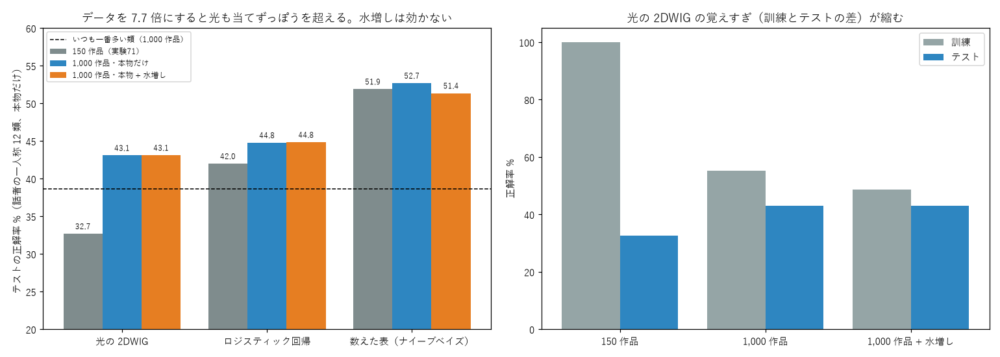

| 方式 | 150 作品（実験71） | 1,000 作品・本物だけ | 1,000 作品・本物 + 水増し |
|---|---|---|---|
| いつも一番多い類 | 34.2 | 38.6 | 38.6 |
| 光の 2DWIG（3 seed） | 32.7（訓練 100） | **43.1 ± 1.0**（訓練 55） | 43.1 ± 0.2（訓練 49） |
| ロジスティック回帰（3 seed） | 42.0 | 44.8 ± 0.1 | 44.8 ± 0.2 |
| 数えた表（ナイーブベイズ、語尾と文字の 2 つ組の袋） | 51.9 | **52.7** | 51.4 |

類ごとの正解（光、本物だけ、seed 0）: 私 70%・俺 44%・僕 32%・わし 11%・武士 10%・あたし 8%、ほかの少ない類はほぼ 0%。

- **データを 7.7 倍にすると、光の 2DWIG の覚えすぎがほぼ消え（訓練 100 → 55%）、当てずっぽう（38.6%）を超えた（43.1%）。** ロジスティック回帰（44.8%）にほぼ並ぶ。
- **話者を変えた水増しは効かなかった**（光・回帰は同じ、数えた表は 52.7 → 51.4%）。置き換えるのは文末だけで、文の途中の口調（例: 武士なのに「おめえ」）は元の話者のまま残り、答えと中身が食い違う例になるため。水増しを効かせるには、文の途中の言い回し（呼び方・敬語）も置き換える必要がある。
- 一番良いのは、まだ数えた表（語尾・言い回しの袋、52.7%）。末尾 12 文字を位置ごとに並べる入れ方より、袋の方が話者を見分けやすい。少ない類（あっし・我々・おいら など）は、どの方式でもほとんど当たらない。

## 実験73: 光の非線形をもっと掘る（持ち主の依頼） (experiments/exp73_nl.py、nl_parts.py、experiments/sweeps_exp73.sh、図 docs/images/exp73_curves.png・exp73_results.png・exp73_io_fold.png)

持ち主の依頼（2026-10-23）: 実験28 の非線形（4f 系 2 段で AUC 89 / 82 → 97 / 97）をもっと掘る。今はソフトウェアの処理だけで考え、ハードの都合で幅を狭めない。
方法: 板 ① を段に分け、段の間に非線形。**1 段の板の枚数は減らさない**（実験36 では段に分けると 1 段の板が減っていた）。非線形 11 通り（nl_parts.KINDS）:
平方根・2 乗・対数・べき（学習）・可飽和（学習）・しきい値（学習）・カー効果（位相を明るさで遅らせる、学習）・位相を残す可飽和（学習）・
しきい値以下を折り返す |I − t|（持ち主の案）・しきい値以下を反転して位相 π（I − t、持ち主の案）。3000 ステップ、seed 0。

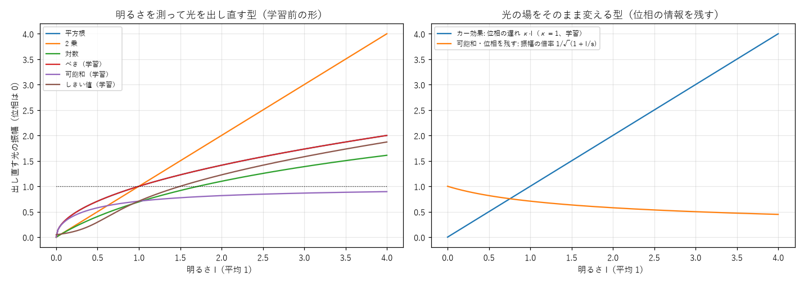
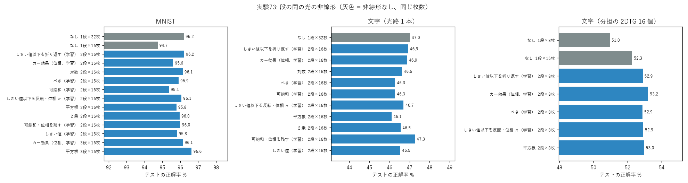

| 課題 | 非線形なし | 非線形あり（同じ板の合計） | 一番良い形 |
|---|---|---|---|
| MNIST（板 32 枚） | 96.2（1 段 × 32） | 95.4〜96.2（2 段 × 16） | 折り返し 96.2、対数・反転 96.1 |
| MNIST（板 48 枚） | | 平方根 96.6・カー 96.1（3 段 × 16） | |
| 文字・光路 1 本（板 32 枚、訓練は全部） | 47.0 | 46.1〜47.3（2 段 × 16） | 位相を残す可飽和 47.3、カー・折り返し 46.9 |
| 文字・分担の 2DTG 16 個（各 16 枚、直前 4 文字、窓 = 64、担当の決め打ち） | 52.3（CE 1.85） | **52.9〜53.2**（2 段 × 8、CE 1.83〜1.87） | **カー 53.2**、平方根 53.0、折り返し・反転・べき 52.9 |
| 参考: 分担の 2DTG 16 × 8 枚 1 段 | 51.0 | | |

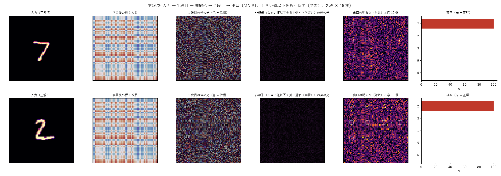

- **板の枚数をそろえると、非線形はほとんど差を生まない。** MNIST・文字の光路 1 本では、非線形あり・なしの差は ±0.8 点以内。実験36 の「非線形で悪化」は、1 段の板が減ったためだった。
- **表を分担した小さな 2DTG の中では、非線形が少し効く（+0.6〜0.9 点、52.3 → 52.9〜53.2%）。** 1 つの 2DTG が受け持つ表が小さいので、組み合わせを表す非線形が役に立つ余地がある、という見立てと合う。一番良いのはカー効果（位相の情報を捨てない非線形）。
- 学んだ非線形の数: カー κ = 0.80、べき γ = 0.94（ほぼ線形の明るさ）、折り返し t = 0.70、反転 t = 0.58。平方根は学習する数なし。
- 実験28（位置の検出、4f 系）で大きく効いた理由は、線形の段をいくら重ねても 1 枚の板と同じになる 4f 系の性質による（板と回折を重ねる今の形は、線形でも段を重ねるほど表現が増える）と考えられる。
- 次の一手: 分担の 2DTG + カー効果を seed を増やして確かめる。単語の課題・2DWIG にも入れる。

## 実験74: 分担の 2DTG + 非線形を seed 1・2 で確かめる (experiments/sweeps_exp74.sh、図 docs/images/exp74_split_nl.png)

実験73 の「分担の 2DTG の中では非線形が +0.6〜0.9 点」（seed 0）を、seed 1・2 を足して 3 seed で確かめる。文字、直前 4 文字、2DTG 16 個（担当の決め打ち、窓 = 64）、板の合計は 16 枚。

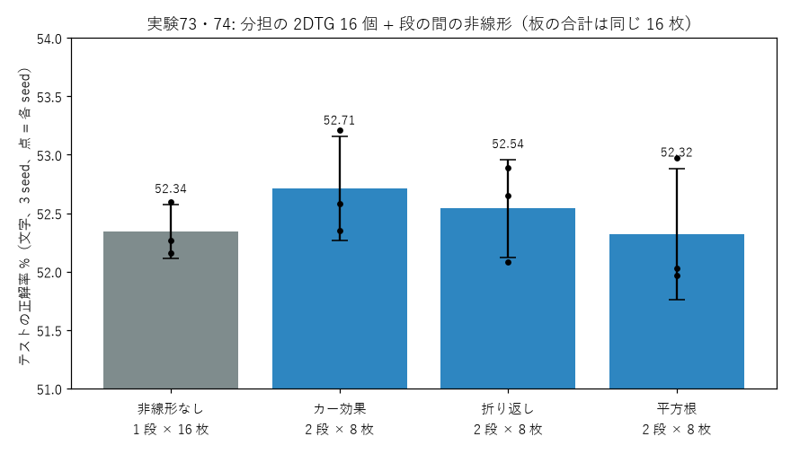

| 方式 | seed 0 / 1 / 2 | 平均 ± ばらつき | CE |
|---|---|---|---|
| 非線形なし（1 段 × 16 枚） | 52.3 / 52.6 / 52.2 | 52.34 ± 0.23 | 1.857 |
| **カー効果（2 段 × 8 枚）** | 53.2 / 52.4 / 52.6 | **52.71 ± 0.45** | **1.845** |
| 折り返し（2 段 × 8 枚） | 52.9 / 52.6 / 52.1 | 52.54 ± 0.42 | 1.850 |
| 平方根（2 段 × 8 枚） | 53.0 / 52.0 / 52.0 | 52.32 ± 0.56 | 1.880 |

- **訂正（実験73 の書き方）: 3 seed にすると、非線形の上乗せは +0.6〜0.9 点ではなく、カー効果で +0.4 点、折り返しで +0.2 点、平方根で 0 点。** seed 0 がたまたま良かった。ばらつき（± 0.2〜0.6）と同じくらいの差。
- 一番良いのは引き続きカー効果（位相の情報を捨てない非線形）で、確信度（CE）も少し良い。ただし差は小さい。
- 実験73・74 のまとめ: 板と回折を重ねる光路では、段の間の非線形はほとんど効かない（板の枚数をそろえれば ±0.4 点）。光の非線形が大きく効くのは、線形の段を重ねても 1 枚と同じになる 4f 系（実験28）のような形。

## 実験75: 4f 系を多段にして、間に光の非線形を入れて分類する（光の CNN、持ち主の依頼） (experiments/exp75_4f.py、experiments/sweeps_exp75.sh、図 docs/images/exp75_4f.png)

4f 系（レンズ → 周波数の面の板 → レンズ = 入力と模様の畳み込み）を 4 本並べて出口を複素数の重みで足し、それを段にして、段の間に光の非線形（nl_parts）を入れた。
最後はレンズの後の明るさ（平行移動で変わらない）か、出口の面の明るさを窓で読む。3000 ステップ、seed 0、1 本 35〜75 秒。
形の課題（位置がでたらめ、8 クラス）と MNIST。実験75 は止めて回し直したので results/exp75.txt に同じ条件が重なる。同じ条件は最後の値を使う。

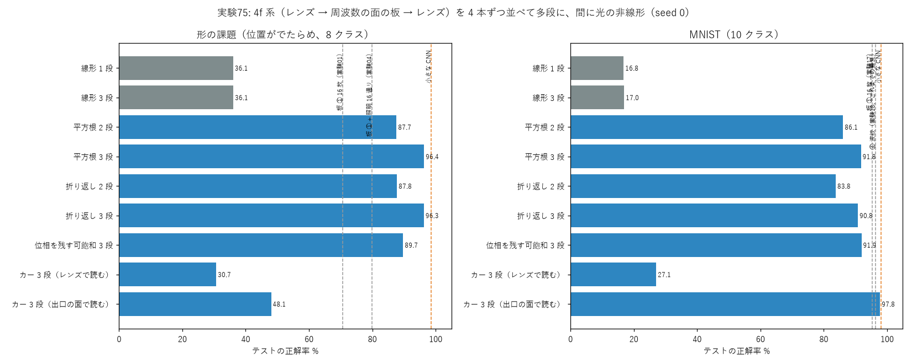

| 方式（幅 4 本） | 形の課題 | MNIST |
|---|---|---|
| 線形 1 段 / 3 段（レンズで読む） | 36.1 / 36.1 | 16.8 / 17.0 |
| 平方根 2 段 / 3 段 | 87.7 / **96.4** | 86.1 / 91.8（訓練 99.6） |
| 折り返し 2 段 / 3 段 | 87.8 / **96.3** | 83.8 / 90.8 |
| 位相を残す可飽和 2 段 / 3 段 | 81.6 / 89.7 | 86.5 / 91.9 |
| カー 2 段 / 3 段（レンズで読む） | 29.2 / 30.7 | 35.6 / 27.1 |
| **カー 3 段（出口の面で読む）** | 48.1 | **97.8**（訓練 100） |
| カー 3 段 × 幅 8 / 4 段 × 幅 4（レンズ） | 18.1 / 27.1 | 25.7 / 11.3 |
| 参考: 板 ① 16 枚 | 70.6（実験01）、照明 16 通り 79.9（実験04） | 95.3（実験17）、④ 波紋 96.3（実験18） |
| 参考: 小さな CNN | 98.6 | 98.1 |

- **4f 系 3 段 + 明るさを測る非線形（平方根・折り返し）で、形の課題が 70.6 → 96.4%（CNN 98.6% に 2.2 点差）。** これまで光路の弱点だった「位置がずれても同じ形と分かる」力が、畳み込み + 非線形でほぼ CNN 並みになった。2 段より 3 段が 8〜9 点良い。
- **線形の 4f 系は何段でも同じ（36.1%・17%）。** レンズで読む明るさは平行移動で変わらない代わりに、線形のままだと周波数ごとの強さしか残らず、MNIST はほぼ当て推量。非線形が要る、という実験28 の見立てどおり。
- **カー効果（明るさで位相を遅らせるだけ）は、レンズで読むと失敗（27〜36%）、出口の面で読むと MNIST 97.8%**（これまでの SinWave の最良 96.3% を超え、CNN 98.1% に 0.3 点差）。カー効果は明るさを変えないので、最後に周波数ごとの強さだけ読むと効きが見えない。出口の面で読むと位置の情報も使えるが、そのぶん形の課題（位置がでたらめ）は 48.1% と弱い。
- カーは幅や段を増やすと悪くなった（レンズで読む場合）。学習が不安定になっている見込み（未確認）。
- 次の一手: カー × 出口の面で読むものの seed を足す。平方根 3 段も出口の面で読んでみる（MNIST が上がるか）。言語の入力を面全体に広げて 4f 系 + 非線形に通す（持ち主と相談済みの「広げる実験」）。カー効果は逆にたどれる非線形なので、逆向きの連想が残るかも確かめる。

## 実験76: 実験75 を seed 0〜2 で確かめる・読み方を全部の非線形でそろえる (experiments/sweeps_exp76.sh、tools/fig_exp76.py、図 docs/images/exp76_4f_seeds.png)

実験75 と同じ形（4f 系 × 幅 4、3000 ステップ）。seed 0〜2（形の課題は seed ごとにデータも作り直す）。60 本、1 時間。結果 results/exp76.txt。

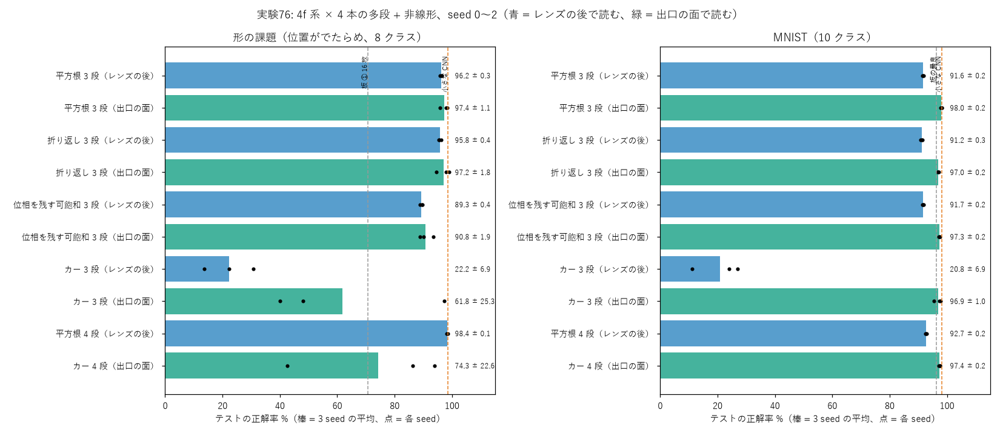

| 方式 | 形の課題（平均 ± ばらつき） | MNIST |
|---|---|---|
| 平方根 3 段（レンズの後 / 出口の面） | 96.2 ± 0.3 / 97.4 ± 1.1 | 91.6 ± 0.2 / **98.0 ± 0.2**（訓練 100） |
| 折り返し 3 段 | 95.8 ± 0.4 / 97.2 ± 1.8 | 91.2 ± 0.3 / 97.0 ± 0.2 |
| 位相を残す可飽和 3 段 | 89.3 ± 0.4 / 90.8 ± 1.9 | 91.7 ± 0.2 / 97.3 ± 0.2 |
| カー 3 段 | 22.2 ± 6.9 / 61.8 ± 25.3（40.0〜97.2） | 20.8 ± 6.9 / 96.9 ± 1.0 |
| **平方根 4 段（レンズの後）** | **98.4 ± 0.1** | 92.7 ± 0.2 |
| カー 4 段（出口の面） | 74.3 ± 22.6 | 97.4 ± 0.2 |
| 参考: 板の最良 / 小さな CNN | 70.6（実験01） / 98.6 | 96.3（実験18） / 98.1 |

- **平方根（明るさを測って出し直す）が一番安定して強い。** MNIST は出口の面で読むと 98.0 ± 0.2%（小さな CNN 98.1%）。形の課題は 4 段・レンズの後で 98.4 ± 0.1%（CNN 98.6%）。どちらも 3 seed で CNN とほぼ同じ。
- **訂正（実験75 の書き方）: MNIST の最良はカー効果ではなく平方根だった。** カー 3 段 × 出口の面は 96.9 ± 1.0%（seed 0 の 97.8% はよい方に振れた値）。カーは seed によって大きくばらつき（形の課題で 40〜97%）、学習が不安定。
- 読み方の使い分け: 形の課題（位置がでたらめ）はどちらでも 96〜97%、MNIST（真ん中にある）は出口の面で読む方が 6 点良い。位置の情報が使える課題では出口の面が良い。
- カー × レンズの後で読むものは、形の課題で訓練 97% なのにテスト 22%（覚えるだけになる）、MNIST では訓練も 22%。「明るさを変えないので見えない」という実験75 の説明だけでは足りない（未解明）。
- 段を増やすと良くなる（平方根: 3 段 → 4 段で形の課題 +2.2、MNIST +1.1）。
- 残っている批判（持ち主への報告 2026-10-25）: 重みの数（約 10 万）や大きさを CNN とそろえていない、平方根は実機では段ごとにカメラと光変調器が要る、板の位相の段数・位置のずれ・検出器の雑音への強さを測っていない。

## 実験77: うまくいかない理由を探る — カー効果はなぜ不安定か、平方根はなぜ効くか（持ち主の依頼「失敗に成功の理由があるかも」） (experiments/sweeps_exp77.sh、nl_parts.py の kerrn・phfrac、tools/fig_exp77.py、図 docs/images/exp77_why.png)

4f 系 3 段 × 4 本、seed 0〜2、132 本（2 時間 15 分）。exp75_4f.py に足したもの: 非線形の数の固定（--fix_p）、勾配の上限（--clip）、
入力を 2 画素ずらしたときの正解率（acc_shift2）、入力に 1000 分の 1 の雑音を足したときの出口の明るさの近さ（cos_noise）、勾配の大きさ。
新しい非線形: kerrn（位相の遅れを いちばん明るい点で κ に抑えたカー効果）、phfrac（振幅はそのまま、位相を p 倍に縮める。p = 0 は平方根と同じ、p = 1 は線形）。

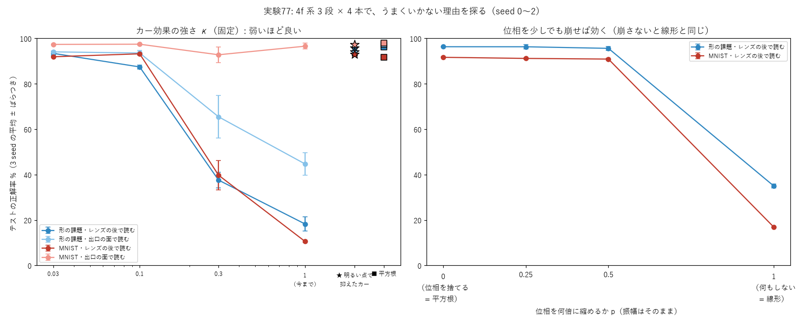

| 方式（3 seed の平均） | 形・レンズの後 | 形・出口の面 | MNIST・レンズの後 | MNIST・出口の面 |
|---|---|---|---|---|
| カー κ = 0.03（固定） | 93.4 | 94.1 | 91.9 | 97.4 |
| カー κ = 0.1 | 87.4 | 93.6 | **93.2** | 97.4 |
| カー κ = 0.3 | 37.6 | 65.5 | 39.8 | 92.8 |
| カー κ = 1 | 18.3 | 44.7 | 10.6 | 96.6 |
| カー（κ を学習、実験76 と同じ） / + 勾配の上限 | 22.2 / 22.0 | 61.8 / 65.0 | 20.8 / 35.6 | 96.9 / 97.1 |
| 明るい点で抑えたカー（kerrn） | 95.9 | 94.1 | 93.0 | 97.3 |
| 位相を縮める p = 0 / 0.25 / 0.5 / 1 | 96.3 / 96.3 / 95.6 / 35.0 | | 91.7 / 91.2 / 90.9 / 16.9 | |
| 平方根 | 96.2 | **97.4** | 91.6 | **98.0** |

入力を 2 画素ずらしたとき（acc_shift2）: レンズの後で読むものは変わらない（作りの上でずれに強い）。出口の面で読むものは MNIST 98.0 → 68.6%（平方根）、形の課題 97.4 → 89.1%。

- **カー効果の失敗の理由は「強すぎる」こと。** 4f 系の後は光が一部の点に集まり、明るさが平均の何十倍にもなる。κ = 1 だとそこで位相が何周も回り、ごく小さな違いが大きく増える（雑音 1000 分の 1 で出口の近さ 0.71、平方根は 1.00）。κ を 0.03〜0.1 に弱めるか、いちばん明るい点で抑える（kerrn）と、平方根と同じくらいになる。MNIST・レンズの後では κ = 0.1 が 93.2% で平方根（91.6%）より良い。
- **学習で κ は弱くならない**（κ は 0.8〜1.2 のまま。実験76）。勾配の上限を付けても直らない。初めから弱くしておく必要がある。
- **平方根が効く理由は「位相を崩すこと」**（平方根の振幅 √I は |u| と同じなので、平方根 = 位相を捨てるだけ）。位相を 0.5 倍に縮めるだけでもほぼ同じ効き、1 倍（崩さない）だと線形と同じ。明るさを変える必要はない。
- 実機につながる見方: 位相だけを変える非線形（カー効果）でも、弱ければ使える。必要な位相の遅れは 0.1 rad 程度で済む。
- 出口の面で読む方式は、入力が 2 画素ずれると大きく落ちる（持ち主の心配「わずかなズレ」）。ずれに強くしたいならレンズの後で読むか、ずらした絵で学習する。

## 実験78: 言語の入力を面に広げて、4f 系の多段 + 平方根に通す（持ち主と決めた「平方根 + レンズの後で読む」） (experiments/text/exp78_text4f.py、sweeps/sweep78.sh、tools/fig_exp78.py、図 docs/images/exp78_text4f.png)

文字（直前 8 文字 → 次の文字 64 クラス、訓練は全部）。入れ方は実験40 の EncNet.field、中身は exp75_4f.Multi4f（幅 4）。光路 1 本、3 seed、1 本 約 70 秒。

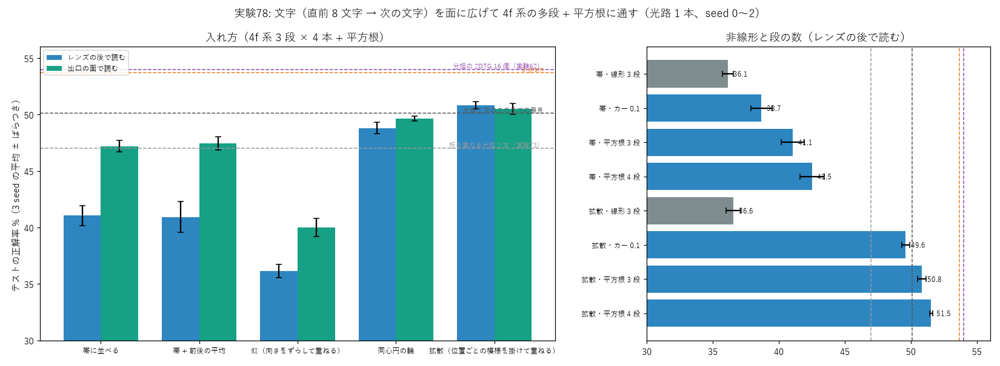

| 入れ方（4f 系 3 段 + 平方根） | レンズの後で読む | 出口の面で読む |
|---|---|---|
| 帯に並べる | 41.1 ± 0.9 | 47.2 ± 0.5 |
| 帯 + 前後の平均 | 40.9 ± 1.4 | 47.5 ± 0.6 |
| 虹（向きをずらして重ねる） | 36.2 ± 0.6 | 40.0 ± 0.8 |
| 同心円の輪 | 48.8 ± 0.5 | 49.6 ± 0.2 |
| **拡散（位置ごとの模様を掛けて重ねる）** | **50.8 ± 0.3** | 50.5 ± 0.5 |
| 拡散・4 段 | **51.5 ± 0.1**（CE 1.95） | |
| 拡散・線形 3 段 / カー 0.1 | 36.6 / 49.6 | |
| 参考: 板を重ねる光路 1 本 / 光路 1 本のこれまでの最良 / 分担の 2DTG 16 個 / 3-gram | 47.0（実験73）/ 50.1 / 54.0（実験62）/ 53.7 | |

- **面全体に広げる入れ方（拡散）が、4f 系 + 平方根と組むと効く。** 板を重ねる形では入れ方で差がなかった（46〜47%、実験40）が、4f 系では帯 41% に対して拡散 51%。光路 1 本で 51.5%（4 段）は、光路 1 本のこれまでの最良 50.1% を超えた。分担の 2DTG 16 個（54.0%）・3-gram（53.7%）には 2.5 点届かない。
- 持ち主の問い「非線形とセットの広げる実験は必要か」の答え: 必要だった。線形では拡散でも 36.6%、平方根で 50.8%。
- レンズの後で読む場合、帯（位置で場所が決まる入れ方）は弱い（41%）。レンズの後の明るさは場所を捨てるので、位置を場所で表すと失われる。位置を模様（拡散）や輪の形で表すと失われない。
- 訓練とテストがほぼ同じ（52.8 対 51.5）で、まだ覚えきれていない。段・幅・ステップを増やす余地がある（実験79）。

## 実験79: 拡散 + 4f 系 + 平方根を大きくする（段・幅・ステップ） (experiments/text/sweeps/sweep79.sh、tools/fig_exp79.py、図 docs/images/exp79_scale.png)

実験78 の最良（拡散、レンズの後で読む）は訓練 ≒ テストで、まだ覚えきれていなかった。3 seed。

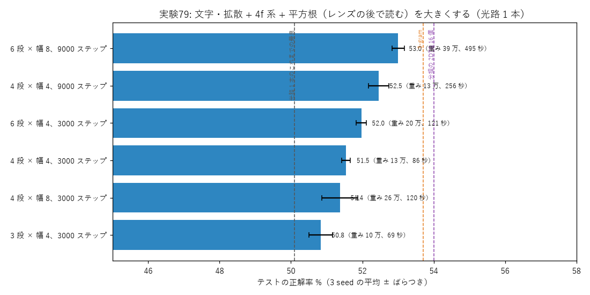

| 段 × 幅、ステップ | テスト（3 seed） | CE | 訓練 | 重み | 時間 |
|---|---|---|---|---|---|
| 3 × 4、3000（実験78） | 50.8 ± 0.3 | 1.97 | 52.4 | 9.8 万 | 69 秒 |
| 4 × 4、3000（実験78） | 51.5 ± 0.1 | 1.95 | 52.8 | 13 万 | 86 秒 |
| 4 × 8、3000 | 51.4 ± 0.5 | 1.95 | 52.8 | 26 万 | 120 秒 |
| 6 × 4、3000 | 52.0 ± 0.1 | 1.93 | 53.5 | 20 万 | 121 秒 |
| 4 × 4、9000 | 52.5 ± 0.3 | 1.87 | 54.5 | 13 万 | 256 秒 |
| **6 × 8、9000** | **53.0 ± 0.2** | **1.84** | 55.5 | 39 万 | 495 秒 |
| 参考: 3-gram / GRU / 分担の 2DTG 16 個（実験62） | 53.7 / 53.3〜54.1 / 54.0 | 1.78 / / 1.74 | | | |

- 段を増やす・長く学ぶほど伸びる。幅だけ増やしても伸びない。光路 1 本で 53.0%（3-gram に 0.7 点差）。
- 訓練 55.5% に対してテスト 53.0% と、差が開き始めた。データの天井（4-gram 55.4%）に近づいている。
- 次の一手: 分担の 2DTG の中身をこの形に替える（表の分担 + 畳み込み・非線形）。

## 実験80: 分担の 2DTG の中身を 4f 系 + 平方根に替える (experiments/text/exp80_split4f.py、sweeps/sweep80.sh)

直前の文字の余りで担当を決め打ち、各 2DTG = 拡散 + 4f 系 + 平方根（レンズの後で読む）。seed 0（8 本の予定を 5 本で止めた。残りは見込みの低い形の seed 違い）。

| 形 | テスト | CE | 訓練 | 重み |
|---|---|---|---|---|
| 担当 16・直前 8 文字・4 段 / seed 1 | 49.8 / 49.7 | 2.86 / 2.78 | 78.9 / 76.9 | 210 万 |
| 担当 16・直前 8 文字・6 段 | 48.7 | 3.42 | 84.5 | 315 万 |
| 担当 16・直前 4 文字・4 段 | 52.7 | 2.42 | 73.5 | 210 万 |
| 担当 8・直前 8 文字・4 段・6000 ステップ | 53.2 | 1.98 | 67.5 | 105 万 |

- **4f 系の 2DTG は覚えすぎる**（訓練 79% 対テスト 50%）。4f 系は 1 つで表現力が十分あるので、細かく分けるとそれぞれが少ないデータを丸暗記する。板の 2DTG（覚えきれない側）とは逆の性格。担当を減らすほど良い。

## 実験81: 覚えすぎを抑えた分担の 2DTG（4f 系）と、光路 1 本（4f 系）の確率の足し合わせ (experiments/text/exp81_fuse.py、sweeps/sweep81.sh、tools/fig_exp81.py、図 docs/images/exp81_fuse.png)

seed 0。足し合わせ: log p = Σ w_i log p_i、重みはテストの前半 5000 件の CE で選び、後半 5000 件で測る。対数確率は results/logits/（git に入れない）。

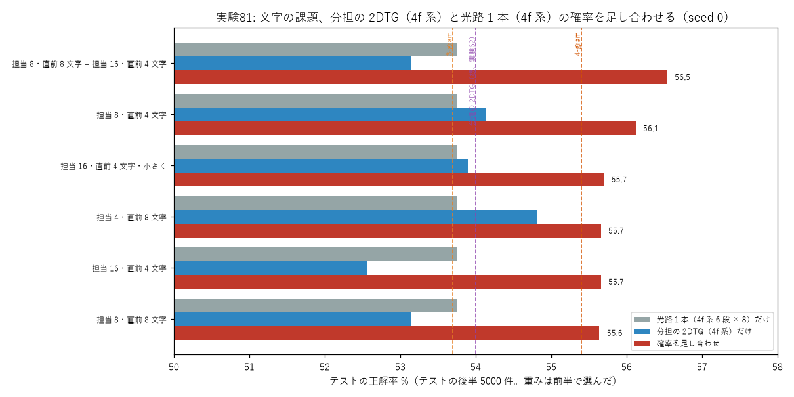

| 分担の 2DTG（4f 系） | 単独（テスト全部） | 訓練 | 光路 1 本と足し合わせ（後半、重み） |
|---|---|---|---|
| 担当 8・直前 8 文字・6000 ステップ | 53.2 | 67.5 | 55.6（0.65 : 0.35） |
| 担当 16・直前 4 文字 | 52.7 | 73.5 | 55.7（0.8 : 0.2） |
| **担当 4・直前 8 文字・9000 ステップ** | **54.5**（CE 1.79） | 61.5 | 55.7（0.45 : 0.55） |
| 担当 16・直前 4 文字・3 段・1500 ステップ | 53.7 | 66.1 | 55.7 |
| 担当 8・直前 4 文字・6000 ステップ | 54.0 | 67.1 | 56.1 |
| 担当 8・直前 8 文字 + 担当 16・直前 4 文字（3 つ） | | | **56.5**（CE 1.71、0.6 : 0.3 : 0.1） |
| 参考: 光路 1 本（6 段 × 8、9000 ステップ） | 53.2（後半 53.8） | 55.1 | |
| 参考: 分担の 2DTG（板、実験62） / 3-gram / 4-gram | 54.0 / 53.7 / 55.4 | | |

- **分担の 2DTG（4f 系）単独で 54.5%**（担当 4）。板の 2DTG の最良（54.0%）を超えた。
- **光路 1 本と足し合わせると 55.6〜56.5%。4-gram（55.4%）を超えた**（3 つの足し合わせで 56.5%、CE 1.71）。覚えすぎる 2DTG と覚えきれない光路 1 本は誤り方が違い、足すと打ち消し合う。
- 注意: seed 0 だけ。足し合わせはテストの後半（5000 件）での値で、4-gram はテスト全部の値。seed を足して確かめる（実験82 の予定）。

### 実験81 の測り直し（訂正、2026-10-25）
足し合わせの重みを前半で選んで後半で測る形だと、後半がたまたま易しかった（光路 1 本だけでも全部 53.2% に対して後半 53.8%）。
テストを 2 つに分け、前半で選んで後半で測る・後半で選んで前半で測るの平均（= テスト全部）で測り直した（exp81_fuse.py、results/exp82_fuse.txt）。seed 0。

| 足し合わせ | 単独（テスト全部） | 足し合わせ（テスト全部） | CE |
|---|---|---|---|
| 光路 1 本 + 担当 8・直前 8 文字 | 53.2 / 53.2 | 55.0 | 1.74 |
| 光路 1 本 + 担当 16・直前 4 文字 | 53.2 / 52.7 | 54.9 | 1.77 |
| 光路 1 本 + 担当 4・直前 8 文字 | 53.2 / 54.5 | 55.0 | 1.72 |
| 光路 1 本 + 担当 8・直前 4 文字 | 53.2 / 54.0 | 55.4 | 1.73 |
| **光路 1 本 + 担当 4・直前 8 文字 + 担当 8・直前 4 文字** | | **55.9** | **1.69** |

- **訂正: 2 つの足し合わせは 54.9〜55.4% で、4-gram（55.4%）と同じくらい。超えたのは 3 つの足し合わせ（55.9%）だけ。** seed 1・2 は実験82 で確かめる。
- 待ち行列は 2026-10-25 から GPU 0 で回す（GPU が 2 枚に。電力上限 150W になったので、時間は前と比べにくい）。GPU の予定は TmpFiles/GPU_QUEUE.md に書く。

## 実験82・83: 4f 系の足し合わせを seed 1・2 で確かめる・足し合わせの相手を増やす (sweeps/sweep82.sh・sweep83.sh、結果 results/exp82_*.txt・exp83_*.txt)

足し合わせはテスト全部（2 つに分けて入れ替え）で測る。実験82 は自前の待ち行列で GPU 0、実験83 は共通の待ち行列で GPU 1（34 分）。電力上限 150W。

| 方式 | seed 0 / 1 / 2 | 平均 ± ばらつき |
|---|---|---|
| 光路 1 本（拡散 + 4f 系 6 段 × 8、9000 ステップ） | 53.21 / 52.78 / 53.03 | 53.01 ± 0.18 |
| 分担の 2DTG（4f 系）担当 4・直前 8 文字 | 54.51 / 54.14 / 54.05 | 54.23 ± 0.20 |
| 分担の 2DTG（4f 系）担当 8・直前 4 文字 | 53.97 / 53.42 / 52.89 | 53.43 ± 0.44 |
| 光路 1 本 + 担当 4・直前 8 | 55.04 / 54.63 / 55.35 | 55.01 ± 0.30 |
| **光路 1 本 + 担当 4・直前 8 + 担当 8・直前 4（3 つ）** | 55.92 / 55.38 / 55.92 | **55.74 ± 0.25**（CE 1.70） |
| 4 つ（+ 担当 4・直前 4、seed 0 だけ） | 56.39 | （CE 1.67） |
| 参考: 分担の 2DTG（板、実験62） / 3-gram / 4-gram | 54.0 / 53.7 / 55.4 | |

実験83（seed 0）の単独: 担当 4・直前 4 文字 54.36%、担当 2・直前 8 文字 54.42%（訓練 58.3%）、光路 1 本を出口の面で読む 52.80%。光路 1 本どうし（レンズの後 + 出口の面）の足し合わせは 53.69% と伸びが小さい（似た誤り方）。

- **3 つの足し合わせは 3 seed で 55.74 ± 0.25%。4-gram（55.4%）を 0.3 点上回る。** 差はばらつきと同じくらい（seed 1 は 55.38% で 4-gram と同じ）。
- 分担の 2DTG（4f 系）単独は 54.2% で、板の 2DTG（54.0%）とほぼ同じ。
- 性格の違うもの（覚えすぎる 2DTG と覚えきれない光路 1 本、文脈の長さが違う 2DTG）を足すほど伸びる。同じ性格のものを足しても伸びない。
- 弱点: 3 つで重み約 500 万・学習約 1 時間（4-gram は数えるだけで数秒）。文字の種類が 64 と少なく、データが多い課題は数える方式の得意な土俵。

## 実験84: 単語の課題で、4f 系 + 平方根（光路 1 本・分担の 2DTG）と足し合わせ (experiments/text/exp84_word4f.py、sweeps/sweep84a.sh・84b.sh、tools/fig_exp84.py、図 docs/images/exp84_word4f.png)

直前 4 語 → 次の語（答え 1023 語 + その他）、訓練 40 万件、テスト 1 万件。拡散 + 4f 系 + 平方根（レンズの後で読む）、窓 256 個 → クラスの符号。seed 0。
共通の待ち行列で GPU 0（84a、9 分）と GPU 1（84b、64 分）に分けて同時に回した。

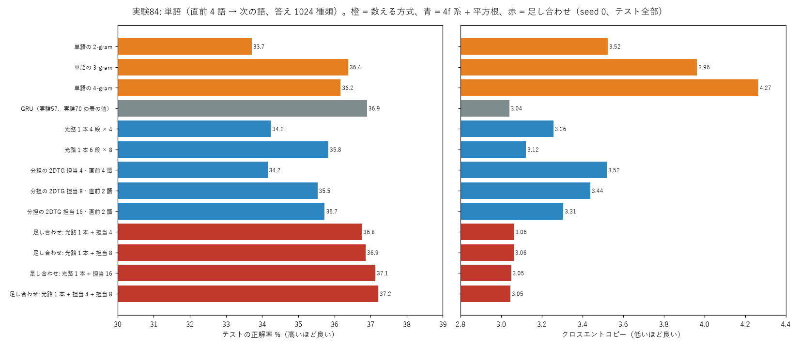

| 方式 | 正解率 | CE | 上位 5 | 訓練 | 重み（うち符号） |
|---|---|---|---|---|---|
| 単語の 2-gram / 3-gram / 4-gram（同じテスト） | 33.7 / **36.4** / 36.2 | 3.52 / 3.96 / 4.27 | 62.0 / 61.5 / 59.4 | | |
| GRU（実験57） | 36.9 | 3.04 | | | 76 万 |
| 光路 1 本 4 段 × 4、3000 ステップ | 34.2 | 3.26 | 61.3 | 34.8 | 39 万（26 万） |
| **光路 1 本 6 段 × 8、9000 ステップ** | 35.8 | **3.12** | 63.9 | 39.5 | 66 万（26 万） |
| 分担の 2DTG 担当 4・直前 4 語 | 34.2 | 3.52 | 62.1 | 50.0 | 157 万 |
| 分担の 2DTG 担当 8・直前 2 語 | 35.5 | 3.44 | 62.6 | 49.5 | 315 万 |
| 分担の 2DTG 担当 16・直前 2 語 | 35.7 | 3.31 | 63.5 | 51.2 | 629 万 |
| 足し合わせ: 光路 1 本 + 担当 16 | 37.1 | 3.05 | | | |
| **足し合わせ: 光路 1 本 + 担当 4 + 担当 8** | **37.2** | **3.05** | | | |
| 参考: 板の分担の 2DTG（実験58・62） | 36.0 | | | | |

- **単語では数える方式が苦手**: 4-gram は 3-gram より悪く（36.2 < 36.4）、CE は 4.27 と大きい（見たことのない組み合わせに弱い）。
- **光路 1 本（4f 系）は CE 3.12 で、3-gram（3.96）よりずっと良い**（確率の出し方が自然）。正解率は 35.8% で 3-gram に 0.6 点届かない。
- **足し合わせで 37.2%（CE 3.05）。3-gram（36.4%）・GRU（36.9%）・板の 2DTG（36.0%）を超えた。** CE は GRU（3.04）と同じくらい。
- 単語でも分担の 2DTG（4f 系）は覚えすぎる（訓練 50% 対テスト 35%）。
- 注意: seed 0 だけ（seed 1・2 は実験85）。GRU は別の実験の値（同じデータ・同じ 40 万件のはずだが、テストの並びは確かめていない）。重みは足し合わせで約 1100 万（大半は符号）と GRU の 15 倍。

## 実験87: 2 つの記憶 Grain を別々の比率で融合できるか（持ち主の依頼: 一時・短期・中期… と記憶に系列を持たせる前処理） (experiments/exp87_memfuse.py、tools/fig_exp87.py、図 docs/images/exp87_memfuse.png)

記憶 Grain = 4f 系の周波数の面の板に「鍵 → 値」の組を学習なしで書き込んだもの（整合フィルタ、ホログラムと同じ）。鍵 = 位相だけのでたらめな模様、値 = 窓 256 個のどれか。
G1 に組の集まり A、G2 に B を書き、比率 α : 1 − α（明るさの比）で融合。融合の仕方 3 通り: 1 枚に重ね書き（二重露光）、重ね書きして位相だけ残す（光変調器でそのまま作れる形）、板は別々で出口の明るさを足す（光路 2 本）。
3 seed、CPU で 4 秒（GPU は使わない）。

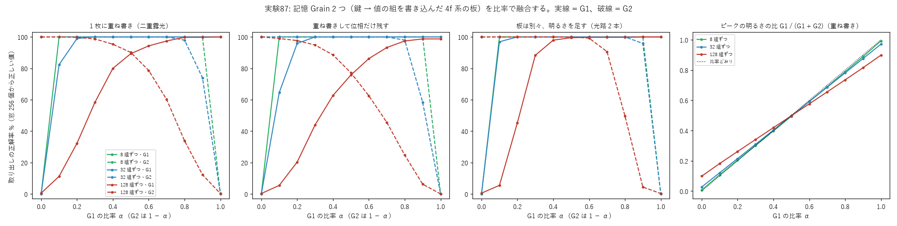

| 組の数（各 Grain） | 融合の仕方 | G1 : G2 = 0.8 : 0.2 の正解率（G1 / G2） | 0.9 : 0.1 | ピークの明るさの比（0.8 : 0.2 のとき） | どちらの記憶かを明るさで当てる |
|---|---|---|---|---|---|
| 8 | 重ね書き | 100 / 100 | 100 / 100 | 0.79 : 0.21 | 100% |
| 32 | 重ね書き | 100 / 97.9 | 100 / 74.0 | 0.78 : 0.22 | 100% |
| 32 | 位相だけ | 100 / 97.9 | 100 / 58.3 | 0.78 : 0.23 | 100% |
| 32 | 光路 2 本 | 100 / 100 | 100 / 95.8 | 0.78 : 0.22 | 100% |
| 128 | 重ね書き | 99.7 / 33.9 | 99.7 / 12.2 | 0.74 : 0.26 | 94% |
| 128 | 光路 2 本 | 99.7 / 49.7 | 100 / 4.4 | 0.74 : 0.26 | 97% |

3 つの融合（重ね書き、32 組ずつ）: 0.6 : 0.3 : 0.1 → 正解率 100 / 100 / 76、明るさの比 0.57 : 0.31 : 0.12。0.5 : 0.3 : 0.2 → 100 / 100 / 100。

- **比率での融合はできる。** 1 枚の板に重ね書きしても、両方の記憶を取り出せる（組が少なければ 100%）。取り出したときの明るさが比率どおりになる（0.8 : 0.2 → 0.79 : 0.21）ので、**明るさから「どちらの記憶か」（= どれだけ古いか）を読める**（比率が違えば 94〜100%）。
- **比率の小さい記憶ほど先に消える。** 組が多いと、ほかの記憶からのにじみ（背景の明るさ）に、薄い記憶のピークが埋もれる（128 組ずつで 20% の記憶は 34%、10% は 12%）。忘れ方が比率と組の数で決まる「忘却の曲線」になっていて、系列の記憶（古いほど薄く）にはむしろ使える性質。
- 位相だけの板にしても比率は残る（明るさの比はほぼ同じ）が、薄い記憶の取り出しは少し弱くなる（32 組・10% で 74 → 58%）。光路を 2 本に分けて明るさで足すと、Grain どうしのにじみがなくなり一番強い（ただし光路が 2 倍要る）。
- 注意: 鍵はでたらめな位相の模様（互いにほぼ直交）。似た鍵（実際の言葉や画像）ではにじみが増え、もっと早く消える見込み（未確認）。学習した Grain（4f 系 + 非線形）の融合は、線形でないので重ね書きと明るさの足し算が同じにならない（次に確かめる）。

## 実験88: 記憶 Grain の融合を似た鍵で試す・確信度を測る（持ち主の依頼: 似た鍵から。確信度で短期記憶を優先させたい） (experiments/exp88_memkeys.py、tools/fig_exp88.py、図 docs/images/exp88_memkeys.png)

実験87 と同じ重ね書き（G1 = 短期、比率 α、G2 = 1 − α）。鍵: でたらめ / 単語の並び（直前 4 語を実験78 の拡散の入れ方で光に、学習なし）/ 共通の模様を混ぜて似せた鍵（似ている度合い 0.25・0.5・0.75）。
確信度 = 一番明るい窓 / 二番目の窓。食い違い = 同じ鍵に G1 は新しい値、G2 は古い値を書く。3 seed、CPU で 5 秒。

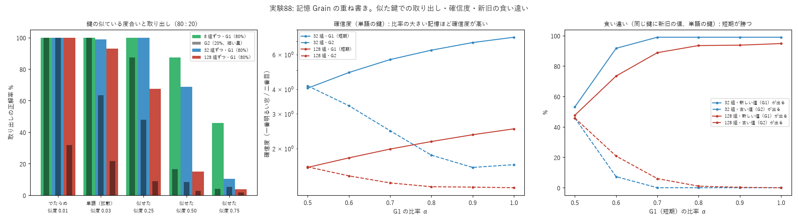

| 鍵（似ている度合い） | 組の数 | 80 : 20 の正解率 G1 / G2 | 確信度 G1 / G2 | 食い違い: 新しい値 / 古い値が出る | 新 / 旧の明るさ |
|---|---|---|---|---|---|
| でたらめ（0.01） | 32 | 100 / 100 | 9.0 / 2.5 | 100 / 0 | 3.4 倍 |
| 単語の並び（0.03） | 32 | 99 / 64 | 6.3 / 1.9 | 99 / 0 | 3.5 倍 |
| 単語の並び | 128 | 93 / 22 | 2.2 / 1.3 | 93 / 1 | 2.9 倍 |
| 似せた 0.25 | 32 | 100 / 48 | 3.6 / 1.5 | 99 / 0 | 3.4 倍 |
| 似せた 0.5 | 32 | 69 / 8 | 1.8 / 1.6 | 54 / 6 | 3.3 倍 |
| 似せた 0.75 | 32 | 10 / 5 | 1.6 / 1.6 | 11 / 5 | 3.6 倍 |

- **単語の並びの鍵は、拡散の入れ方のおかげで互いにあまり似ない（0.03）。** でたらめの鍵より少し早く薄い記憶が消える程度（32 組・20% の記憶 100 → 64%）。
- **鍵が似ていると、急に取り出せなくなる。** 似ている度合い 0.5 で、80% の記憶も 69%（32 組）。共通の成分が全部の記憶に重なり、背景になるため。共通の成分を引いてから書く（白色化）などの工夫が要る（未確認）。
- **確信度は比率の大きい記憶（短期）ほど高い**（単語 32 組で 6.3 対 1.9）。確信度で「短期の記憶を優先」は、重ね書きだけで自然にできている。
- **同じ鍵に新旧の値があると、短期（80%）の値が出る**（99%）。新しい値の明るさは古い値の約 3.5 倍（比率 0.8 / 0.2 = 4 に近い）。50 : 50 だと五分五分。上書きは比率 0.6 以上で効く（32 組で 0.6 → 92%）。
- 注意: 値は窓の位置（でたらめに選んだもの）で、値どうしは似ていない。鍵が似すぎると、確信度も G1・G2 で差がなくなる（似せた 0.75 で 1.6 / 1.6）ので、確信度に頼る前に鍵を似せない入れ方が要る。

## 実験89: 短期記憶から長期記憶へ移す方法（持ち主の構想: 1 繰り返し・2 関連・3 重要度、docs/memory_design.md） (experiments/exp89_consolidate.py、tools/fig_exp89.py、図 docs/images/exp89_consolidate.png)

記憶の候補 300 組（鍵 → 値）から、区切りごとに 16 組が短期記憶に入る（出る頻度は Zipf、よく出る組は何度も来る）。60 回。区切りごとに長期記憶（4f 系の板 1 枚）へ書き足し、長期は毎回 0.97 倍に薄れる。
後半で 15% の組の値が変わる。10% の組に「重要」の印（書く重み 3 倍）。3 seed、CPU で 10 秒。

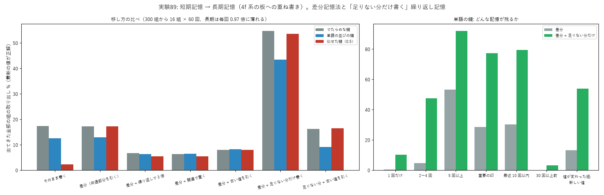

| 移し方 | でたらめな鍵 | 単語の並びの鍵 | 似せた鍵 0.5 | 単語: 5 回以上 / 1 回だけ / 重要 / 最近 / 値が変わった組の新しい値 |
|---|---|---|---|---|
| そのまま書く | 17.3 | 12.4 | 2.2 | 52 / 0 / 30 / 29 / 11 |
| 差分（鍵の共通部分を引く） | 17.1 | 12.9 | **17.2** | 53 / 0 / 29 / 30 / 13 |
| 差分 + 繰り返しで 3 倍 | 6.6 | 6.2 | 5.4 | |
| 差分 + 関連で重く | 6.3 | 6.4 | 5.4 | |
| 差分 + 古い値を引く | 7.9 | 8.1 | 7.9 | |
| **差分 + 足りない分だけ書く** | **54.7** | **43.4** | **53.5** | **92 / 10 / 77 / 79 / 54** |
| 足りない分だけ + 古い値を引く | 16.1 | 9.0 | 16.5 | |

先に 1 回で書き込む場合（実験88 の続き、CPU で確かめた。64・128 組）: 似ている度合い 0.75 の鍵 128 組は、そのまま書くと 3%、書く鍵から共通部分を引くと 51%、読む鍵からも引くと 100%。

- **差分記憶法（鍵の共通部分 = 今までの鍵の平均を、書くときも読むときも引く）で、似た鍵の問題は消える。** 似ている度合いにかかわらず、でたらめな鍵と同じ成績になる（0.5 で 2.2 → 17.2%）。共通部分は長期記憶と一緒に持つ（1 枚の模様）。
- **繰り返し記憶は「足りない分だけ書く」形で効く。** すでに確信度 2 以上で正しく取り出せる組は、書く重みを 0.1 にする。全体で 17 → 55%、最近の記憶 30 → 79%、値が変わった組で新しい値が出る 13 → 54%（単語）。よく来る組（5 回以上）は 92% で残り、1 回だけの組は 10%、30 回以上前の組はほぼ消える（忘却）。
- **繰り返しで単純に重みを上げる（3 倍）・関連で重くする形は逆効果（17 → 6%）。** 強くなった記憶が背景になり、ほかを埋もれさせる。強度は「足りない分を補う」形で上げる必要がある。
- 古い値を引く（上書き）も逆効果。取り出しの間違いの多くは食い違いではなくにじみで、間違った窓を引くと壊れる。食い違いへの対策は、足りない分だけ書く形のほうが効く（新しい値 54%）。
- 重要の印（3 倍）は効く（77%、印なしは約 40%）。
- 注意: 1 枚の板に 225 組前後を詰め込んでいて、全体の正解率はまだ低い（55%）。関連記憶（案 2）は簡単な形でしか試していない。値はでたらめな窓。

## 実験85・86: 単語の 4f 系を seed 1・2 で確かめる・文脈を長くする (sweeps/sweep85.sh・sweep86.sh、共通の待ち行列)

| 方式（単語、テスト全部） | seed 0 / 1 / 2 | 平均 ± ばらつき |
|---|---|---|
| 光路 1 本（拡散 + 4f 系 6 段 × 8） | 35.83 / 35.92 / 36.59 | 36.11 ± 0.34 |
| 分担の 2DTG 担当 16・直前 2 語 | 35.73 / 35.95 / 36.96 | 36.21 ± 0.53 |
| 光路 1 本 + 担当 16 | 37.13 / 36.85 / 38.02 | 37.33 ± 0.50 |
| **3 つの足し合わせ** | 37.21 / 37.11 / 37.96 | **37.43 ± 0.38**（CE 3.04） |
| 参考: 3-gram / GRU（seed 0 のテスト / 実験57） | 36.4 / 36.9 | |

文脈の長さ（光路 1 本、seed 0、実験86）: 直前 2 語 35.9%・4 語 35.8%・8 語 36.3%・16 語 36.0%（CE 3.13 / 3.12 / 3.12 / 3.12）。

- 3 seed でも、足し合わせ（37.4%）が 3-gram・GRU を上回る。
- 注意: worddata は seed ごとに訓練・テストの組を選び直すので、テストが seed ごとに違う（3-gram は seed 0 のテストの値）。
- **マイナス: 光路 1 本は長い文脈をほとんど使えない**（2 語でも 16 語でも 36% 前後）。全部の語を 1 枚の面に重ねるので、遠い語は埋もれる。長い文章の要所をまとめる仕組み（持ち主の構想）が要る理由になる。

## 実験90・91: 記憶の残りの実験 — 案 1 の手順、値を実際の言葉に、板を何枚かに (exp89_consolidate.py の logdiff、exp90_wordvals.py、exp91_series.py、tools/fig_exp90_91.py、図 docs/images/exp90_91_memory.png)

持ち主と決めた順（1 → 4 → 5、2026-10-26）。どれも CPU で数秒、3 seed。

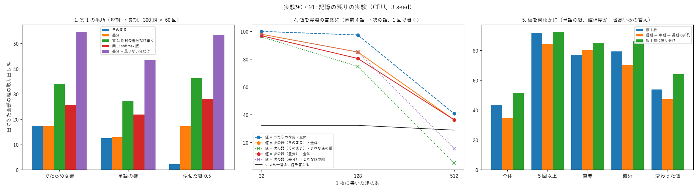

**1. 案 1 の手順（対数 → 差分マップ → softmax → 融合）を作り直す**（実験89 の場面、results/exp90_logdiff.txt）

| 移し方 | でたらめな鍵 | 単語の鍵 | 似せた鍵 0.5 |
|---|---|---|---|
| そのまま / 差分 | 17.3 / 17.1 | 12.4 / 12.9 | 2.2 / 17.2 |
| 案 1: 差分マップ log(前段 + ε) − log(長期から読んだ地図 + ε) の、値の窓の大きさだけ書く | 34.0 | 27.2 | 36.3 |
| 案 1: softmax(差分マップ + 現在の記憶) − 現在の記憶 を書く | 25.6 | 21.8 | 28.1 |
| 差分 + 足りない分だけ書く（実験89） | **54.7** | **43.4** | **53.5** |

- 作り直すと発散せずに動き、そのままより 2 倍良い。ただし「足りない分だけ書く」（確信度 2 以上で取り出せたら書く重みを 0.1 に）には届かない。案 1 は、少し覚えている組の書く量も減らすので、中途半端な記憶が弱いまま残る。

**4. 値を実際の言葉にする**（直前 4 語 → 次の語、頻出 255 語 + その他 = 窓 256 個、1 回で書く、results/exp90.txt）

| 1 枚の組の数 | 値 = でたらめな窓 | 値 = 次の語（そのまま） | 値 = 次の語（差分） | まれな値の組（そのまま / 差分） | 多数派 |
|---|---|---|---|---|---|
| 32 | 100 | 97.9 | 96.9 | 96 / 98 | 32 |
| 128 | 97.4 | 85.2 | 80.5 | 75 / 85 | 32 |
| 512 | 40.7 | 36.3 | 36.3 | **5 / 16** | 29 |

- **値の出方の偏りで、記憶が「よく出る値」に引っ張られる。** 512 組では、まれな値の組はほぼ取り出せない（5%）。よく出る値（「その他」「の」など）の窓が、全部の鍵に対して背景として明るくなるため。
- 値の頻度で書く量を割ると、まれな値の組は 92% まで戻るが、全体は 36 → 33% に下がる（よく出る値が弱くなる）。値の側の引き算（平均を引く）は効かない。偏りとの付き合い方は今後の課題。
- 文章を順に流して長期へ移す（約 940 組）と、どの移し方も 29〜33%（多数派 29%）で、容量を超えている。最近の組は「足りない分だけ書く」で 59%。

**5. 板を何枚かにして容量を増やす**（実験89 の場面、確信度が一番高い板の答えを使う、results/exp91.txt）

| 作り | でたらめな鍵 | 単語の鍵 | 単語: 5 回以上 / 重要 / 最近 / 変わった値 |
|---|---|---|---|
| 板 1 枚（差分 + 足りない分だけ） | 54.7 | 43.4 | 92 / 77 / 79 / 54 |
| 短期（λ 0.7）→ 中期（2 回以上、λ 0.95）→ 長期（4 回以上か重要、λ 0.995） | 46.6 | 34.8 | 84 / **80** / 70 / 47 |
| **板 3 枚に振り分け**（同じ作り、来た組を順に 3 枚へ） | **71.2** | **51.5** | **93 / 85 / 87 / 64** |

- **板を 3 枚にして確信度で選ぶと、全体 55 → 71%（でたらめな鍵）、変わった値で新しい値が出る 65 → 90%。** 確信度で板を選ぶ読み方がそのまま使える。
- 短期・中期・長期の系列にすると、重要な組・よく来た組は残りやすい（でたらめな鍵で重要 94%・5 回以上 99%）が、全体は 1 枚より下がる。短期の板が速く薄れ、中期・長期に入らない組（1 回だけの組）が消えるため。系列の作り方（どの組をいつ上へ送るか）は持ち主の構想とあわせて考える。

## 実験92: 記憶の系列を細かく刻む（持ち主の見立て: 秒 → 分 → 10 分 → … → 1 日、刻みはフィボナッチっぽく） (experiments/exp92_fibtiers.py、results/exp92.txt)

実験89・91 の場面（300 組から 16 組 × 60 回）。CPU、3 seed。読むときはどれも確信度が一番高い板の答え。

| 作り | でたらめな鍵 | 単語の鍵 | 単語: 1 回だけ / 5 回以上 / 重要 / 最近 / 10〜30 回前 / 変わった値 | 板の数 |
|---|---|---|---|---|
| 板 1 枚（実験89） | 54.7 | 43.4 | 10 / 92 / 77 / 79 / — / 54 | 1 |
| 半減期をフィボナッチ（1, 2, 3, 5, 8, 13, 21 区切り）にした板 7 枚、全部に書く | 52.2 | 36.2 | 10 / 77 / 68 / 73 / 20 / 45 | 7 |
| 同じ 7 枚、来た回数がフィボナッチ回以上で上の板へ（cascade） | 33.7 | 24.0 | 5 / 73 / 49 / 58 / 3 / 36 | 7 |
| 板 7 枚に順に振り分け（同じ作り） | 81.7 | 53.8 | 32 / 86 / 87 / 86 / 48 / 67 | 7 |
| **時間で板を分ける（毎回新しい板、同じ長さの板 2 枚を融合 → 古いほど長い時間の板: 32・16・8・4 区切り）** | **83.6** | **57.0** | **33 / 91 / 87 / 88 / 53 / 63** | **4** |
| 同じだが長さをフィボナッチ数に（違うフィボナッチ数の和の形に融合） | 62.3 | 42.1 | 14 / 84 / 71 / 79 / 27 / 49 | 2（55・5） |

- **「古いほど長い時間をまとめた板」の系列が一番良い**（板 4 枚で 83.6%、板 7 枚の振り分けより少ない枚数で上）。新しい記憶は短い時間の板にあり、ほかの記憶と混ざらないので、はっきり取り出せる。持ち主の刻み（秒 → 分 → 10 分 → 30 分 → 1 時間 → 2 時間 → …）は、ほぼ倍々のこの形に近い。
- 薄れる速さだけを変えた板を並べる（全部に同じ記憶を書く）と、容量は増えない（52.2%、1 枚と同じ）。板を増やす効き目は「違う記憶を違う板に置く」ことから来る。
- 回数で上の板へ送る形は、1 回だけの記憶が下の板で速く消えるので全体が下がる（33.7%）。
- マイナス: フィボナッチ数での融合は、私の作り方（違うフィボナッチ数の和に保つ）だと融合が進みすぎて板が 2 枚になり、倍々（4 枚）に負けた。フィボナッチの刻みを活かすなら、板の数を保つ別の融合の仕方が要る。

## 実験93: 記憶の段を「ずらしながら比率で融合」する（持ち主の構想: 1・1・2（差分）・3（比率 2 : 3）・5（3 : 5）… 55 まで、短期 → 中期 → 長期も同じ形） (experiments/exp93_shift.py、results/exp93.txt)

私の読み方: 段 k は古さの幅 W_k（1, 1, 2, 3, 5, … 55）の記憶を持つ板。区切りごとに新しい記憶を段 0 に書き（差分 + 足りない分だけ）、各段の 1 / W_k を次の段へ送る（送り先の板と比率で融合）。一番上は積み重ねる（λ 0.995）。
「_mid」は短期の一番上から送り出す分を、同じ形の中期の段へ入れる二重の系列。比率の調整として幅を r 倍ずつ（r = 1.5・2・3）にしたものも比べる。実験89 の場面、CPU、3 seed。

| 作り | でたらめな鍵: 全体 / 最近 / 10〜30 回前 / 30 回以上前 / 変わった値 | 単語の鍵: 全体 / 最近 / 30 回以上前 / 重要 |
|---|---|---|
| 時間で板を分けて倍々に融合（実験92、板 4 枚） | **83.6** / 99.6 / **97.4** / 41.4 / **95.3** | **57.0** / **88.0** / 13.4 / **86.6** |
| ずらしながら融合・フィボナッチ（10 段） | 82.2 / 98.6 / 89.5 / **47.4** / 86.9 | 40.4 / 67.7 / 11.6 / 75.7 |
| 同 + 中期の系列 | 82.3 / 98.6 / 90.4 / 46.8 / 88.1 | 42.3 / 67.5 / 16.5 / 79.9 |
| 幅 1.5 倍ずつ（10 段）+ 中期 | 83.0 / 98.9 / 91.7 / 47.3 / 90.9 | 46.2 / 74.4 / **17.1** / 83.1 |
| 幅 2 倍ずつ（7 段）+ 中期 | 80.7 / 99.3 / 86.5 / 44.3 / 87.1 | 44.3 / 72.2 / 17.1 / 77.2 |
| 幅 3 倍ずつ（5 段）+ 中期 | 76.0 / 98.6 / 76.9 / 39.6 / 78.1 | 42.6 / 71.7 / 15.3 / 74.0 |

- でたらめな鍵では、ずらしながら融合する形も時間で分ける形とほぼ同じ（82〜83%）で、**古い記憶はこちらの方が残る**（30 回以上前 47 対 41%）。比率は 1.5 倍・フィボナッチ（約 1.6 倍）が 2 倍・3 倍より良い。中期の系列を重ねると、古い記憶と重要な記憶が少し良くなる。
- **マイナス: 単語の鍵では、ずらしながら融合する形は時間で分ける形に大きく負ける（40〜46 対 57%、最近の記憶 68〜74 対 88%）。** ずらすたびに 1 つの記憶が何段にも少しずつ分かれ、どの段でもはっきりしなくなる。似た鍵どうしの混ざりが段の間でも起きるためと考えられる（未確認）。新しい記憶を「はっきりした曲線」で残すには、段の間で中身を少しずつ混ぜるより、まとめて送る（時間で分けて融合する）方が良い。

## 実験94: 記憶の段を「満ちたらまとめて次へ送る」（実験93 の改善案、持ち主の依頼） (experiments/exp94_flush.py、results/exp94.txt、案は docs/memory_design.md)

段 k は幅 W_k 区切り分までためる板。入れると幅を超えるなら、先に中身をまるごと次の段へ送って融合する（1 つの記憶はいつもどれか 1 段にまとまる）。融合はそのまま足す（sum）か、持ち主の比率（今ある中身 : 入ってくる板 = ためた量の比）で足す（ratio）。実験89 の場面、CPU、3 seed。

| 幅の比率（段の数） | 融合 | でたらめな鍵: 全体 / 1 回だけ / 10〜30 回前 / 30 回以上前 / 変わった値 | 単語の鍵: 全体 / 最近 / 重要 |
|---|---|---|---|
| 時間で分けて倍々（実験92、板 4 枚） | | 83.6 / 66.7 / 97.4 / 41.4 / 95.3 | **57.0 / 88.0 / 86.6** |
| 少しずつ送る・1.5 倍 + 中期（実験93） | | 83.0 / 67.9 / 91.7 / 47.3 / 90.9 | 46.2 / 74.4 / 83.1 |
| フィボナッチ（10 段） | sum / ratio | 73.8 / 78.7（古い記憶 30.5 / 45.9） | 44.1 / 41.8 |
| **1.5 倍ずつ（10 段）** | sum / ratio | **91.1 / 90.8**（1 回だけ 83、10〜30 回前 99.6 / 98.2、30 回以上前 **66.5 / 67.1**、変わった値 97.1 / 94.6） | 49.3 / 50.4（最近 74） |
| 2 倍ずつ（6 段） | sum / ratio | 75.9 / 79.2 | 40.7 / 42.4 |

- **でたらめな鍵では、1.5 倍ずつの段で全体 91%（これまでの最良）、30 回以上前の記憶も 67%**（倍々の 4 枚は 41%）。1 つの記憶がどれか 1 段にまとまるので、実験93 の「薄く分かれる」問題がなくなった。持ち主の比率での融合は、フィボナッチ・2 倍のときに古い記憶を +15 点にする。
- **マイナス: 単語の鍵では 41〜50% で、倍々の 4 枚（57%）に届かない。** 段が 10 枚あると、確信度で段を選ぶときに、似た鍵どうしで違う段を選び間違えやすいと見ている（未確認）。段の数を抑える・段の選び方を変える（確信度だけでなく段の古さも使う）などが次の手。
- 60 区切りでは短期の一番上の段まで満ちず、中期の系列は一度も使われなかった（_mid は同じ値）。もっと長い流れで確かめる必要がある。
- 追記（確かめた）: 単語の鍵・1.5 倍ずつ（10 段）で、段の選び方が完全だったら（どれかの段で正しく取り出せる割合）**83.7%**、確信度で選んだ実際は 49.3%。でたらめな鍵は 93.7 対 91.1。単語の鍵で負けたのは、記憶が消えたからではなく、**読む段を選び間違えるため**（どれかの段にはほぼ残っている）。10 段のどれかが偶然当たる分を少し含むので、83.7% はやや甘めの値。

## 実験95: 実験94 のマイナスポイントへの手当て — 段の選び方、長い流れで中期の系列 (experiments/exp95_select_long.py、exp94_flush.py に選び方を追加、tools/fig_exp94_minus.py・fig_exp95.py、図 docs/images/exp94_minus.png・exp95_select_long.png)

説明の図（持ち主の依頼）: 段の選び間違い、各段の板（周波数の面の明るさ）、似た単語の並びの鍵の例、正しい段と選ばれた段の読み出し。

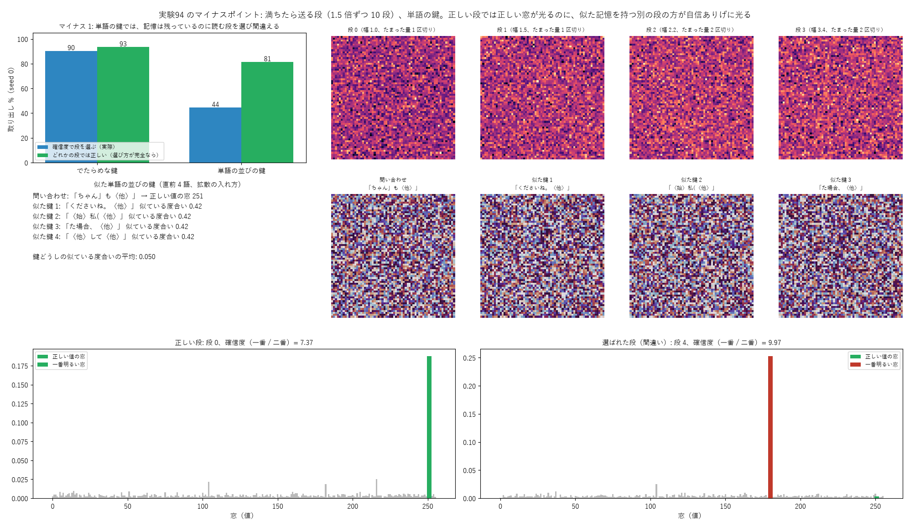

- 似た単語の並びの鍵の例（seed 0）: 問い合わせ「ちゃん」も〈他〉」に、「くださいね。〈他〉」「〈始〉私(〈他〉」「た場合、〈他〉」が似ている度合い 0.42（鍵全体の平均は 0.05）。**似ている原因は、同じ位置に入る「〈他〉」（頻出 4094 語の外の語をまとめた印）**。最後の語が〈他〉の鍵どうしは、拡散の入れ方でも同じ模様を持つ。
- 正しい段（段 0）は正しい窓を確信度 7.4 で出すが、似た鍵の記憶を持つ段 4 は別の窓を確信度 10.0 で出し、そちらが選ばれる。

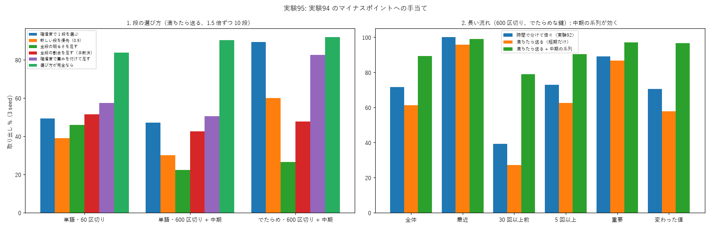

| 選び方（満ちたら送る、1.5 倍ずつ 10 段） | 単語・60 区切り | 単語・600 区切り + 中期 | でたらめ・600 区切り + 中期 |
|---|---|---|---|
| 確信度で 1 段を選ぶ（実験94） | 49.3 | 47.2 | **89.3** |
| 新しい段を優先（確信度 × 0.9^段） | 39.0 | 30.0 | 59.9 |
| 全段の明るさを足す | 45.9 | 22.2 | 26.4 |
| 全段の割合を足す（多数決） | 51.4 | 42.6 | 47.7 |
| **確信度で重みを付けて足す** | **57.5** | **50.4** | 82.4 |
| 選び方が完全なら | 83.7 | 90.3 | 91.8 |

| 長い流れ（600 区切り） | でたらめ: 全体 / 30 回以上前 / 5 回以上 / 重要 / 変わった値 | 単語: 全体 |
|---|---|---|
| 時間で分けて倍々（実験92） | 71.6 / 39.2 / 72.9 / 89.1 / 70.6 | 46.6 |
| 満ちたら送る（短期だけ） | 61.2 / 27.1 / 62.6 / 86.6 / 57.9 | 36.0 |
| **満ちたら送る + 中期の系列** | **89.3 / 78.8 / 90.3 / 97.1 / 96.5** | 47.2（重みを付けて足すと **50.4**） |

- **段の選び方は「確信度で重みを付けて足す」が良い**（単語 49 → 58%、倍々の 4 枚 57% と並ぶ）。新しい段を優先するのは逆効果。それでも「完全な選び方」（84〜90%）との差は大きく、選び方の改良の余地がまだある。
- **長い流れでは中期の系列がはっきり効く**（でたらめな鍵: 短期だけ 61% → 中期あり 89%、30 回以上前の記憶 27 → 79%、変わった値 58 → 97%）。持ち主の構想の「短期全体を 1 つとして中期へ」が、長い流れで初めて意味を持つ。
- 単語の鍵では、600 区切り + 中期 + 重みを付けて足すで 50.4%（倍々 46.6%）。選び方が完全なら 90% で、記憶はほぼ残っている。

## 実験96: 段の選び方に「確信度以外」— なじみ（関連度）を足す、〈他〉を語ごとに別々にする（持ち主の依頼） (experiments/exp96_familiar.py、exp88_memkeys.py の word_hash、tools/fig_exp96.py、図 docs/images/exp96_familiar.png)

なじみの板: 段ごとに、記憶の板と一緒に「書いた鍵をすべて同じ 1 点に結ぶ板」を持つ（段を送るときは一緒に送る）。問い合わせの鍵を通すと、その段に似た鍵がどれだけ書かれているか（なじみ = 関連度）が点の明るさで分かる。
word_hash: 単語の並びの鍵で、頻出語の外の語を〈他〉の 1 つの印にまとめず、語の表記から決まる別々の向きにする（似ている度合い 0.3 を超える鍵の組 2.5% → 1.5%）。CPU、3 seed。

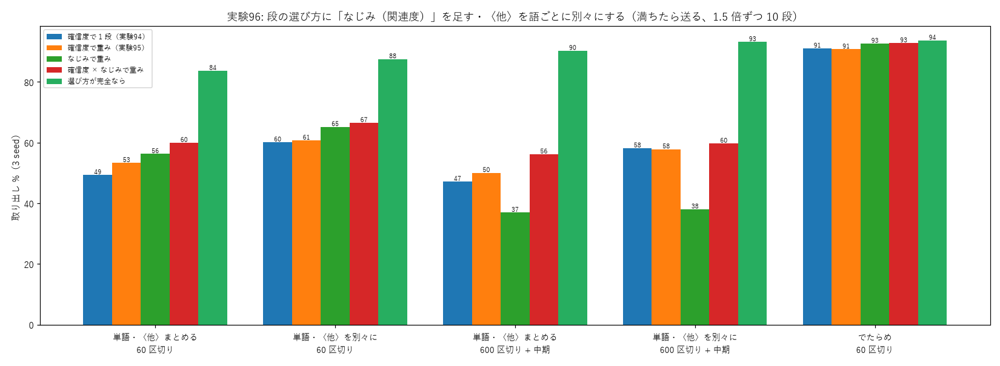

| 選び方 | 単語 60 区切り | 単語・〈他〉別々 60 | 単語 600 + 中期 | 単語・〈他〉別々 600 + 中期 | でたらめ 60 |
|---|---|---|---|---|---|
| 確信度で 1 段（実験94） | 49.3 | 60.1 | 47.2 | 58.2 | 91.1 |
| 確信度で重みを付けて足す（実験95） | 53.3 | 60.7 | 50.1 | 57.8 | 90.8 |
| なじみで重みを付けて足す | 56.3 | 65.2 | 36.9 | 38.0 | 92.7 |
| **確信度 × なじみで重みを付けて足す** | **60.0** | **66.5** | **56.2** | **59.7** | **92.8** |
| 選び方が完全なら | 83.7 | 87.6 | 90.3 | 93.2 | 93.7 |

- **〈他〉を語ごとに別々にするだけで、単語の鍵が 49 → 60% に上がる**（意味のない共通の印で鍵が似るのを防ぐ）。
- **確信度 × なじみ（関連度）で重みを付けて足すと、どの場面でも一番良い**（単語・〈他〉別々・60 区切りで 66.5%、最初の 49.3% から +17 点）。
- なじみだけで選ぶと、長い流れでは悪い（37〜38%）。長期の段にはたくさんの鍵が書かれていて、何に対してもなじみが高くなるため。確信度と組み合わせると補い合う。
- まだ「選び方が完全なら」（88〜93%）とは差がある。
