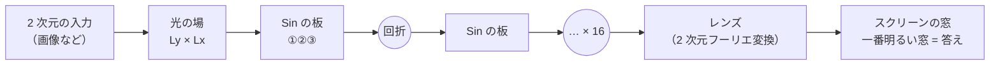

# SN2-Parts-2D — 波の干渉と回折で 2 次元を処理する部品

画像のような 2 次元の入力を光の場にして、**模様のある透明な板と回折だけ**で処理する部品（Python の関数）を作っています。重み行列（ニューロンのマップ）は持ちません。

> **作り始めたばかりです（版 0.2.0）。** 合成した図形の分類（到達点 M1）まで。本物の画像はまだ試していません。



## これは何？

[Sin-CNN2](https://github.com/devaf09/Sin-CNN2) では、文字列を 1 列の光にして、模様のある板を何枚も通し、スクリーンのどの窓が明るいかで答える学習器 **SinWave** を作りました。学習するのは板の模様だけです。別々に学んだ技能を「足すだけ」で合わせられ、外せば完全に元に戻る、という特徴があります。

このプロジェクトでは、それを **2 次元（縦 × 横の場）** に広げます。板の模様は 3 つの形を用意して比べます。

| 板 | 模様 | ひとこと |
|---|---|---|
| ① 交点で掛け算 | 横の波 + 縦の波 | 軽い。条件が合えば 2 次元の計算が横 1 列 + 縦 1 列に分かれる。代わりに横と縦が混ざらない |
| ② 斜めの縞 | 向きのある縞 | 2 次元の計算が要る |
| ③ 波紋 | 池の波紋・楕円の輪 | ② を含む広い形。光をどこに集めるかを学べる |

作った部品は、音の研究 [SN2-Acoustics](https://github.com/devaf09/SN2-Acoustics)（スペクトログラムなどの 2 次元の入力）でも使う予定です。

## いちばん簡単な使い方

必要なもの: Python 3.10 以上、PyTorch 2.0 以上。`sn2_parts_2d.py` を 1 つコピーすれば使えます。

```python
import torch
import sn2_parts_2d as p2

Ly = Lx = 64
y, x = p2.grid(Ly, Lx)
pid = p2.patch_index(Ly, Lx, 4, 4)                     # 4 × 4 の区画
A, phi = torch.rand(16), 6.28 * torch.rand(16)         # 区画ごとの振幅と初期位相（学習する数）
wx, wy = torch.rand(16), torch.rand(16)                # 縞の細かさと向き（固定）
H = p2.transfer(Ly, Lx, z=64.0)                        # 板の間隔 64 画素の回折

u = torch.ones(1, Ly, Lx, dtype=torch.complex64)       # 入力の光の場
u = p2.normalize(p2.propagate(p2.apply_plate(u, p2.plate_stripes(A, wx, wy, phi, pid, y, x)), H))
I = p2.intensity(p2.lens(u))                           # レンズの後のスクリーンの明るさ (1, 64, 64)
```

## 部品の一覧

| 関数 | 何をするか | 確かめたところ |
|---|---|---|
| `image_to_field` | 画像を光の場にする（振幅として・位相として） | 実験01（振幅） |
| `Net2D`, `train`, `evaluate` | 1 本の光路（板の形を 1 枚ごとに選べる）、学習、正解率 | 実験01 |
| `grid`, `patch_index`, `band_index` | 場の座標、区画・帯の番号 | テスト |
| `plate_xy`, `plate_xy_parts` | ① 交点で掛け算の板 | テスト・実験01 |
| `plate_stripes` | ② 斜めの縞の板 | 実験01 |
| `plate_ripple`, `ripple_radius` | ③ 波紋の板（等間隔の輪・ゾーンプレート、楕円） | テスト（中心を遠くへ置くと ② になる）・実験01 |
| `apply_plate` | 板の位相を光に掛ける | |
| `transfer`, `transfer_sep`, `propagate` | 2 次元の回折（角スペクトル法・近軸） | テスト（光の量が変わらない） |
| `normalize`, `lens`, `intensity` | 明るさを平均 1 に、レンズ、明るさ | テスト |
| `propagate_sep`, `normalize_sep`, `lens_sep`, `outer` | ① の軽い計算（横 1 列 + 縦 1 列） | テスト・実験00 |
| `window_grid`, `read_windows` | スクリーンの窓を並べ、明るさを読む | テスト・実験01 |

学習器を作って学習する例（64 × 64 の画像 `X`（0〜1）とラベル `y`）:

```python
net = p2.Net2D(64, n_classes=8, plates=["xy"] * 16)          # 板 ① を 16 枚
to_field = lambda v: p2.image_to_field(v, "amp")
p2.train(net, X, y, to_input=to_field)
print(p2.evaluate(net, X_test, y_test, to_input=to_field))  # 正解率（%）
```

これから作る部品と順番は [docs/design_m1.md](docs/design_m1.md) にあります。

## ここまでの結果

**4 つの合成課題**（64 × 64、テスト正解率 %、3 seed の平均、実験01）


| 方式 | 学習する数 | 形 | 縞の向き | 位置（3×3 のマス） | 線の向き × 左右 |
|---|---|---|---|---|---|
| 偶然 | – | 12.5 | 12.5 | 11.1 | 12.5 |
| ロジスティック回帰（画素） | 32776 | 37.2 | 13.8 | 100 | 64.9 |
| レンズの後の明るさで回帰 | 32776 | 100 | 100 | 10.6 | 50.1 |
| 小さな CNN | 2784 | **98.6** | 100 | 99.0 | 100 |
| **SinWave 板 ①**（交点で掛け算） | 2057 | 70.6 | 99.9 | **99.8** | 99.4 |
| SinWave 板 ②（斜めの縞） | 2057 | 60.0 | 99.9 | 99.5 | 97.9 |
| SinWave 板 ③（波紋） | 2057 | 60.5 | 99.9 | 99.4 | 97.5 |

- 向き・位置・その組み合わせは、同じくらいの大きさの小さな CNN と並びました。
- **できないこと**: 位置が少しずれても同じ形と答えること（形の課題 71%、CNN は 98.6%）。計算も CNN より重く、推論は 1 件 45 µs（CNN 6 µs）、学習は約 70 秒（CNN 6 秒）です。

**計算量**（実験00、RTX 3060、板 16 枚・学習 1 ステップの 1 件あたり）

| 場の大きさ | 2 次元の場（②③） | ① 横と縦に分けた計算 | メモリ（256 件、2 次元の場） |
|---|---|---|---|
| 64 × 64 | 0.15 ms | 0.11 ms | 0.4 GB |
| 128 × 128 | 0.50 ms | 0.11 ms | 1.5 GB |
| 256 × 256 | 1.96 ms | 0.14 ms | 6.1 GB |
| 参考: 1 次元の SinWave（1024 画素） | 0.06 ms | | 0.1 GB |

① の軽い計算は、入力が「横の模様 × 縦の模様」の形のときだけ使えます（画像は一般にこの形ではありません）。

目標への到達度は [docs/scoreboard.md](docs/scoreboard.md)（今 30.4 / 100 点）。

## しくみ

光（波）は、模様のある板を通ると、模様に合わせて少しずつ向きを変えます。板を何枚も通し、板と板の間で光を広がらせる（回折）と、入力ごとに違う場所に光が集まるようになります。最後にレンズで「同じ向きに進む光」を 1 点に集め、どの窓が一番明るいかで答えます。学習するのは板の模様だけです。

くわしくは、実験の歩み [docs/experiments_guide.md](docs/experiments_guide.md)、研究ノート [NOTES.md](NOTES.md)、1 次元版の解説 [Sin-CNN2 の introduction.md](https://github.com/devaf09/Sin-CNN2/blob/main/docs/introduction.md) を見てください。

## フォルダの構成

| 場所 | 中身 |
|---|---|
| `sn2_parts_2d.py` | 部品（1 ファイル、PyTorch のみ）。先頭に変更履歴と `__version__` |
| `tests/` | 部品の確認 |
| `experiments/expNN_名前.py` | 実験のプログラム（NN = 実験番号）。条件は `experiments/sweeps/sweepNN.sh` |
| `results/expNN.txt` | 結果（1 回の実行 = 1 行の JSON） |
| `experiments/tasks2d.py`, `baselines2d.py` | 合成課題、比較相手（回帰・MLP・小さな CNN） |
| `tools/` | 集計（`summarize.py`）、ポイント表（`scoreboard.py`）、図（`fig_tasks.py`） |
| `docs/` | 説明資料、ポイント表、設計の案 |
| `vendor/` | Sin-CNN2 から写した 1 次元の SinWave（MIT、出典は [vendor/README.md](vendor/README.md)） |
| `NOTES.md` | 実験ノート（数字の正本） |

テストの実行（CPU で数秒）:

```bash
python -m pytest tests -q
```

実験のやり直し（GPU。実験01 は RTX 3060 で約 2 時間）と集計:

```bash
bash experiments/sweeps/sweep01.sh
```

```bash
python tools/summarize.py results/exp01.txt --rows method --cols task
```

## ライセンスとデータの出典

[MIT License](LICENSE)（Copyright (c) 2026 devaf09）。`vendor/` のコードは Sin-CNN2（MIT、同じ著作権者）からの写しです。

データ:
- 合成課題（実験00〜14）はすべてプログラムの中で作った入力です。
- **MNIST**（手書き数字、実験15〜）: Yann LeCun, Corinna Cortes。ライセンス CC BY-SA 3.0。torchvision の置き場から `python tools/fetch_mnist.py mnist` で `data/` に取得します。
- **Fashion-MNIST**（服の絵、実験15〜）: Zalando Research（[github.com/zalandoresearch/fashion-mnist](https://github.com/zalandoresearch/fashion-mnist)）。ライセンス MIT。`python tools/fetch_mnist.py fashion` で取得します。
- データ自体はリポジトリに入れていません（`data/` は .gitignore）。
