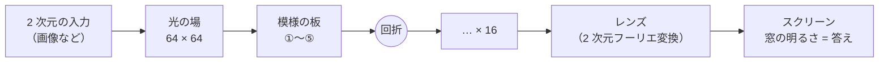
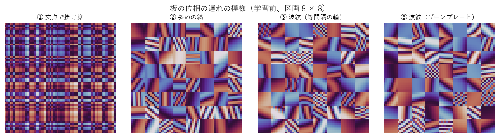
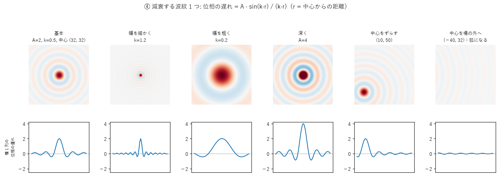

# SN2-Parts-2D — 波の干渉と回折で 2 次元を処理する部品

画像のような 2 次元の入力を光の場にして、**模様のある透明な板と回折だけ**で処理する部品（Python の関数）を作っています。重み行列（ニューロンのマップ）は持ちません。

> **版 0.11.0。画像認識（実験00〜30）と言語（実験31〜65）の区切り。** 一番良かった組み合わせは [docs/best_configs.md](docs/best_configs.md)、有望なアイディアは [docs/ideas.md](docs/ideas.md)、部品の評価は [docs/parts_review.md](docs/parts_review.md)、効率（光とデジタルの重さ）は [docs/efficiency.md](docs/efficiency.md)。


*10 本の光路（数字ごと）を別々に学習し、色を分けて重ねるだけで、「どこに何の数字があるか」を 1 枚で出した例（実験30）。*



## これは何？

[Sin-CNN2](https://github.com/devaf09/Sin-CNN2) では、文字列を 1 列の光にして、模様のある板を何枚も通し、スクリーンのどの窓が明るいかで答える学習器 **SinWave** を作りました。学習するのは板の模様だけで、別々に学んだ技能を「足すだけ」で合わせられ、外せば完全に元に戻る、という特徴があります。

このプロジェクトは、それを **2 次元（縦 × 横の場）** に広げる部品集です。作った部品は、音の研究 [SN2-Acoustics](https://github.com/devaf09/SN2-Acoustics)（スペクトログラムなどの 2 次元の入力）や、画像・木構造の研究（Project Metasequoia）で使います。

## 画像認識でできたこと（実験00〜30）

| できたこと | 数字（3 seed の平均） | 実験 |
|---|---|---|
| 手書き数字 MNIST を、ロジスティック回帰より少ない数で上回る | **96.3%**（回帰 92.5%・学習する数 1/5、小さな CNN 98.1%） | 15・17・18 |
| 服の絵 Fashion-MNIST | **85.9%**（回帰 84.4%、CNN 87.6%） | 18 |
| 別々に学んだ技能を、明るさを足すだけで融合（相手のデータなし） | **4 技能で 100%**（同時に学習 99.4%）。「担当なし」の絵を見せるのが鍵 | 10・12 |
| 外せば完全に元に戻る（取消） | 差 0 | 07 |
| クラスを窓の明るさの模様（符号）で表す。窓の数に縛られない | 窓 16 個で 1 クラス 1 窓と同等以上（85.3 対 84.2%） | 22 |
| 学習なしでクラスを足す（例の平均の模様を符号に） | 10 クラスで 76.3% | 23 |
| 例を 1 枚も見せない服を、部品の組み合わせだけで当てる | コート・ブーツ・スニーカー 77〜82%（偶然 10%） | 26 |
| どこに何があるかを出す（光学相関器 + 光の非線形） | 数字の位置ごとに 85%、2 数字の見分け AUC 97% | 27〜30 |
| 学習の谷で終わらない（学習率を最後に 0 まで下げる） | どの条件でも最後が一番良い | 17・21 |

**できないこと・弱いこと（いまのところ）**
- 小さな CNN には届かない（MNIST 1.8 点、Fashion 1.7 点）。学習の時間は CNN の約 20 倍。
- 位置が少しずれても同じ形と答えること（合成の形の課題 70〜80%、CNN 98.6%）。
- 学習し直さずに場の大きさを変えること（実験06）。
- 親の光路から子の光路を作る「木」で、作り方（共通の初期の板・親から派生）による差は見えなかった（実験20・25）。
- 1 本の光路への技能の足し算は 2 次元では壊れる（実験09）。融合は並列の光路で行う。
- アナログで作ったとき、板が 1 画素ずれるとほぼ当てずっぽうになる（実験05。模様の精度は 16 段階で足りる）。

目標への到達度は [docs/scoreboard.md](docs/scoreboard.md)。実験の歩みは高校生向けの説明 [docs/experiments_guide.md](docs/experiments_guide.md)、数字の正本は [NOTES.md](NOTES.md)。

## 言語でできたこと・分かったこと（実験31〜65）

文章（CC-100 日本語 約 60 万字）で、直前の文字・単語から次の文字・単語を当てる課題です。

| できたこと・分かったこと | 数字 | 実験 |
|---|---|---|
| **小さな光路（2DTG）に担当を分け、別々に学んで足すだけで融合**すると、文字の課題で GRU・3-gram に並ぶ | **54.0%**（同じ学習する数の光路 1 本 51.3、GRU 53.3〜54.1、3-gram 53.7）。2DTG ごとに自分の符号を学ぶのが条件 | 58・62・64・66 |
| 単語（形態素）の予測。次の単語の確率を出す（ありがとう → ござい 83%） | 分担して 36.0〜36.4%（同じ重さの 1 本 33.3、GRU 36.9、3-gram 36.4） | 52・58・66 |
| 1 本の光路は、全部の語が同じ板を共有するので、覚えられる対応表が小さい（図 [capacity.png](docs/images/capacity.png)） | 「1 語 → 次の語」の表でも 29.6%（表 33.6%）。板を倍にして +1 点 | 55・56 |
| データが少ないときは光路が強い（覚えすぎにくい） | 2 万件で光路 27.3% > GRU 25.7% | 57 |
| 振幅 + 位相の板は、位相だけの板より良い | +2.2 点（29.0 → 31.2%） | 63 |
| 光路は逆向きに通せる。答えを位相まで持たせれば、出口から答えを入れて「前に来やすい語」を連想でき、穴埋めに使える | 穴埋め 21.3 → 33.8%（明るさだけで読むと偶然並み） | 65・67 |
| 効かなかったもの: 1 次元で効いた照明の工夫・参照波、光の記憶、鏡の往復、短冊、板の間隔、語の並べ方、関連度グレイン | ばらつきの範囲 | 34・48・50・51・54・59・60 |

## いちばん簡単な使い方

必要なもの: Python 3.10 以上、PyTorch 2.0 以上。`sn2_parts_2d.py` を 1 つコピーすれば使えます。

```python
import sn2_parts_2d as p2

# 64 × 64 の画像 X（0〜1）とラベル y で、板 ① を 16 枚の光路を学習する
net = p2.Net2D(64, n_classes=10, plates=["xy"] * 16)
to_field = lambda v: p2.image_to_field(v, "amp")
p2.train(net, X, y, to_input=to_field, schedule="cosine")        # 学習率を最後に 0 まで下げる（推奨）
print(p2.evaluate(net, X_test, y_test, to_input=to_field))       # 正解率（%）

# 融合: 技能ごとに「担当なし」の絵も見せて学習し、明るさを足すだけ
G = p2.generic_images(4000, 64)
a = p2.train(p2.Net2D(64, 10, ["xy"] * 16, seed=1), Xa, ya, to_input=to_field, reject=G, reject_weight=0.3)
b = p2.train(p2.Net2D(64, 10, ["xy"] * 16, seed=2), Xb, yb, to_input=to_field, reject=G, reject_weight=0.3)
both = p2.merge([a, b])                                          # 外せば元どおり: p2.merge([a])
```

## 部品の一覧（sn2_parts_2d.py）

| 区分 | 関数 | 何をするか | 確かめた実験 |
|---|---|---|---|
| 入力 | `image_to_field` | 画像を光の場にする（振幅として・位相として） | 01・02（振幅が良い） |
| 板 | `plate_xy` | ① 交点で掛け算（横の波 + 縦の波） | 01・15（板の中で一番良い） |
| 板 | `plate_stripes` | ② 斜めの縞 | 01 |
| 板 | `plate_ripple` | ③ 波紋（等間隔の輪・ゾーンプレート、楕円） | 01・03 |
| 板 | `plate_sinc` | ④ 減衰する波紋（持ち主の案。深さ・幅・中心だけで決まる） | 11・13・17・18（MNIST 96.3%） |
| 板 | `plate_sinc_ellipse` | ⑤ 楕円で大きさを変えられる減衰する波紋（持ち主の案） | 14 |
| 伝搬 | `transfer`, `propagate`, `lens`, `normalize` | 2 次元の回折（角スペクトル法・近軸）、レンズ、明るさの正規化 | テスト |
| 伝搬 | `propagate_sep` など | ① の軽い計算（横 1 列 + 縦 1 列） | 00 |
| 照明 | `illumination`, `Net2D(illum=...)` | 2 次元の照明（区画どうしの干渉を消す） | 04（形 71 → 80%） |
| 光路 | `Net2D`, `train`, `evaluate` | 1 本の光路、学習（cosine・担当なし）、正解率 | 01〜 |
| 融合 | `merge`, `generic_images`, `train(reject=...)` | 並列の光路の融合・取消、担当なしの学習 | 07・10・12 |
| 融合 | `derive`, `combine` | 共通の出発点からの足し算（2 次元では壊れる） | 09 |
| 読み方 | `window_grid`, `read_windows` | スクリーンの窓（1 クラス 1 窓） | 01〜 |
| 読み方 | `code_scores`, `prototype_codes` | 符号で読む（窓の数に縛られない）、典型の模様でクラスを足す | 22・23 |
| 読み方 | `parts_scores` | 部品の窓から、例のないクラスを部品の組み合わせで当てる | 26 |
| 位置 | `Correlator4f` | 光学相関器（4f 系）、光の非線形をはさんだ 2 段。どこに何があるか | 27〜30 |

板の模様（学習前）:




## しくみ

光（波）は、模様のある板を通ると、模様に合わせて少しずつ向きを変えます。板を何枚も通し、板と板の間で光を広がらせる（回折）と、入力ごとに違う場所に光が集まるようになります。最後にレンズで「同じ向きに進む光」を 1 点に集め、どの窓が一番明るいかで答えます。学習するのは板の模様だけです。

「どこにあるか」を出すときは、レンズ → 周波数の面の板 → もう一度レンズ（光学相関器）にします。探す物がある位置に光が集まります。

くわしくは [docs/experiments_guide.md](docs/experiments_guide.md)（実験の歩み）、1 次元版の解説 [Sin-CNN2 の introduction.md](https://github.com/devaf09/Sin-CNN2/blob/main/docs/introduction.md)。

## フォルダの構成

| 場所 | 中身 |
|---|---|
| `sn2_parts_2d.py` | 部品（1 ファイル、PyTorch のみ）。先頭に変更履歴と `__version__` |
| `tests/` | 部品の確認（`python -m pytest tests -q`、CPU で数秒） |
| `experiments/image/` | 画像認識の実験（実験00〜30）。`expNN_名前.py`、合成課題 `tasks2d.py`、比較相手 `baselines2d.py`、条件 `sweeps/sweepNN.sh` |
| `experiments/text/` | 言語の実験（実験31〜65）。中身の一覧は [experiments/text/README.md](experiments/text/README.md) |
| `results/expNN.txt` | 結果（1 回の実行 = 1 行の JSON）。実験番号は画像・言語で通し |
| `tools/` | 集計（`summarize.py`）、ポイント表（`scoreboard.py`）、図（`fig_*.py`）、データの取得（`fetch_mnist.py`） |
| `docs/` | 説明資料（`experiments_guide.md`）、ポイント表、設計のメモ、図（`images/`） |
| `vendor/` | Sin-CNN2 から写した 1 次元の SinWave（MIT、出典は [vendor/README.md](vendor/README.md)） |
| `NOTES.md` | 実験ノート（数字の正本） |

実験はリポジトリ直下で実行します。例:

```bash
python experiments/image/exp15_mnist.py --data mnist --method xy --seed 0 --device cuda
```

```bash
python tools/summarize.py results/exp15.txt --rows method --cols data
```

## ライセンスとデータの出典

[MIT License](LICENSE)（Copyright (c) 2026 devaf09）。`vendor/` のコードは Sin-CNN2（MIT、同じ著作権者）からの写しです。

データ:
- 合成課題（実験00〜14）はすべてプログラムの中で作った入力です。
- **MNIST**（手書き数字、実験15〜）: Yann LeCun, Corinna Cortes。ライセンス CC BY-SA 3.0。torchvision の置き場から `python tools/fetch_mnist.py mnist` で `data/` に取得します。
- **Fashion-MNIST**（服の絵、実験15〜）: Zalando Research（[github.com/zalandoresearch/fashion-mnist](https://github.com/zalandoresearch/fashion-mnist)）。ライセンス MIT。`python tools/fetch_mnist.py fashion` で取得します。
- **CC-100 日本語**（言語、実験31〜）: Common Crawl 由来（Conneau et al. 2020 / Wenzek et al. 2020）。Sin-CNN2 が取得した先頭 約 60 万字を `data/cc100_ja.txt` に写して使っています。
- 単語に切るのに **MeCab**（fugashi 1.5.2、MIT / 辞書 unidic-lite 1.0.8、BSD 等）を使います（`pip install fugashi unidic-lite`）。
- データ自体はリポジトリに入れていません（`data/` は .gitignore）。
