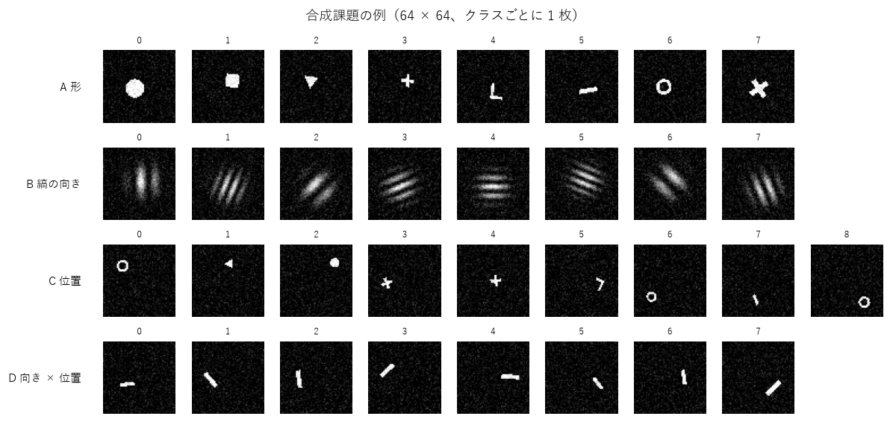

# SN2-Parts-2D 実験の歩み — 波で学ぶ部品を 2 次元へ

この資料は、SN2-Parts-2D の実験を、**番号順に、目的・方法・結果・得られたもの・問題点**の形で並べたものです。高校数学程度の知識で追えるように書いています。

- 数字の元になった記録は [NOTES.md](../NOTES.md)、実験のプログラムは `experiments/`、条件は `experiments/sweeps/sweepNN.sh`（NN = 実験番号）にあります。
- うまくいかなかった実験もすべて載せます。
- 土台の 1 次元版の歩みは [Sin-CNN2 の説明資料](https://github.com/devaf09/Sin-CNN2/blob/main/docs/experiments_guide.md) にあります。

---

## 1. この資料を読むための最小限の言葉

| 言葉 | 意味 |
|---|---|
| 場 | 光の明るさと位相を、画素ごとに並べたもの。この資料では縦 Ly × 横 Lx の 2 次元 |
| 位相 | 波のタイミングのずれ。山の位置がどれだけずれているか |
| 板（Sin の板） | 光の位相だけを遅らせる、模様のある透明な板。学習するのはこの模様 |
| 回折 | 波が広がりながら進むこと |
| 干渉 | 波が重なって、強め合ったり打ち消し合ったりすること |
| レンズ | 同じ向きに進む光を 1 点に集める。計算ではフーリエ変換 |
| 窓 | スクリーンの決まった場所。一番明るい窓のクラスを答えにする |
| 正解率（テスト） | 学習に使っていない問題のうち、正しく答えた割合 |
| 比較相手 | 昔からある方法。新しい方法の数字は、これと比べて初めて良し悪しが分かる |
| seed | 乱数の種。大事な結果は seed を 3 つ変えて平均する |
| 平均 ± 標準誤差 | 3 回の平均と、その平均のぶれの目安 |
| 計算量 | 時間とメモリ。この資料では GPU（RTX 3060）で測った値 |

---

## 2. 全体の流れ

| 段階 | 実験 | 問い | 一言でいうと |
|---|---|---|---|
| M1 基本部品 | 00〜05 | 2 次元の板と回折で、合成した模様を分類できるか | 向き・位置は小さな CNN に並んだ。形（平行移動しても同じ形と分かる）は大きく負けた |
| M2 得意分野 | | 融合・取消・足し算・語根が 2 次元でも成り立つか | 未着手 |
| M3 本物の画像 | | 手書き数字などを認識できるか | 未着手 |
| M4 受け渡し | | 音の研究（SN2-Acoustics）が部品として使えるか | 未着手 |
| M5 公開 | | 1 ファイルの最小版 1.0.0 | 未着手 |

---

## 3. 実験の一覧

判定: ◎ 大きな成果 / ○ 効いた / △ 一部効いた・確認 / × 効かなかった

| 番号 | 名前 | 判定 | 一言の結果 |
|---|---|---|---|
| 00 | 大きさごとの計算量 | △ | 2 次元は画素数に比例して重い。64 × 64 なら 1 次元の 2.5 倍。① の板は条件つきで軽い |
| 01 | 4 つの合成課題で板の形を比べる | ○ | 向き・位置・向き × 位置は CNN に並ぶ（99%+）。形は 71%。板の形は ① が一番 |
| 02 | 画像を位相として載せる | × | 形・組み合わせで大きく悪化。振幅として載せる方が良い |
| 03 | 区画の大きさ（容量） | △ | 学習する数を 4 倍にしても形は 70% のまま（容量ではなく汎化の問題）。波紋の持ち味は出ない |
| 04 | 2 次元の照明で位置の雑音を減らす | ○ | 形 70.6 → 79.9（照明 16 通り、計算約 8 倍）。CNN にはまだ届かない |
| 05 | アナログで作ったときの強さ | △ | 位相 4 ビット・雑音には強いが、板が 1 画素ずれるとほぼ偶然。① が少し強い |

---

## 4. 各実験の詳細

### 段階 M1: 基本部品

#### 実験00「大きさごとの計算量」△
- **目的**: 2 次元は 1 次元より画素がずっと多い（64 × 64 で 4096、256 × 256 で 65536）。実験の前に、どの大きさならどれだけ時間とメモリがかかるかを知る。
- **方法**: 板 16 枚の光路を 1 回学習させる計算を、場の大きさと板の形ごとに測る。板の形は 3 つ:
  ① 交点で掛け算（横方向の波と縦方向の波の組み合わせ）、② 斜めの縞、③ 波紋（池に石を投げたときのような輪）。
  ① は、入力も「横の模様 × 縦の模様」の形なら、2 次元の計算を横 1 列と縦 1 列の計算に分けられる。
- **結果**（1 件あたりの時間、ms）:

| 板の形 | 64 × 64 | 128 × 128 | 256 × 256 |
|---|---|---|---|
| 比較: 1 次元（1024 画素） | 0.06 | | |
| ② 斜めの縞（③ もほぼ同じ） | 0.15 | 0.50 | 1.96 |
| ① 横と縦に分けた計算 | 0.11 | 0.11 | 0.14 |

- **得られたもの**: 2 次元の計算は画素の数にほぼ比例して重くなる。最初の課題は 64 × 64 で行えば、1 回の学習が約 1 分で済む。① の板は、条件が合えば大きさによらず軽い。
- **問題点**: 256 × 256 では 256 件で 6GB のメモリを使い、照明を何通りも重ねる工夫はそのままでは載らない。① の軽い計算は、入力が「横 × 縦」の形のときだけ使える。

#### 実験01「4 つの合成課題で板の形を比べる」○
- **目的**: 2 次元の板と回折だけで、図形を見分けられるか。板の 3 つの形（① 交点で掛け算、② 斜めの縞、③ 波紋）で違いが出るか。
- **方法**: 64 × 64 の白黒の絵を 4 種類の課題として作った（下の図）。A は形 8 種（位置が少しずつずれる）、B は縞の向き 8 方向、C は小さな模様が 3 × 3 のどのマスにあるか、D は線の向き 4 種 × 左右どちらにあるか。
  どの板も学習する数を約 2000 個にそろえ、昔からの方法（ロジスティック回帰、小さなニューラルネット、同じくらいの大きさの小さな CNN）と比べた。

- **結果**（テスト正解率 %、3 seed の平均）:

| 方式 | A 形 | B 縞の向き | C 位置 | D 向き × 位置 |
|---|---|---|---|---|
| 偶然 | 12.5 | 12.5 | 11.1 | 12.5 |
| レンズの後の明るさで回帰 | 100 | 100 | 10.6 | 50.1 |
| 小さな CNN（約 2800 個） | 98.6 | 100 | 99.0 | 100 |
| **SinWave ① 交点で掛け算**（約 2000 個） | **70.6** | 99.9 | **99.8** | 99.4 |
| SinWave ② 斜めの縞 | 60.0 | 99.9 | 99.5 | 97.9 |
| SinWave ③ 波紋 | 60.5 | 99.9 | 99.4 | 97.5 |

- **得られたもの**: 向き・位置・その組み合わせは、小さな CNN と同じくらい正しく答えられた。レンズは「何があるか」は分かるが「どこにあるか」は分からない（C で 10.6%）。板はその前で、位置を光の向きに変えている。板の形では ① が一番良く、「① は横と縦を組み合わせた特徴が苦手」という予想は外れた。
- **問題点**: 形の課題は 71% で、CNN（98.6%）に大きく負けた。位置がずれても同じ形と答えるのが苦手（1 次元で問題になった「位置の雑音」と同じ）。計算は CNN の約 7 倍（1 件 45 µs）。③ 波紋は区画が小さいと縞と変わらず、持ち味が出ていない。

#### 実験02「画像を位相として載せる」×
- **目的**: 画像の明るさを、光の明るさ（振幅）ではなく、光のタイミングのずれ（位相）として載せたらどうか。1 次元の SinWave は文字を「明るさ 1 の波」として入れていたので、2 次元でも同じ方が良いのでは。
- **方法**: 実験01 と同じ課題で、入力だけを変えた。位相として載せるのは、透明な板の厚さで模様を表すのと同じ。
- **結果**（テスト正解率 %、3 seed）:

| 板 | 入力 | 形 | 縞の向き | 位置 | 向き × 位置 |
|---|---|---|---|---|---|
| ① | 振幅（実験01） | **70.6** | 99.9 | 99.8 | **99.4** |
| ① | 位相 | 55.2 | 99.9 | 99.8 | 69.3 |
| ② | 振幅（実験01） | **60.0** | 99.9 | 99.5 | **97.9** |
| ② | 位相 | 38.8 | 98.8 | 98.9 | 56.5 |

- **得られたもの**: 振幅として載せる方がはっきり良い。位相だと、何もない背景まで明るい光になり、模様の情報は小さなゆらぎに埋もれてしまうと考えられる。
- **問題点**: 光学の装置では位相だけの入力（透明な板）の方が光をむだにしないので、使うなら背景を打ち消す工夫が要る。

#### 実験03「区画の大きさ（容量）」△
- **目的**: 形の課題が苦手なのは、覚える力（学習する数）が足りないからか。波紋の板が縞と変わらなかったのは、区画が小さすぎて輪が見えないからか。
- **方法**: 板 1 枚を分ける区画の数を、縦横 2・4・8・16 個に変えた（学習する数は 137〜8201 個）。
- **結果**（形の課題、テスト正解率 %。括弧は学習に使った問題での正解率）:

| 板 | 2 × 2 | 4 × 4 | 8 × 8 | 16 × 16 |
|---|---|---|---|---|
| ① 交点で掛け算 | 47.0（50） | 63.7（74） | 70.6（94） | 70.4（97） |
| ② 斜めの縞 | 33.3（38） | 47.4（60） | 60.0（91） | 69.7（100） |
| ③ 波紋 | 33.7（39） | 47.4（61） | 60.5（92） | 70.9（100） |

- **得られたもの**: 区画を細かくすると、学習に使った問題は全部当たるようになるが、新しい問題は 70% のまま。苦手の原因は「覚える力」ではなく「位置がずれても同じ形と分かる力」だと分かった。学習する数が少ないときは ① が有利。
- **問題点**: 波紋の板は、区画を大きくしても縞の板と同じだった。「光を集める場所を学べる」という持ち味は、この課題では出ていない。

#### 実験04「2 次元の照明で位置の雑音を減らす」○
- **目的**: 形の課題が苦手なのは、絵のあちこちの光どうしが干渉して「位置の雑音」になるからではないか。1 次元で大きく効いた照明の工夫を 2 次元で試す。
- **方法**: 絵を縦横いくつかの区画に分け、区画ごとに少しずつ違う向きの光で照らした結果を何通りか平均する。こうすると、違う区画の光どうしの干渉がちょうど打ち消し合う（携帯電話が混信を消すのと同じ考え方）。
- **結果**（形の課題、テスト正解率 %）:

| 方式 | 形 | 計算（推論 1 件） |
|---|---|---|
| 小さな CNN | 98.6 | 6 µs |
| 板 ①、照明なし | 70.6 | 44 µs |
| 板 ①、照明 4 通り（2 × 2 の区画） | 73.9 | 129 µs |
| 板 ①、照明 16 通り（4 × 4 の区画） | **79.9** | 493 µs |

- **得られたもの**: 位置の雑音が苦手の原因の一つだと確かめられた。区画を細かくするほど良くなる。
- **問題点**: 照明の数だけ計算が増える。16 通りで CNN の約 80 倍の時間がかかり、それでも CNN に 19 点届かない。

#### 実験05「アナログで作ったときの強さ」△
- **目的**: いずれ光や電子回路の装置で作ることを考えて、部品の粗さや組み立ての誤差にどこまで耐えるかを知る。
- **方法**: コンピュータの中で学習した板に、わざと誤差を入れて答えさせた（板の模様を粗い段階に丸める、模様にばらつきを足す、板をずらす、板の間隔を変える、明るさの測定に雑音を足す）。
- **結果**（向き × 位置の課題、正解率 %）:

| 誤差 | ① 交点で掛け算 | ② 斜めの縞 | ③ 波紋 |
|---|---|---|---|
| なし | 99.4 | 97.9 | 97.5 |
| 模様を 16 段階に丸める | 97.6 | 94.0 | 93.1 |
| 明るさの測定に 20% の雑音 | 92.5 | 88.7 | 87.8 |
| 板の間隔が ±1% 違う | 98.6 | 96.8 | 95.7 |
| 板が 1 画素ずれる | 18.4 | 16.9 | 14.2 |

- **得られたもの**: 模様は粗くてよく（16 段階で十分）、雑音にも強いので、部品は安く作れる。① はどの誤差でも少し強い。
- **問題点**: 板が 1 画素ずれるだけで、ほぼ当てずっぽうになる（1 次元のときよりさらに弱い）。作った後に、その装置の上で学習し直す前提が必要。

---

## 5. まとめ

### 効いたもの
1. 板を通してからレンズで読む（実験01）— 位置を光の向きに変えるので、位置と向きの両方が分かる
2. 2 次元の照明（実験04）— 位置の雑音を消して、形の課題が 71 → 80%

### 効かなかったもの
- 画像を位相として載せる（実験02）

### まだ解けていないこと
- 位置がずれても同じ形と分かること（形の課題 71%、CNN 98.6%、実験01）
- 計算量（推論が CNN の約 7 倍、実験01）
- 板の位置合わせへの弱さ（1 画素のずれでほぼ偶然、実験05）
- M2〜M5

---

## 6. 改良できそうな点（挑戦したい人へ）

| テーマ | アイデア | 関連する実験 |
|---|---|---|
| 計算量 | 画像を「横 × 縦」の形の和に分けて、① の軽い計算を使う | 00 |
| 形の認識 | 照明の工夫・虹で位置の雑音を減らす、典型の模様と比べて読む | 01 |
| 波紋の板 | 区画を大きくして、輪の中心に光を集める働きを活かす | 01 |
