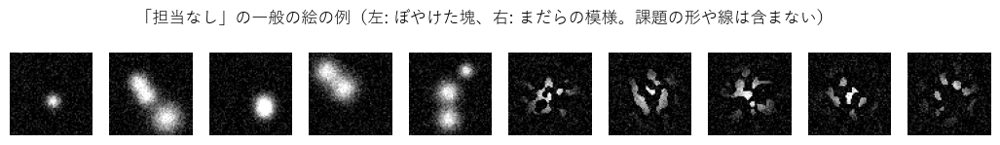
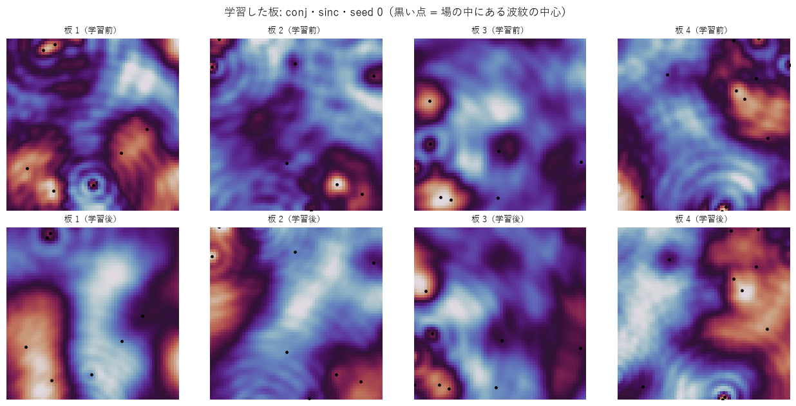
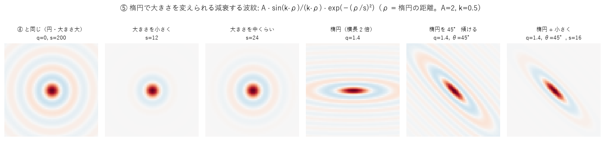
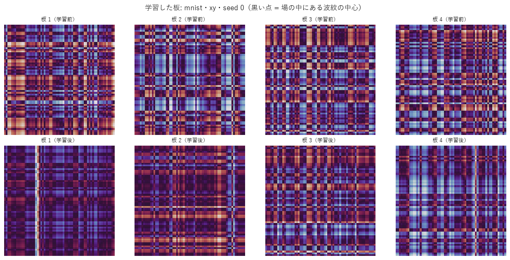

# SN2-Parts-2D 実験の歩み — 波で学ぶ部品を 2 次元へ

この資料は、SN2-Parts-2D の実験を、**番号順に、目的・方法・結果・得られたもの・問題点**の形で並べたものです。高校数学程度の知識で追えるように書いています。

- 数字の元になった記録は [NOTES.md](../NOTES.md)、画像認識の実験のプログラムは `experiments/image/`、条件は `experiments/image/sweeps/sweepNN.sh`（NN = 実験番号）にあります。
- うまくいかなかった実験もすべて載せます。
- 土台の 1 次元版の歩みは [Sin-CNN2 の説明資料](https://github.com/devaf09/Sin-CNN2/blob/main/docs/experiments_guide.md) にあります。

---

## 1. この資料を読むための最小限の言葉

| 言葉 | 意味 |
|---|---|
| 場 | 光の明るさと位相を、画素ごとに並べたもの。この資料では縦 Ly × 横 Lx の 2 次元 |
| 位相 | 波のタイミングのずれ。山の位置がどれだけずれているか |
| 板（Sin の板） | 光の位相だけを遅らせる、模様のある透明な板。学習するのはこの模様 |
| 回折 | 波が広がりながら進むこと |
| 干渉 | 波が重なって、強め合ったり打ち消し合ったりすること |
| レンズ | 同じ向きに進む光を 1 点に集める。計算ではフーリエ変換 |
| 窓 | スクリーンの決まった場所。一番明るい窓のクラスを答えにする |
| 正解率（テスト） | 学習に使っていない問題のうち、正しく答えた割合 |
| 比較相手 | 昔からある方法。新しい方法の数字は、これと比べて初めて良し悪しが分かる |
| seed | 乱数の種。大事な結果は seed を 3 つ変えて平均する |
| 平均 ± 標準誤差 | 3 回の平均と、その平均のぶれの目安 |
| 計算量 | 時間とメモリ。この資料では GPU（RTX 3060）で測った値 |

---

## 2. 全体の流れ

| 段階 | 実験 | 問い | 一言でいうと |
|---|---|---|---|
| M1 基本部品 | 00〜06 | 2 次元の板と回折で、合成した模様を分類できるか | 向き・位置は小さな CNN に並んだ。形（平行移動しても同じ形と分かる）は大きく負けた |
| M2 得意分野 | 07〜10 | 融合・取消・足し算・語根が 2 次元でも成り立つか | 取消は完全。「担当なし」の絵を見せれば、足すだけの融合が同時学習に並ぶ |
| M3 本物の画像 | 15〜 | 手書き数字などを認識できるか | MNIST 94.4%。定番の回帰を上回るが、小さな CNN には届かない |
| M4 受け渡し | | 音の研究（SN2-Acoustics）が部品として使えるか | 未着手 |
| M5 公開 | | 1 ファイルの最小版 1.0.0 | 未着手 |

---

## 3. 実験の一覧

判定: ◎ 大きな成果 / ○ 効いた / △ 一部効いた・確認 / × 効かなかった

| 番号 | 名前 | 判定 | 一言の結果 |
|---|---|---|---|
| 00 | 大きさごとの計算量 | △ | 2 次元は画素数に比例して重い。64 × 64 なら 1 次元の 2.5 倍。① の板は条件つきで軽い |
| 01 | 4 つの合成課題で板の形を比べる | ○ | 向き・位置・向き × 位置は CNN に並ぶ（99%+）。形は 71%。板の形は ① が一番 |
| 02 | 画像を位相として載せる | × | 形・組み合わせで大きく悪化。振幅として載せる方が良い |
| 03 | 区画の大きさ（容量） | △ | 学習する数を 4 倍にしても形は 70% のまま（容量ではなく汎化の問題）。波紋の持ち味は出ない |
| 04 | 2 次元の照明で位置の雑音を減らす | ○ | 形 70.6 → 79.9（照明 16 通り、計算約 8 倍）。CNN にはまだ届かない |
| 05 | アナログで作ったときの強さ | △ | 位相 4 ビット・雑音には強いが、板が 1 画素ずれるとほぼ偶然。① が少し強い |
| 06 | 学習した板を大きな場へ移す | × | 引き伸ばしも敷き詰めも、学習し直さないと働かない（15% / 10%） |
| 07 | 2 つの技能を足すだけで融合 | △ | 取消は完全。融合は 80.8%（同時に学習 99.4%）で、1 次元より大きく落ちる |
| 08 | 融合の目盛りを少量のデータで合わせる | △ | 80.8 → 86.8%。少し効くが同時に学習（99.4%）には遠い |
| 09 | 共通の出発点からの足し算 | × | 1 本の光路への足し算は壊れる（59.9%）。1 次元の結果は再現しない |
| 10 | 「担当なし」の絵を見せて融合 | ◎ | 相手のデータなしで、足すだけの融合が 80.8 → 100%（同時に学習 99.4%）。形は 57.7% |
| 11 | ④ 減衰する波紋の板（持ち主の案） | ○ | 向き × 位置で最良（99.8〜100%）。形は 62%（① 71%）だが、平行移動にいちばん強い |
| 12 | 技能を 4 つに増やした融合 | ◎ | 担当なしの学習があれば 4 技能でも足すだけで 100%（なしなら 35%） |
| 13 | ④ 波紋を増やして浅くする | ○ | 128 個・深さ半分で形 76.3%（照明なしの板で最良） |
| 14 | ⑤ 楕円で大きさを変えられる波紋（持ち主の案） | △ | ④ と同程度。形では少し下 |
| 15 | 本物の画像（MNIST・Fashion-MNIST） | ◎ | MNIST 94.4%（回帰 92.5% を 1/20 の数で上回る）。CNN 97.8% には届かない |
| 16 | 学習曲線（何ステップで十分か） | ○ | 板 ① は約 5000 ステップ（3 分）で十分。過学習は小さい。④ は学習が不安定 |
| 17 | 学習率を最後に 0 まで下げる | ◎ | 谷が消え、最後が一番良くなる。④ が MNIST 88.5 → 95.7%（最良） |
| 18 | ④ 波紋の数の種類ごとの学習率 | ○ | 中心を大きく・幅を小さく動かすと MNIST 96.3%・Fashion 85.9%（最良） |
| 19 | ④ 波紋の中心の初期配置 | △ | 格子・ずらし・でたらめで差はない |
| 21 | 学習の谷の理由 | ○ | 谷は学習の揺れ（訓練も一緒に落ちる）。似た上着どうしが入れ替わる。移動平均で防げる |
| 20 | 親から子を作る木（持ち主の構想） | × | 子の作り方（でたらめ・同じ初期・親から派生・前半共有）でほぼ差がない |
| 22 | 符号で読む（窓の数に縛られない、持ち主の案） | △ | 窓の模様でクラスを表すと 1 クラス 1 窓と同等以上。足したクラスは古いクラスを奪う。部品だけの定義は当たらない |
| 23 | 典型の模様で符号をそろえてクラスを足す | ○ | 学習なしで 2 クラス足しても 10 クラスで 76.3%（そろえないと 54%） |
| 24 | 部品の符号の和だけで見せないクラスを当てる | × | どのクラスでも 0〜9%。部品を共有するクラスに吸い込まれる |
| 26 | 部品ごとの窓で例のないクラスを当てる | ◎ | 例を見せないコート・ブーツ・スニーカーを部品だけで 77〜82%（1 次元の語根と同じ） |
| 27 | 光学相関器で「どこに何があるか」 | ○ | 数字の位置に光が集まり、2 本を色で重ねて 3 と 7 の位置が見える。別の数字との見分けはまだ弱い |
| 25 | 親から子の木を測り直す | × | 学習率を 0 まで下げても、子の作り方で差はない |
| 28 | 光学相関器を 2 段にして間に非線形 | ◎ | 見分けの強さ 89/82 → 97/97%、誤報が半分 |
| 29 | 共通する特徴を引く・相手を引く（持ち主の案） | △ | 共通を引くのは効かない。相手を引くのは 1 段のときに効く |
| 30 | 10 種類の数字の位置を同時に出す | ○ | 10 本の光路を別々に学習して色で融合。数字の位置ごとに 85% 正しい |

---

## 4. 各実験の詳細

### 段階 M1: 基本部品

#### 実験00「大きさごとの計算量」△
- **目的**: 2 次元は 1 次元より画素がずっと多い（64 × 64 で 4096、256 × 256 で 65536）。実験の前に、どの大きさならどれだけ時間とメモリがかかるかを知る。
- **方法**: 板 16 枚の光路を 1 回学習させる計算を、場の大きさと板の形ごとに測る。板の形は 3 つ:
  ① 交点で掛け算（横方向の波と縦方向の波の組み合わせ）、② 斜めの縞、③ 波紋（池に石を投げたときのような輪）。
  ① は、入力も「横の模様 × 縦の模様」の形なら、2 次元の計算を横 1 列と縦 1 列の計算に分けられる。
- **結果**（1 件あたりの時間、ms）:

| 板の形 | 64 × 64 | 128 × 128 | 256 × 256 |
|---|---|---|---|
| 比較: 1 次元（1024 画素） | 0.06 | | |
| ② 斜めの縞（③ もほぼ同じ） | 0.15 | 0.50 | 1.96 |
| ① 横と縦に分けた計算 | 0.11 | 0.11 | 0.14 |

- **得られたもの**: 2 次元の計算は画素の数にほぼ比例して重くなる。最初の課題は 64 × 64 で行えば、1 回の学習が約 1 分で済む。① の板は、条件が合えば大きさによらず軽い。
- **問題点**: 256 × 256 では 256 件で 6GB のメモリを使い、照明を何通りも重ねる工夫はそのままでは載らない。① の軽い計算は、入力が「横 × 縦」の形のときだけ使える。

#### 実験01「4 つの合成課題で板の形を比べる」○
- **目的**: 2 次元の板と回折だけで、図形を見分けられるか。板の 3 つの形（① 交点で掛け算、② 斜めの縞、③ 波紋）で違いが出るか。
- **方法**: 64 × 64 の白黒の絵を 4 種類の課題として作った（下の図）。A は形 8 種（位置が少しずつずれる）、B は縞の向き 8 方向、C は小さな模様が 3 × 3 のどのマスにあるか、D は線の向き 4 種 × 左右どちらにあるか。
  どの板も学習する数を約 2000 個にそろえ、昔からの方法（ロジスティック回帰、小さなニューラルネット、同じくらいの大きさの小さな CNN）と比べた。

- **結果**（テスト正解率 %、3 seed の平均）:

| 方式 | A 形 | B 縞の向き | C 位置 | D 向き × 位置 |
|---|---|---|---|---|
| 偶然 | 12.5 | 12.5 | 11.1 | 12.5 |
| レンズの後の明るさで回帰 | 100 | 100 | 10.6 | 50.1 |
| 小さな CNN（約 2800 個） | 98.6 | 100 | 99.0 | 100 |
| **SinWave ① 交点で掛け算**（約 2000 個） | **70.6** | 99.9 | **99.8** | 99.4 |
| SinWave ② 斜めの縞 | 60.0 | 99.9 | 99.5 | 97.9 |
| SinWave ③ 波紋 | 60.5 | 99.9 | 99.4 | 97.5 |

- **得られたもの**: 向き・位置・その組み合わせは、小さな CNN と同じくらい正しく答えられた。レンズは「何があるか」は分かるが「どこにあるか」は分からない（C で 10.6%）。板はその前で、位置を光の向きに変えている。板の形では ① が一番良く、「① は横と縦を組み合わせた特徴が苦手」という予想は外れた。
- **問題点**: 形の課題は 71% で、CNN（98.6%）に大きく負けた。位置がずれても同じ形と答えるのが苦手（1 次元で問題になった「位置の雑音」と同じ）。計算は CNN の約 7 倍（1 件 45 µs）。③ 波紋は区画が小さいと縞と変わらず、持ち味が出ていない。

#### 実験02「画像を位相として載せる」×
- **目的**: 画像の明るさを、光の明るさ（振幅）ではなく、光のタイミングのずれ（位相）として載せたらどうか。1 次元の SinWave は文字を「明るさ 1 の波」として入れていたので、2 次元でも同じ方が良いのでは。
- **方法**: 実験01 と同じ課題で、入力だけを変えた。位相として載せるのは、透明な板の厚さで模様を表すのと同じ。
- **結果**（テスト正解率 %、3 seed）:

| 板 | 入力 | 形 | 縞の向き | 位置 | 向き × 位置 |
|---|---|---|---|---|---|
| ① | 振幅（実験01） | **70.6** | 99.9 | 99.8 | **99.4** |
| ① | 位相 | 55.2 | 99.9 | 99.8 | 69.3 |
| ② | 振幅（実験01） | **60.0** | 99.9 | 99.5 | **97.9** |
| ② | 位相 | 38.8 | 98.8 | 98.9 | 56.5 |

- **得られたもの**: 振幅として載せる方がはっきり良い。位相だと、何もない背景まで明るい光になり、模様の情報は小さなゆらぎに埋もれてしまうと考えられる。
- **問題点**: 光学の装置では位相だけの入力（透明な板）の方が光をむだにしないので、使うなら背景を打ち消す工夫が要る。

#### 実験03「区画の大きさ（容量）」△
- **目的**: 形の課題が苦手なのは、覚える力（学習する数）が足りないからか。波紋の板が縞と変わらなかったのは、区画が小さすぎて輪が見えないからか。
- **方法**: 板 1 枚を分ける区画の数を、縦横 2・4・8・16 個に変えた（学習する数は 137〜8201 個）。
- **結果**（形の課題、テスト正解率 %。括弧は学習に使った問題での正解率）:

| 板 | 2 × 2 | 4 × 4 | 8 × 8 | 16 × 16 |
|---|---|---|---|---|
| ① 交点で掛け算 | 47.0（50） | 63.7（74） | 70.6（94） | 70.4（97） |
| ② 斜めの縞 | 33.3（38） | 47.4（60） | 60.0（91） | 69.7（100） |
| ③ 波紋 | 33.7（39） | 47.4（61） | 60.5（92） | 70.9（100） |

- **得られたもの**: 区画を細かくすると、学習に使った問題は全部当たるようになるが、新しい問題は 70% のまま。苦手の原因は「覚える力」ではなく「位置がずれても同じ形と分かる力」だと分かった。学習する数が少ないときは ① が有利。
- **問題点**: 波紋の板は、区画を大きくしても縞の板と同じだった。「光を集める場所を学べる」という持ち味は、この課題では出ていない。

#### 実験04「2 次元の照明で位置の雑音を減らす」○
- **目的**: 形の課題が苦手なのは、絵のあちこちの光どうしが干渉して「位置の雑音」になるからではないか。1 次元で大きく効いた照明の工夫を 2 次元で試す。
- **方法**: 絵を縦横いくつかの区画に分け、区画ごとに少しずつ違う向きの光で照らした結果を何通りか平均する。こうすると、違う区画の光どうしの干渉がちょうど打ち消し合う（携帯電話が混信を消すのと同じ考え方）。
- **結果**（形の課題、テスト正解率 %）:

| 方式 | 形 | 計算（推論 1 件） |
|---|---|---|
| 小さな CNN | 98.6 | 6 µs |
| 板 ①、照明なし | 70.6 | 44 µs |
| 板 ①、照明 4 通り（2 × 2 の区画） | 73.9 | 129 µs |
| 板 ①、照明 16 通り（4 × 4 の区画） | **79.9** | 493 µs |

- **得られたもの**: 位置の雑音が苦手の原因の一つだと確かめられた。区画を細かくするほど良くなる。
- **問題点**: 照明の数だけ計算が増える。16 通りで CNN の約 80 倍の時間がかかり、それでも CNN に 19 点届かない。

#### 実験05「アナログで作ったときの強さ」△
- **目的**: いずれ光や電子回路の装置で作ることを考えて、部品の粗さや組み立ての誤差にどこまで耐えるかを知る。
- **方法**: コンピュータの中で学習した板に、わざと誤差を入れて答えさせた（板の模様を粗い段階に丸める、模様にばらつきを足す、板をずらす、板の間隔を変える、明るさの測定に雑音を足す）。
- **結果**（向き × 位置の課題、正解率 %）:

| 誤差 | ① 交点で掛け算 | ② 斜めの縞 | ③ 波紋 |
|---|---|---|---|
| なし | 99.4 | 97.9 | 97.5 |
| 模様を 16 段階に丸める | 97.6 | 94.0 | 93.1 |
| 明るさの測定に 20% の雑音 | 92.5 | 88.7 | 87.8 |
| 板の間隔が ±1% 違う | 98.6 | 96.8 | 95.7 |
| 板が 1 画素ずれる | 18.4 | 16.9 | 14.2 |

- **得られたもの**: 模様は粗くてよく（16 段階で十分）、雑音にも強いので、部品は安く作れる。① はどの誤差でも少し強い。
- **問題点**: 板が 1 画素ずれるだけで、ほぼ当てずっぽうになる（1 次元のときよりさらに弱い）。作った後に、その装置の上で学習し直す前提が必要。

#### 実験06「学習した板を大きな場へ移す」×
- **目的**: 小さな場で学習した板を、学習し直さずに大きな場で使えるか（1 次元では「敷き詰め」で完全に同じ働きになった）。
- **方法**: 64 × 64 で学習した板を 128 × 128 にする。(1) 模様を 2 倍に引き伸ばし、板の間隔を 4 倍に（回折の効き方をそろえる理屈）。(2) 板を 2 × 2 に並べる（敷き詰め）。
- **結果**（向き × 位置の課題、板 ①、正解率 %）: 元 99.4、引き伸ばし 15.2、敷き詰め 10.4、128 でゼロから学習 99.0〜99.6。入力の絵も 2 × 2 に並べたときだけ元と完全に同じ（99.4）。
- **得られたもの**: 理屈どおりの条件（絵も敷き詰める）では完全に同じ働きになることを確かめた。
- **問題点**: 普通の絵では、どちらの方法も働かない。2 次元で大きさを変えるときは、今のところ学習し直す必要がある。

#### 実験07「2 つの技能を足すだけで融合」△
- **目的**: SinWave の一番の特徴「別々に学習した技能を、明るさを足すだけで合わせられ、外せば元に戻る」が 2 次元でも成り立つか。
- **方法**: 8 種類の答えを 4 種類ずつ 2 つの技能に分け、別々の光路をそれぞれのデータだけで学習した。そのあと 2 つの光路の明るさを足して、8 種類の中から答えさせた。
- **結果**（向き × 位置の課題、正解率 %）:

| 方式 | 正解率 |
|---|---|
| 技能 A 単独（自分の 4 種類の中で） | 99.7 |
| 2 つを足すだけで融合（8 種類の中で） | 80.8 |
| 8 種類を 1 本で同時に学習 | 99.4 |
| 融合から B を外したものと A 単独の差 | 0（完全に同じ） |

- **得られたもの**: 外せば完全に元に戻る（取消）は 2 次元でも成り立つ。
- **問題点**: 足すだけの融合は 19 点落ちた（1 次元では 1 点）。各技能が、相手の技能の絵にも明るく反応してしまい、どちらの技能の入力かを取り違える。

#### 実験08「融合の目盛りを少量のデータで合わせる」△
- **目的**: 実験07 の融合で技能を取り違えるのは、2 つの光路の「明るさの目盛り」がそろっていないからではないか。
- **方法**: 板はそのままで、各光路の明るさの倍率と窓ごとの下駄（全部で 18 個の数）だけを、両方の技能の絵を少し（40〜1000 枚）使って合わせた。
- **結果**（向き × 位置、正解率 %）: 合わせない 80.8 → 40 枚 85.4 → 1000 枚 86.8。同時に学習すると 99.4。
- **得られたもの**: 少しは良くなり、40 枚でほぼ十分。
- **問題点**: 目盛りを合わせるだけでは、相手の技能の絵に自分の窓が明るく反応すること自体は直らない。

#### 実験09「共通の出発点からの足し算」×
- **目的**: 1 次元では、同じ出発点から別々に追加学習した 2 つの技能の「変化分」を足すと、1 本の光路のまま融合できた。2 次元でも成り立つか。
- **方法**: 縞の向きを学習した光路を出発点にして、技能 A・B をそれぞれ追加学習した。出発点 + A の変化分 + B の変化分 を 1 本の光路にした。
- **結果**（向き × 位置、正解率 %）: 足し算 59.9、派生させた 2 本を並べて足す 88.1、同時に学習 99.4。
- **得られたもの**: 1 次元の成果がそのままは 2 次元に移らないことが分かった。同じ出発点から作ると、並べて足す融合は少し良くなる（80.8 → 88.1）。
- **問題点**: 2 次元では、2 つの技能の変化分が同じ光の通り道で重なり、互いの働きを壊していると考えられる（未確認）。

#### 実験10「担当なしの絵を見せて融合」◎
- **目的**: 融合で技能を取り違えるのは、各技能が「自分の担当でない絵」を見たことがないから。相手の技能のデータを使わずに、それを教えられないか。
- **方法**: どの課題とも関係のない絵（ぼやけた塊や、まだらの模様）を「担当なし」として見せ、そのときはどの窓も同じ明るさにする（答えを出さない）ように学習させた。相手の技能の絵は一切見せない。

- **結果**（正解率 %）:

| 方式 | 向き × 位置 | 形 |
|---|---|---|
| 足すだけの融合（実験07） | 80.8 | 39.4 |
| **担当なしの絵を見せて、足すだけの融合** | **100.0** | **57.7** |
| 8 種類を 1 本で同時に学習 | 99.4 | 70.6 |

- **得られたもの**: 相手のデータを使わずに、足すだけの融合が同時に学習したのと同じ以上になった。1 次元の SinWave の「別々に学んで足すだけ」が 2 次元でも成り立つ。
- **問題点**: 形の課題では、同時に学習した場合に 13 点届かない。似た形どうしの区別は、関係のない絵だけからは学びにくい。

#### 実験11「④ 減衰する波紋の板」○（持ち主の案）
- **目的**: 池に石を落としたときのような、中心が深くて外ほど浅くなる波紋を何個か重ねるだけで板を作れないか。波紋 1 つは「深さ・幅・中心の位置」の 4 つの数だけで決まる。

- **方法**: 板 1 枚に波紋を 32 個（または 128 個）重ね、4 つの数をすべて学習させた。学習する数は、波紋 32 個で ①②③ とちょうど同じ（約 2000 個）。
- **結果**（テスト正解率 %）:

| 板 | 形 | 縞の向き | 位置 | 向き × 位置 |
|---|---|---|---|---|
| ① 交点で掛け算 | **70.6** | 99.9 | **99.8** | 99.4 |
| **④ 減衰する波紋 32 個** | 62.3 | 99.0 | 98.9 | **99.8** |
| ④ 減衰する波紋 128 個 | 33.2 | **100** | **99.9** | **100** |

- **得られたもの**: 向き × 位置では、どの板より良い。形の課題では ① に負けるが、学習に使った問題と新しい問題の差がいちばん小さい（4 点。① は 23 点）。位置がずれても崩れにくい板になっている。
- **問題点**: 形の課題は覚えきれていない。波紋を 128 個にすると、重なった波紋が深くなりすぎて学習が進まない。

#### 実験12「技能を 4 つに増やした融合」◎
- **目的**: 1 次元では、技能が増えるほど融合した後の正解率が落ちた。2 次元で、実験10 の「担当なし」の学習を使うとどうなるか。
- **方法**: 8 種類の答えを 2 種類ずつ 4 つの技能に分け、それぞれ自分のデータと担当なしの絵だけで学習し、明るさを足して融合した。
- **結果**（向き × 位置、正解率 %）: 担当なしの学習あり 100.0、なし 35.1、8 種類を 1 本で同時に学習 99.4。
- **得られたもの**: 技能を 4 つにしても、足すだけで同時に学習したのと同じ以上になった。
- **問題点**: 計算は技能の数だけ増える。

#### 実験13「④ 波紋を増やして浅くする」○
- **目的**: ④ の波紋を 128 個に増やすと学習が進まなかった（重なった波紋が深くなりすぎた）。最初の深さを浅くすれば直るか。
- **結果**（形の課題、正解率 %）: 128 個・深さそのまま 33.2 → **128 個・深さ半分 76.3**（① 70.6、④ 32 個 62.3）。照明を足すのは効かなかった。
- **得られたもの**: 照明なしの板で一番良い。学習に使った問題と新しい問題の差も小さいまま（4 点）。
- **問題点**: 学習する数が 4 倍（8201 個）になる。

#### 実験14「⑤ 楕円で大きさを変えられる波紋」△（持ち主の案）
- **目的**: ④ の波紋に、楕円（縦横の比と角度）と、届く範囲の大きさを足すと良くなるか。

- **結果**（正解率 %）: 形 56.7（④ 62.3）、縞の向き 99.6、位置 99.2、向き × 位置 99.1。
- **得られたもの**: 波紋の形を細かく決められるようにしても、同じ学習する数では ④ と同程度だった。
- **問題点**: 1 つの波紋に使う数が増えた分、波紋の数が 32 → 18 個に減った。形の課題では、波紋の数の方が効くようだ。

#### 実験15「本物の画像（MNIST・Fashion-MNIST）」◎
- **目的**: 手書き数字（MNIST）と服の絵（Fashion-MNIST）を認識できるか。
- **方法**: 28 × 28 の画像を 64 × 64 の場の真ん中に置いて学習した。比較相手はロジスティック回帰と小さな CNN。
- **結果**（テスト正解率 %、3 seed の平均）:

| 方式 | 学習する数 | MNIST | Fashion-MNIST |
|---|---|---|---|
| ロジスティック回帰 | 約 4 万 | 92.5 | 84.4 |
| 小さな CNN | 約 2900 | **97.8** | **86.1** |
| **SinWave 板 ①** | 約 2000 | **94.4** | 84.4 |
| SinWave ④ 波紋 32 個 | 約 2000 | 86.6 | 55.9（seed によって崩れる） |

- **得られたもの**: 手書き数字で、定番のロジスティック回帰を、20 分の 1 の学習する数で上回った。
- **問題点**: 小さな CNN にはまだ 3 点ほど届かない。学習の時間は CNN の約 16 倍。

#### 実験16「学習曲線（何ステップで十分か）」○（持ち主の依頼）
- **目的**: どのくらい学習すれば十分か、覚えすぎ（過学習）が起きるかを知り、計算の目安にする。
- **方法**: MNIST・Fashion-MNIST で 1 万ステップまで学習し、途中で何度も正解率を測った。「十分に学習した」は、その後の一番良い値から 0.5 点以内に入った最初の時点とした。

- **結果**（MNIST）: 板 ① は約 5000 ステップ（学習 3 分強）で十分（最高 95.1%）。小さな CNN は約 3700 ステップ（10 秒、98.1%）、回帰は約 900 ステップ（1 秒、92.8%）。
- **得られたもの**: どの方式も、学習に使った問題と新しい問題の差は最後まで 1〜3 点で、覚えすぎは起きなかった。板 ① の学習は 5000 ステップを目安にすればよい。
- **問題点**: 十分に学習するまでの時間は CNN の約 20 倍。④ 波紋の板は、学習の途中で正解率が大きく上下して安定しない。

#### 実験17「学習率を最後に 0 まで下げる」◎
- **目的**: 学習の途中で正解率が上下する（谷がある）。谷で学習を終えるともったいない。原因は、学習の歩幅（学習率）が最後まで大きいことではないか。
- **方法**: 学習率を、最初は今までどおり、最後は 0 になるように、なめらかに下げていった（cosine という決め方）。

- **結果**（テスト正解率 %）: ④ 波紋 128 個は MNIST 88.5 → **95.7**、Fashion-MNIST 79.9 → 84.8。板 ① は MNIST 94.7 → 95.3。
- **得られたもの**: どれも最後が一番良くなり、谷で終わることがなくなった。④ が弱く見えたのは板の形のせいではなく、学習のしかたのせいだった。
- **問題点**: 小さな CNN（MNIST 98.1%）にはまだ届かない。

#### 実験18「④ 波紋の数の種類ごとの学習率」○
- **目的**: 波紋の中心（画素で 0〜64）と幅（0.03〜1.5）は単位がまったく違うのに、同じ歩幅で学習していた。種類ごとに歩幅を変えると良くなるか。
- **結果**（正解率 %）: 中心を 10 倍・幅を 0.1 倍の歩幅にすると、MNIST 95.7 → **96.3**、Fashion-MNIST 84.8 → **85.9**（どちらもこれまでの最良）。
- **問題点**: 小さな CNN（98.1 / 87.6）にはまだ届かない。

#### 実験19「④ 波紋の中心の初期配置」△（持ち主の問い）
- **目的**: 学習前の波紋の中心は、整然と並べる方がよいか、でたらめがよいか。
- **結果**（正解率 %）: でたらめ 95.7、格子 95.9、格子＋少しずらす 95.8（MNIST）。差はほとんどない。
- **得られたもの**: 初期配置は気にしなくてよい。装置で作るなら、作りやすい格子で始めてよい。

#### 実験21「学習の谷の理由」○（持ち主の問い）
- **目的**: 学習中に正解率が落ち込むのは、的外れな着眼点（服の影を服の特徴として覚えるなど）のせいか、学習の揺れのせいか。
- **方法**: 50 ステップごとに、新しい問題と学習に使った問題の正解率、種類ごとの正解率を測った。

- **結果**: 落ち込みは 95 回とも、学習に使った問題でも一緒に落ちていた。落ちるのは似た上着（プルオーバー・コート・T シャツ・シャツ）どうしが入れ替わる形だった。
- **得られたもの**: 谷は的外れな着眼点ではなく、似た種類の境目が行ったり来たりする学習の揺れ。学習率を最後に 0 まで下げるか、板の平均（移動平均）で答えれば防げる。

#### 実験20「親から子を作る木」×（持ち主の構想）
- **目的**: 服をおおまかに見分ける「親」の光路から、細かい種類を見分ける「子」の光路を作ると有利か。融合するとき、学習前の板が同じ方が有利か。
- **方法**: 親 = 上着類・靴・その他の 3 分類。子 = それぞれの中の細かい分類。子を「別々のでたらめから」「同じでたらめから」「親から」「親の前半を共有」の 4 通りで作り、比べた。
- **結果**（10 分類への融合、正解率 %）: 別々 79.2、同じ 77.4、親から 79.1、前半共有 75.7（1 本で同時に学習すると 85.3）。データを 1 種類 300 枚に減らしても、ほぼ同じ。
- **得られたもの**: 今の形では、子の作り方で差は出なかった。
- **問題点**: 学習の設定が古い（学習率一定・短い学習）。学習率を 0 まで下げて測り直す必要がある。

#### 実験22「符号で読む」△（持ち主の案）
- **目的**: 「1 種類 = 1 つの窓」だと、種類が増えると窓が足りなくなる。窓の数は決めたまま、種類を窓の明るさの模様（符号）で表せないか。
- **結果**（服の絵 10 種類、正解率 %）: 1 種類 1 窓 84.2、窓 16 個の模様 84.5〜85.3。学習なしで 2 種類を足すと、新しい 2 種類は 97% 当たるが、全体は 54% に落ちる。部品の組み合わせだけで決めたコートは当たらない（9%）。
- **得られたもの**: 種類を窓の模様で表しても、1 種類 1 窓と同じ以上に当たる。窓の数に縛られない読み方の土台になる。
- **問題点**: 学習なしで足した種類が、古い種類の絵まで奪ってしまう。部品だけで新しい種類を作るのはまだできない。

#### 実験26「部品ごとの窓で、例のないクラスを当てる」◎（持ち主の案）
- **目的**: 「上半身・長袖・前開き」のような部品を見つけて組み合わせれば、例を 1 つも見せていない服（コート）を当てられないか。
- **方法**: 部品ごとに窓を 1 つ持たせ、「その部品があるか」を学習した。コートの絵は一度も見せず、「コート = 上半身 + 長袖 + 前開き」と定義だけした。部品の出やすさの偏りを差し引いて答える。
- **結果**（10 種類の中から、正解率 %）: 見せていないコート 76.9、ブーツ 80.8、スニーカー 81.6（偶然 10%）。見せた種類は 62〜63%。
- **得られたもの**: 例のない物を部品の組み合わせで認識できた。1 次元の SinWave の「語根」と同じことが 2 次元でもできる。
- **問題点**: 見せた種類の正解率が下がる（新しい種類に引き寄せられる）。プルオーバーのように、ほかの種類の部品の一部になっている種類は、強い補正が要る。

#### 実験27「光学相関器で、どこに何があるか」○（持ち主の案）
- **目的**: 2 つの光路を融合したとき、「ここが 3、ここが 7」と場所ごとに答えを出せないか。
- **方法**: レンズ → 模様の板 → もう一度レンズ、という昔からある光学の装置（光学相関器）を使う。探す物がある場所に光が集まる。3 を探す光路と 7 を探す光路を作り、別の色で重ねた。

- **結果**: 探す数字の位置で 95〜99% 光った。ただし、別の数字の位置でも光ることが多く、見分けの強さ（AUC）は 82〜89%。
- **得られたもの**: 「どこに何があるか」を 1 枚の出力で見せる土台ができた。学習は 15 秒と速い。
- **問題点**: 似た数字との見分けが弱い。板を何枚重ねても、光のままでは 1 枚と同じ働きしかしないので、途中で明るさを測って光を出し直す段が要りそう（実験28）。

#### 実験28「光学相関器を 2 段にして、間に非線形」◎
- **目的**: 光学相関器は、探す数字以外でも光ってしまう。光のままでは何枚重ねても 1 枚と同じなので、途中で明るさを測って、その明るさで光を出し直す段（カメラと表示器のつなぎ）を入れる。
- **結果**: 見分けの強さ（AUC）が 3 で 89 → **97**、7 で 82 → **97**。ほかの数字で光る誤報は半分（61 → 37%）になった。
- **得られたもの**: 見分けを強くするのは、段の数ではなく、間の非線形。
- **問題点**: 装置で作るには、明るさを測って光を出し直す部品が要る。

#### 実験29「共通する特徴を引く・相手を引く」△（持ち主の案）
- **目的**: 誤反応は「白い線がある」という共通の特徴のせいではないか。共通部分に反応しないようにすれば、それぞれの数字の特徴だけで判断できるはず。
- **方法**: 「どの数字でも光る」光路を作って引く方法と、相手の光路（3 なら 7）を引く方法を比べた。
- **結果**: 共通する特徴を引くのは効かなかった（全部引くと悪くなる）。相手を引くのは、1 段の光学相関器では効いた（7 の見分け 82 → 88%）。2 段 + 非線形では、そのまま読むのが一番良い。
- **得られたもの**: 共通部分を除いて組み合わせを見る働きは、外で引くより、光路の中の非線形の段として入れる方が効く。

#### 実験30「10 種類の数字の位置を同時に出す」○
- **目的**: 光路を数字ごとに 1 本ずつ作り、色を分けて重ねれば、絵の中のどこに何の数字があるかを 1 枚で出せないか。
- **方法**: 2 段 + 非線形の光学相関器を、数字ごとに 1 本（10 本）、別々に学習した。場所ごとに一番光った光路の数字を答えにする。

- **結果**: 数字の位置ごとに、正しい数字が一番光ったのは 85.3%。絵の中の数字を全部当てたのは 79.5%。
- **得られたもの**: 別々に学習した光路を色で重ねるだけで、「どこに何があるか」を出せる。
- **問題点**: 9・2・8 は似た数字と取り違えやすい。10 本の光路の確率の高さがそろっていない。

---

## 5. まとめ

### 効いたもの
1. 板を通してからレンズで読む（実験01）— 位置を光の向きに変えるので、位置と向きの両方が分かる
2. 2 次元の照明（実験04）— 位置の雑音を消して、形の課題が 71 → 80%
3. 学習率を最後に 0 まで下げる（実験17）— 谷で終わらず、④ が MNIST 95.7%
4. 担当なしの絵を見せる（実験10）— 相手のデータなしで、足すだけの融合が同時に学習に並ぶ

### 効かなかったもの
- 画像を位相として載せる（実験02）
- 学習し直さずに引き伸ばし・敷き詰めで大きさを変える（実験06）
- 共通の出発点からの 1 本の光路への足し算（実験09）

### まだ解けていないこと
- 位置がずれても同じ形と分かること（形の課題 71%、CNN 98.6%、実験01）
- 計算量（推論が CNN の約 7 倍、実験01）
- 板の位置合わせへの弱さ（1 画素のずれでほぼ偶然、実験05）
- 学習し直さずに大きさを変えること（実験06）
- 形の課題の融合（57.7%、同時に学習 70.6%、実験10）
- M2〜M5

---

## 6. 改良できそうな点（挑戦したい人へ）

| テーマ | アイデア | 関連する実験 |
|---|---|---|
| 計算量 | 画像を「横 × 縦」の形の和に分けて、① の軽い計算を使う | 00 |
| 形の認識 | 照明の工夫・虹で位置の雑音を減らす、典型の模様と比べて読む | 01 |
| 波紋の板 | 区画を大きくして、輪の中心に光を集める働きを活かす | 01 |
