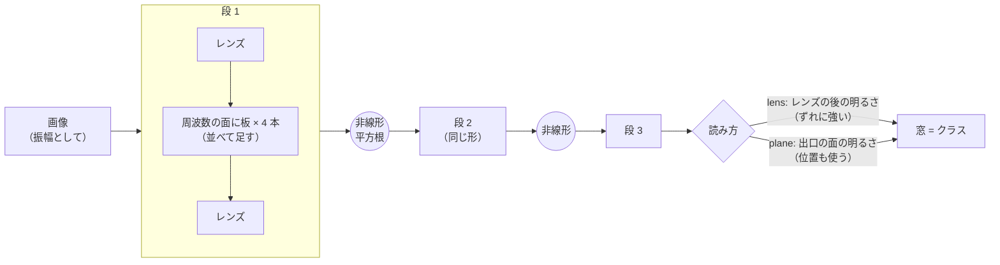
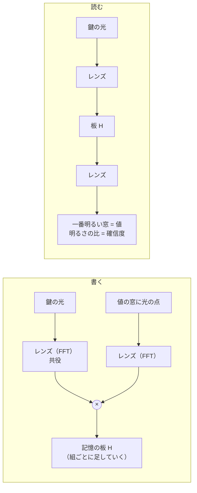

# 目的別の使い方（レシピ集）

SN2-Parts-2D の有望な結果を**目的別**に並べ、**そのまま試せるコマンドとコード**を載せたページです（2026-10-26 作成、持ち主の依頼）。
どれもリポジトリの直下で実行します。数字の正本は [NOTES.md](../NOTES.md)、画像の古い最良の構成は [best_configs.md](best_configs.md) にあります。


*灰 = 前の最良、青 = いまの最良、橙 = 比べる相手（小さな CNN・n-gram・GRU）。*

## 目次

| 目的 | いちばん良い形 | 結果 | 節 |
|---|---|---|---|
| 画像を分類する（位置がずれる） | 4f 系 4 段 + 平方根、レンズの後で読む | 形 98.4%（CNN 98.6） | [1](#1-画像を分類する4f-系の多段--光の非線形) |
| 画像を分類する（位置がそろう） | 4f 系 3 段 + 平方根、出口の面で読む | MNIST 98.0%（CNN 98.1） | [1](#1-画像を分類する4f-系の多段--光の非線形) |
| 光の非線形を選ぶ | 平方根（= 位相を捨てる）。光だけなら弱いカー効果 | | [2](#2-光の非線形を選ぶ) |
| 次の文字を当てる | 拡散 + 4f 系 + 平方根（光路 1 本） | 53.0% | [3](#3-次の文字単語を当てる言語) |
| 次の文字・単語をもっと当てる | 光路 1 本 + 分担の 2DTG の確率の足し合わせ | 文字 55.7%（4-gram 55.4）、単語 37.4%（GRU 36.9） | [4](#4-性格の違う光路を足し合わせる) |
| 記憶する（鍵 → 値） | 4f 系の板への重ね書き + 差分記憶法 | 似た鍵 128 組で 100% | [5](#5-記憶する4f-系の板への重ね書き) |
| 短期 → 長期の記憶 | 差分 + 足りない分だけ書く | 300 組で 43〜55% | [5](#5-記憶する4f-系の板への重ね書き) |
| 別々に学んだ技能を合わせる | 「担当なし」の絵を見せて学習し、明るさを足すだけ | 4 技能で 100% | [6](#6-別々に学んだ技能を足すだけで合わせる) |

装置は RTX 3060 12GB（2026-10-25 から電力上限 150W）。時間はその実測です。

---

## 1. 画像を分類する（4f 系の多段 + 光の非線形）

**4f 系** = レンズ → 周波数の面に模様の板 → レンズ。光が通るだけで「入力と模様の畳み込み」になります（CNN の畳み込みの層と同じ）。
線形のままだと何段重ねても 1 段と同じなので、段の間に**光の非線形**を入れます。



| 課題 | 形 | 結果（3 seed） | 比べる相手 | 1 本の時間 |
|---|---|---|---|---|
| 位置がでたらめな形（8 クラス） | 4 段 × 幅 4、平方根、lens | **98.4 ± 0.1%** | 板を重ねる形 70.6、小さな CNN 98.6 | 約 1 分 |
| MNIST | 3 段 × 幅 4、平方根、plane | **98.0 ± 0.2%** | 板の最良 96.3、小さな CNN 98.1 | 約 1 分 |

**実行**

```bash
python experiments/exp75_4f.py --task shape --stages 4 --width 4 --kind sqrt --read lens --seed 0 --device cuda
```

```bash
python experiments/exp75_4f.py --task mnist --stages 3 --width 4 --kind sqrt --read plane --seed 0 --device cuda
```

**引数**（[experiments/exp75_4f.py](../experiments/exp75_4f.py)）

| 引数 | 意味 | 既定 |
|---|---|---|
| `--task` | `shape`（合成の形、位置がでたらめ）・`mnist` | shape |
| `--stages` | 段の数。3〜4 が良い（線形なら何段でも同じ） | 3 |
| `--width` | 1 段に並べる 4f 系の本数。増やしても伸びにくい | 4 |
| `--kind` | 段の間の非線形（[2](#2-光の非線形を選ぶ)）。`sqrt` が基本 | kerr |
| `--read` | `lens` = レンズの後で読む（位置がずれても同じ答え）、`plane` = 出口の面で読む（位置の情報も使う。2 画素ずれると MNIST 98 → 69%） | lens |
| `--fix_p` | 非線形の数を固定する（例: カー効果の強さ 0.1） | なし（学習） |
| `--lr` / `--clip` / `--steps` | 学習率（0 まで下げる）/ 勾配の上限 / ステップ数 | 0.01 / 0 / 3000 |
| `--save` | 学習した光路を results/models/ に保存 | なし |
| `--out` | 結果を足すファイル（1 行 = 1 回の JSON） | results/exp75.txt |

**自分のデータで使う**

```python
import sys
sys.path.insert(0, "experiments")
import torch
import torch.nn.functional as F
import sn2_parts_2d as p2
from exp75_4f import Multi4f

m = Multi4f(L=64, n_out=10, stages=3, width=4, kind="sqrt", read="lens", seed=0)
x = torch.rand(8, 64, 64)                       # 画像 8 枚（0〜1、64 × 64）
logits = m(p2.image_to_field(x, "amp"))         # (8, 10) クラスの点数
loss = F.cross_entropy(logits, torch.randint(10, (8,)))
loss.backward()                                 # あとは普通に Adam などで学習
```

注意: 重みは約 10 万（CNN と数をそろえていない）。平方根は実機では段ごとに「明るさを測って光を出し直す」装置が要ります。

---

## 2. 光の非線形を選ぶ

部品は [nl_parts.py](../nl_parts.py) の `NL(kind)`。

| kind | 中身 | 4f 系での効き（実験76・77） | 使いどころ |
|---|---|---|---|
| `sqrt` | 明るさの平方根を振幅に、位相は捨てる（= 位相を捨てるだけ） | **一番安定して強い** | ソフトで使うならこれ |
| `phfrac` | 振幅はそのまま、位相を p 倍に縮める | p = 0〜0.5 なら平方根と同じくらい | 「位相を崩すこと」が効く理由の確かめ |
| `kerr` | 明るいほど位相を遅らせる（光カー効果）。明るさは変えない | **強さ 1 だと壊れる（形 18%）、0.03〜0.1 に固定すると 93%** | 光だけで動かすなら（`--fix_p 0.1`） |
| `kerrn` | カー効果の遅れを、いちばん明るい点で κ に抑える | 平方根に近い（形 95.9%） | 強さを決めずにカー効果を使う |
| `fold` | しきい値より暗い分を折り返す（持ち主の案） | 平方根とほぼ同じ | |
| `ssat` | 位相を残す可飽和吸収 | 平方根より少し下 | |
| `none` | 非線形なし | 何段でも 1 段と同じ（形 36%） | 比べる相手 |


なぜカー効果は強いと壊れるか: 4f 系を通ると光は一部の点に集まり、そこでは明るさが平均の何十倍にもなります。そこで位相が何周も回り、ごく小さな違いが大きく増えます（入力に 1000 分の 1 の雑音で出口が大きく変わる）。

---

## 3. 次の文字・単語を当てる（言語）

文字（や単語）の番号を、**面全体に広げて**（拡散 = 位置ごとに決まった模様を掛けて重ねる）4f 系 + 平方根に通します。帯に並べるより 10 点良く、線形では効きません（実験78）。


| 課題 | 形 | 結果 | 比べる相手 | 時間 |
|---|---|---|---|---|
| 文字（直前 8 文字 → 64 種類） | 6 段 × 幅 8、9000 ステップ | 53.0 ± 0.2%（3 seed） | 3-gram 53.7、光路 1 本の前の最良 50.1 | 約 8 分 |
| 単語（直前 4 語 → 1024 種類） | 同上 + 窓 256 個の符号読み | 36.1 ± 0.3%（CE 3.12） | 3-gram 36.4（CE 3.96） | 約 8 分 |

**実行**

```bash
python experiments/text/exp78_text4f.py --enc spread --stages 6 --width 8 --steps 9000 --seed 0 --device cuda
```

```bash
python experiments/text/exp84_word4f.py --G 1 --stages 6 --width 8 --steps 9000 --seed 0 --device cuda --ngram
```

**引数**（[exp78_text4f.py](../experiments/text/exp78_text4f.py)・[exp84_word4f.py](../experiments/text/exp84_word4f.py)）

| 引数 | 意味 | 既定 |
|---|---|---|
| `--enc` | 入れ方: `spread`（拡散、一番良い）・`rings`（同心円）・`bands`（帯）・`smear`・`rainbow`・`blur` | spread |
| `--stages` / `--width` | 4f 系の段の数 / 1 段の本数。段とステップを増やすほど伸びる | 3（単語 4）/ 4 |
| `--kind` / `--fix_p` | 非線形と、その数の固定 | sqrt / なし |
| `--read` | `lens`・`plane` | lens |
| `--steps` | ステップ数（9000 で 3000 より +1.5 点） | 3000 |
| `--save_logits` | テストの対数確率を保存（[4](#4-性格の違う光路を足し合わせる) の足し合わせに使う） | なし |
| `--n`（単語） | 直前何語を入れるか。2〜16 で差はほぼない（実験86） | 4 |
| `--G`（単語） | 1 = 光路 1 本、2 以上 = 分担の 2DTG（直前の語の番号の余りで担当を決める） | 1 |
| `--K` / `--C`（単語） | 窓の数（符号読み）/ 答えの種類 | 256 / 1024 |
| `--ngram`（単語） | 同じテストで 2〜4-gram も測る（CPU） | なし |

注意: 光路 1 本は長い文脈をほとんど使えません（直前 2 語でも 16 語でも 36%、実験86）。

---

## 4. 性格の違う光路を足し合わせる

**覚えすぎる**分担の 2DTG（担当ごとに小さな 4f 系）と、**覚えきれない**光路 1 本は、間違え方が違います。確率（対数）を重み付きで足すと、誤りが打ち消し合います（実験81〜85）。似たもの同士（光路 1 本どうし）を足しても伸びません。

| 課題 | 足し合わせ | 結果（3 seed、テスト全部） | 比べる相手 |
|---|---|---|---|
| 文字 | 光路 1 本 + 2DTG（担当 4・直前 8 文字）+ 2DTG（担当 8・直前 4 文字） | **55.7 ± 0.3%** | 4-gram 55.4、GRU 53.3〜54.1 |
| 単語 | 光路 1 本 + 2DTG（担当 16・直前 2 語）+ 2DTG（担当 8・直前 2 語） | **37.4 ± 0.4%**（CE 3.04） | 3-gram 36.4、GRU 36.9 |

**実行**（文字。3 本を学習して対数確率を保存 → 足し合わせ。全部で約 1 時間）

```bash
python experiments/text/exp78_text4f.py --enc spread --stages 6 --width 8 --steps 9000 --seed 0 --device cuda --save_logits results/logits/single.pt
```

```bash
python experiments/text/exp80_split4f.py --n 8 --G 4 --stages 4 --steps 9000 --seed 0 --device cuda --save_logits results/logits/g4_n8.pt
```

```bash
python experiments/text/exp80_split4f.py --n 4 --G 8 --stages 4 --steps 6000 --seed 0 --device cuda --save_logits results/logits/g8_n4.pt
```

```bash
python experiments/text/exp81_fuse.py results/logits/single.pt results/logits/g4_n8.pt results/logits/g8_n4.pt
```

`exp81_fuse.py` は、保存した対数確率のファイルをいくつでも受け取り、重み（0.05 刻み）をテストの前半で選んで後半で測り、前後を入れ替えた平均（= テスト全部の値）を出します。結果の `fused_cross` が [正解率, CE]、`weights` が選ばれた重みです。書き出し先は環境変数 `FUSE_OUT`（既定 results/exp81.txt）。

`exp80_split4f.py` の引数: `--n`（直前何文字）、`--G`（担当の数。多いほど覚えすぎる。4〜8 が良い）、ほかは exp78 と同じ。

注意: 3 つで重み約 500 万・学習約 1 時間（4-gram は数えるだけで数秒）。

---

## 5. 記憶する（4f 系の板への重ね書き）

4f 系の周波数の面の板に、「鍵 → 値」の組を**学習なしで**書き込めます（ホログラムと同じ。板 = Σ 鍵の光の共役 × 値の光）。
読むときは鍵の光を通すと、値の窓が光ります。持ち主の構想（短期 → 長期、繰り返し・関連・重要度の記憶）は [memory_design.md](memory_design.md)。



| やりたいこと | やり方 | 結果 | 実験 |
|---|---|---|---|
| 2 つの記憶を比率で 1 枚にまとめる（短期 80% + 長期 20%） | 板を √0.8 : √0.2 で足す（明るさの比が 0.8 : 0.2） | 各 32 組で 100 / 98%。明るさが比率どおりになり、どちらの記憶か読める | 87 |
| 確信度で短期を優先 | 確信度 = 一番明るい窓 / 二番目 | 短期 6.3、長期 1.9。同じ鍵の新旧は短期が 99% で勝つ | 88 |
| 似た鍵でも取り出す | **差分記憶法**: 鍵の共通部分（今までの鍵の平均）を、書くときも読むときも引く | 似ている度合い 0.75・128 組で 3 → 100% | 89 |
| 何度も来る記憶を強く残す | **足りない分だけ書く**: すでに確信度 2 以上で取り出せる組は書く重みを 0.1 に | 300 組・60 回で全体 12 → 43%（単語の鍵）、5 回以上来た記憶 92% | 89 |


**そのまま試せるコード**（CPU で 1 秒。`PYTHONPATH=.` でリポジトリ直下から）

```python
import math
import torch
import sn2_parts_2d as p2

L, K = 64, 256
det = p2.window_grid(L, L, K, 2)                                    # 値 = 窓 256 個のどれか
cent = torch.stack([torch.stack(torch.where(d > 0)).float().mean(1) for d in det]).round().long()

def point(vals):                                                     # 値 → その窓の位置に光の点
    u = torch.zeros(len(vals), L, L, dtype=torch.complex64)
    u[torch.arange(len(vals)), cent[vals, 0], cent[vals, 1]] = 1
    return u

def write(keys, vals, w=None):                                       # 記憶の板 = Σ 鍵の共役 × 値の点（周波数の面）
    w = torch.ones(len(vals)) if w is None else w
    H = (torch.fft.fft2(keys).conj() * torch.fft.fft2(point(vals)) * w[:, None, None]).sum(0)
    return H / H.abs().pow(2).sum().sqrt()                           # 明るさの合計を 1 に

def read(H, keys):                                                   # 鍵を通す → 窓の明るさ (n, K)
    return p2.read_windows(torch.fft.ifft2(torch.fft.fft2(keys) * H).abs().pow(2), det)

g = torch.Generator().manual_seed(0)
n, rho = 64, 0.75                                                    # 64 組ずつ、鍵の似ている度合い 0.75
common = torch.polar(torch.ones(L, L), 2 * math.pi * torch.rand(L, L, generator=g))
keys = math.sqrt(rho) * common + math.sqrt(1 - rho) * torch.polar(torch.ones(2 * n, L, L), 2 * math.pi * torch.rand(2 * n, L, L, generator=g))
vals = torch.randint(K, (2 * n,), generator=g)
k1, k2, v1, v2 = keys[:n], keys[n:], vals[:n], vals[n:]

# 1) 比率で融合（短期 G1 80% + 長期 G2 20%）。比率は明るさの比なので、振幅には √ をかける
H = math.sqrt(0.8) * write(k1, v1) + math.sqrt(0.2) * write(k2, v2)
S1, S2 = read(H, k1), read(H, k2)
print("そのまま  G1", (S1.argmax(1) == v1).float().mean().item(), "G2", (S2.argmax(1) == v2).float().mean().item())   # 0.06 / 0.0

# 2) 差分記憶法: 鍵の共通部分（平均）を、書くときも読むときも引く
km = keys.mean(0)
H = math.sqrt(0.8) * write(k1 - km, v1) + math.sqrt(0.2) * write(k2 - km, v2)
S1, S2 = read(H, k1 - km), read(H, k2 - km)
print("差分     G1", (S1.argmax(1) == v1).float().mean().item(), "G2", (S2.argmax(1) == v2).float().mean().item())   # 1.0 / 0.81

# 3) 確信度 = 一番明るい窓 / 二番目
top = S1.topk(2, 1).values
print("確信度 G1", (top[:, 0] / top[:, 1]).mean().item())          # 約 4.6
```

**実験のプログラム**（どれも引数なし、CPU で数秒、結果は results/ に 1 行ずつ足す）

| プログラム | 中身 |
|---|---|
| [exp87_memfuse.py](../experiments/exp87_memfuse.py) | 2〜3 つの記憶を比率で融合（1 枚に重ね書き・位相だけの板・光路 2 本で明るさを足す）、組の数 8〜128 |
| [exp88_memkeys.py](../experiments/exp88_memkeys.py) | 似た鍵（でたらめ・単語の並び・似せた鍵）、確信度、同じ鍵の新旧の食い違い。`make_keys`・`write`・`read`・`conf` を部品として使える |
| [exp89_consolidate.py](../experiments/exp89_consolidate.py) | 短期 → 長期の移し方 7 通り（そのまま・差分・繰り返し・関連・上書き・足りない分だけ…）、重要の印、忘却 |

注意: 値はでたらめな窓（互いに似ていない）。実際の言葉を値にするともっと難しくなる見込み。1 枚の板に 200 組を超えると全体の正解率は 50% 前後。

---

## 6. 別々に学んだ技能を足すだけで合わせる

技能ごとに光路を別々に学ぶとき、どの技能とも関係ない一般の絵（ぼやけた塊・斑の模様）を「担当なし」として見せておくと、あとで光路の明るさを**足すだけ**で合わせられます。外せば完全に元に戻ります（実験07・10・12）。

| 結果 | 2 技能で 80.8 → **100.0%**、4 技能でも 100.0%（同時に学習 99.4%） |
|---|---|

```bash
python experiments/image/exp10_reject.py --task conj --method xy --seed 0 --device cuda
```

| 引数 | 意味 | 既定 |
|---|---|---|
| `--task` | 合成の課題（`conj` = 向き × 位置、ほか形など） | conj |
| `--method` | 板の形（`xy` = 板 ①、`stripes`・`ripple`） | xy |
| `--w` | 「担当なし」の損失の重み | 1.0 |
| `--n_generic` | 「担当なし」として見せる一般の絵の数 | 4000 |
| `--steps` / `--n_train` / `--n_test` | ステップ数 / 訓練・テストの数 | 1500 / 4000 / 2000 |

詳しい条件は [best_configs.md](best_configs.md) と NOTES.md の実験10・12。
